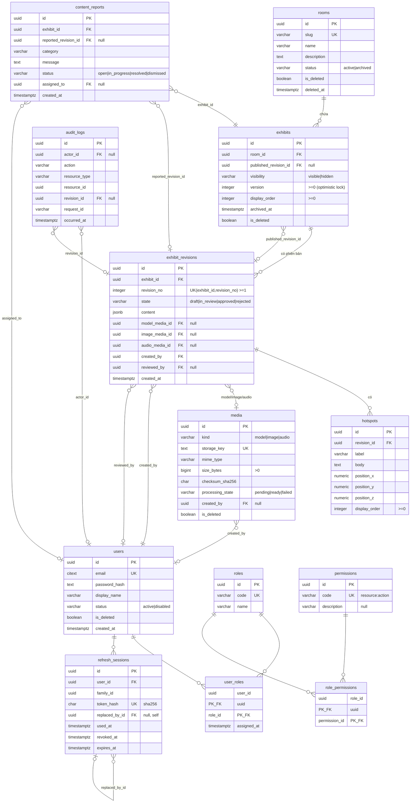

# 01 — ERD 13 bảng MVP

Phản ánh đúng entity TypeORM + migration `AlignMuseumMvpSchema`. Mọi khóa chính là `uuid`;
thời điểm dùng `timestamptz`. Soft-delete (`is_deleted` + `deleted_at`) ở `rooms`, `exhibits`,
`media`, `users`. Mọi FK dùng `ON DELETE RESTRICT`.

## Chỉ mục & ràng buộc chính

- `UNIQUE(exhibit_id, revision_no)` trên `exhibit_revisions`.
- `INDEX exhibits(room_id, display_order, id)`, `content_reports(status, created_at)`,
  `audit_logs(resource_type, resource_id, occurred_at)`, `refresh_sessions(user_id, family_id)`.
- `CHECK (is_deleted = (deleted_at IS NOT NULL))` cho các bảng soft-delete.
- FK vòng `exhibits.published_revision_id ↔ exhibit_revisions.exhibit_id` thêm bằng
  `ADD CONSTRAINT` sau khi tạo cả hai bảng.
