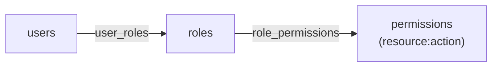
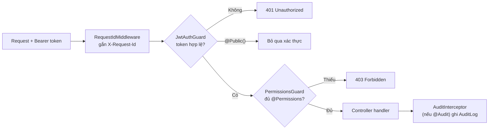

# 02 — RBAC & phân quyền

## Mô hình dữ liệu RBAC

Người dùng ⟶ nhiều vai trò (bảng nối `user_roles`); vai trò ⟶ nhiều quyền
(bảng nối `role_permissions`). Quyền ở dạng chuỗi `resource:action` (vd `user:create`).



Vai trò hệ thống mặc định (seed): `admin` (toàn quyền), `moderator` (duyệt/report/audit),
`editor` (CRUD nội dung). Không cho xóa 3 vai trò này.

## Gộp quyền vào access token

Khi đăng nhập, service nạp `user → userRoles → role → rolePermissions → permission`,
gộp (union) toàn bộ `permission.code` rồi nhúng vào access token. Nhờ vậy guard **không**
truy vấn DB mỗi request.

```mermaid
flowchart TD
    login[POST /auth/login] --> load[Nạp user kèm roles + permissions]
    load --> merge[Gộp roles[] và permissions[]]
    merge --> jwt["Ký access token JWT<br/>payload: sub, email, roles[], permissions[]"]
    jwt --> client[Trả cho client + set cookie refresh]
```

## Chuỗi kiểm tra mỗi request



- `JwtAuthGuard` + `PermissionsGuard` đăng ký **toàn cục**; route công khai đánh `@Public()`.
- `@Permissions('resource:action')` khai báo quyền cần có; guard đối chiếu với `permissions` trong token.
- Chốt chặn thật ở backend; FE chỉ ẩn/hiện bằng `RequirePermission` cho UX.
