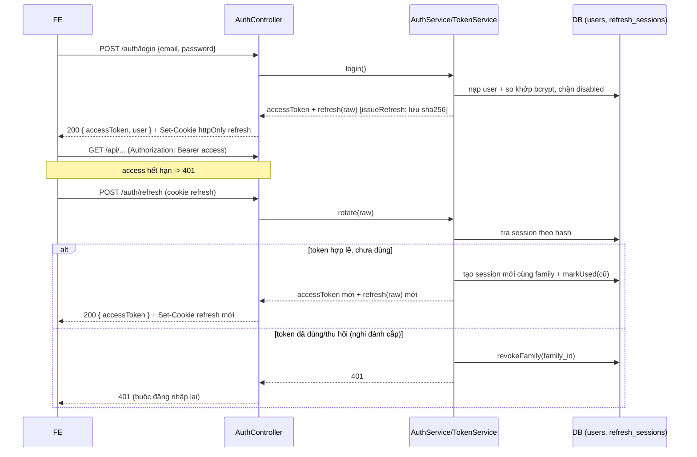
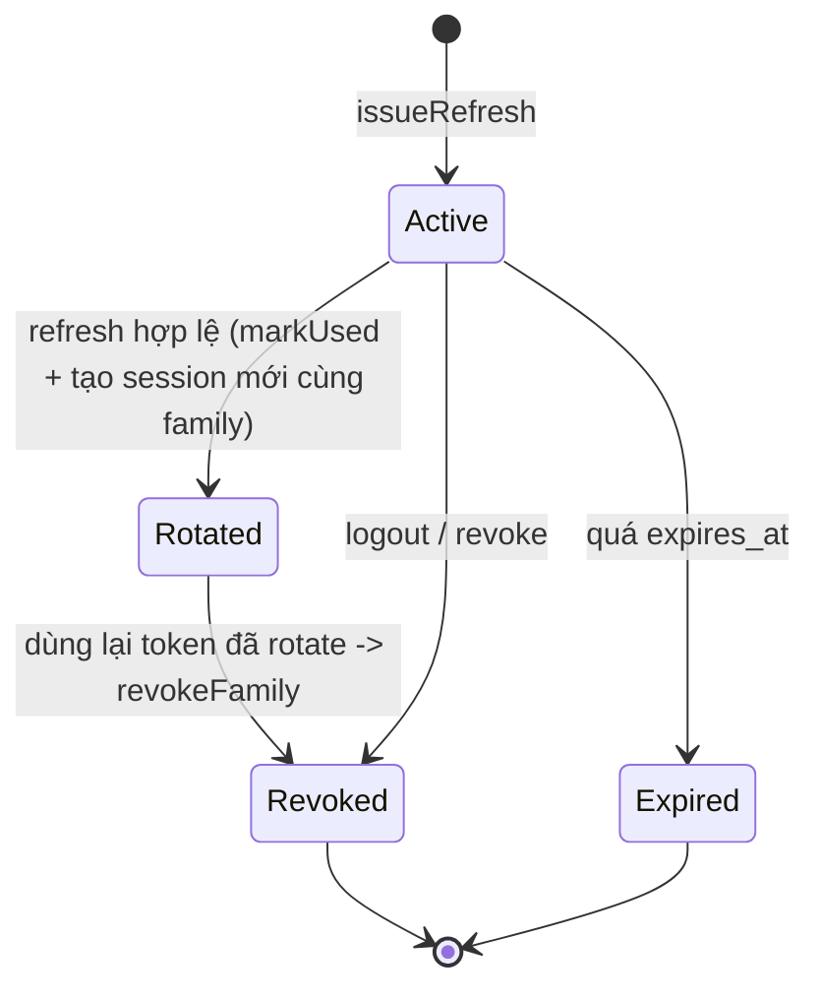

# 03 — Luồng xác thực (login / refresh rotation)

Access token JWT ngắn hạn (~15 phút) gửi qua `Authorization: Bearer`.
Refresh token dài hạn (~7 ngày) chỉ lưu **hash** trong `refresh_sessions`, trao đổi qua
**httpOnly cookie**, **xoay vòng** mỗi lần refresh.

## Đăng nhập + gọi API + refresh

## Xoay vòng & phát hiện tái dùng (reuse-detection)

- Mỗi lần refresh tạo session mới cùng `family_id`, đánh dấu session cũ `used_at` + `replaced_by_id`.
- Nếu một token đã `used`/`revoked` lại được dùng để refresh → **thu hồi cả family** và trả 401.
- FE dùng single-flight: nhiều request 401 đồng thời chỉ gọi `/auth/refresh` một lần.
