# Aura Museum — Software Architecture Document

**Document:** `architecture.md`  
**Project:** Aura Museum — WebXR Interactive Museum  
**Version:** v0.1  
**Status:** Initial Baseline  
**Date:** 2026-10-08  
**Repository path:** `/docs/architecture.md`  
**Requirements source:** [requirements.md](requirements.md) — Initial Baseline v0.1

---

## 1. Purpose

Tài liệu này mô tả kiến trúc phần mềm mục tiêu của **Aura Museum** dựa trên SRS hiện tại.

Đây là bản kiến trúc đầu tiên v0.1 đã chốt, làm cơ sở thiết kế chi tiết và triển khai. Trạng thái Initial Baseline xác nhận các quyết định kiến trúc, không có nghĩa các thành phần đã được implement hoặc kiểm thử thành công.

Phạm vi MVP:

- bảo tàng 3D trên desktop/mobile;
- 2D accessible fallback;
- nội dung Việt/Anh;
- exhibit, hotspot, audio, transcript và captions;
- Guided Tour Manual/Auto;
- Admin CMS;
- Draft / Preview / Published;
- media management;
- progressive loading và graceful degradation;
- WebXR chỉ là extension point sau MVP.

Tài liệu này không thay thế SRS. Khi có xung đột về yêu cầu sản phẩm, `/docs/requirements.md` là nguồn ưu tiên.

---

## 2. Architecture Goals

Kiến trúc ưu tiên:

1. **Đơn giản cho nhóm nhỏ**
   - Không đưa microservices, queue, Kubernetes hoặc Redis vào MVP khi chưa có nhu cầu thực tế.

2. **Tách trách nhiệm rõ**
   - Frontend chịu trách nhiệm UX, rendering và client-side state.
   - Backend chịu trách nhiệm business rules, authentication, publication state, consistency và persistence.

3. **Một source of truth**
   - 2D, 3D, Guided Tour và CMS đều dựa trên cùng domain data.

4. **Accessible by design**
   - Canvas không phải nơi duy nhất chứa nội dung.

5. **Graceful degradation**
   - 3D lỗi thì vẫn có 2D.
   - Một asset lỗi không làm toàn ứng dụng hỏng.

6. **Secure content boundary**
   - Frontend chỉ gọi NestJS API và media route do backend quản lý.
   - Frontend không truy cập PostgreSQL, Supabase Database, Supabase Storage hoặc Storage SDK trực tiếp.
   - Draft không xuất hiện trong public API/public media.

7. **Strong publication consistency**
   - Publish/Unpublish/Delete thành công phải có hiệu lực với request public mới ngay sau commit theo SRS.

8. **Retry-safe CMS**
   - Lost response/retry không được tạo duplicate Exhibit/Media hoặc báo sai trạng thái.

9. **Extensible**
   - Có thể bổ sung WebXR sau MVP mà không phải viết lại toàn hệ thống.

---

## 3. Architecture Drivers

### 3.1 Functional Drivers

- Visitor không cần account.
- Desktop/mobile có trải nghiệm 3D.
- Visitor xem exhibit, hotspot, audio, transcript/captions.
- Guided Tour hỗ trợ Manual/Auto.
- Nội dung hỗ trợ `vi` và `en`.
- Admin đăng nhập và quản lý exhibit/media/hotspot/tour.
- Admin sử dụng Draft, Preview, Publish và Unpublish.
- Public chỉ nhận Published content.
- Published content không được chỉnh trực tiếp.
- 2D fallback hoạt động khi 3D không khả dụng.
- Preview Draft phải được bảo vệ.
- Frontend chỉ giao tiếp qua NestJS API/backend-managed media route.
- API response phải được frontend validate trước khi sử dụng.
- WebXR không phải dependency của MVP.
- CMS retry phải không tạo duplicate.

### 3.2 Quality Drivers

- performance;
- accessibility;
- security;
- reliability;
- consistency;
- maintainability;
- compatibility;
- testability;
- localization.

### 3.3 Existing Technical Constraints

- React + TypeScript + Vite;
- React Three Fiber / Three.js;
- NestJS;
- TypeORM;
- PostgreSQL;
- Supabase-compatible infrastructure;
- Zod ở frontend;
- `synchronize: false`;
- database schema thay đổi bằng migration;
- frontend không truy cập trực tiếp database/storage.

---

## 4. Architecture Style

Aura Museum sử dụng:

> **Client–Server + Modular Monolith Backend + Single Web Frontend**

Không dùng microservices trong MVP.

Lý do:

- phù hợp nhóm nhỏ;
- transaction đơn giản;
- giảm deployment/infrastructure overhead;
- module boundary vẫn rõ;
- có thể scale backend theo replica nếu load test chứng minh cần.

---

## 5. Current → Target Architecture

Phần này phân biệt **scaffold hiện có** và **kiến trúc mục tiêu**. Target dưới đây không được hiểu là đã implement.

| Concern | Current Scaffold | Target Architecture |
|---|---|---|
| Public API | `/rooms`, `/rooms/:slug` | Versioned `/api/v1/*` |
| Media route | Static `/media/*` | Backend-authorized media route |
| Content language | Single-language fields | `vi`/`en` translation records |
| Publication | Chưa có Draft/Published đầy đủ | Explicit `DRAFT` / `PUBLISHED` |
| Authentication | Chưa có Admin session đầy đủ | PostgreSQL-backed Admin session |
| Exhibit transform | Schema hiện tại còn hạn chế | Position + Rotation + Scale |
| Hotspot | Chưa có target module hoàn chỉnh | Hotspot + localization |
| Tour persistence | Chưa có target persistence hoàn chỉnh | Tour + ordered TourItem |
| Media access | Static/public path | Private Storage + backend authorization |
| CMS writes | Chưa đủ CRUD/publish route | Authenticated Admin API |
| Retry semantics | Chưa xác định | Idempotency operation model |

### 5.1 API Transition

Trong quá trình chuyển đổi:

1. Tạo target endpoints dưới `/api/v1`.
2. Chuyển frontend sang contract mới.
3. Chạy end-to-end tests.
4. Route cũ chỉ được bỏ sau khi không còn caller hợp lệ.
5. Không giả định route target đã tồn tại chỉ vì được mô tả trong tài liệu này.

---

## 6. System Context — C4 Level 1

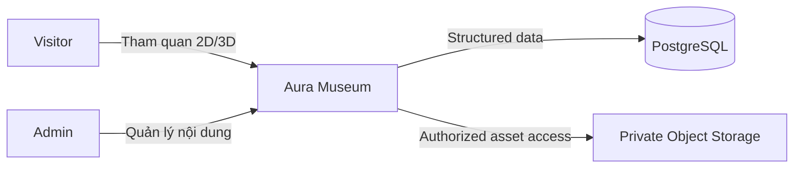

### Visitor

- không cần login;
- chỉ xem Published content;
- desktop/mobile;
- 2D hoặc 3D;
- tiếng Việt/Anh.

### Admin

- phải login;
- mọi Admin trong MVP có cùng mức quyền;
- quản lý exhibit, hotspot, media và tour;
- Preview Draft;
- Publish/Unpublish.

---

## 7. Container Architecture — C4 Level 2

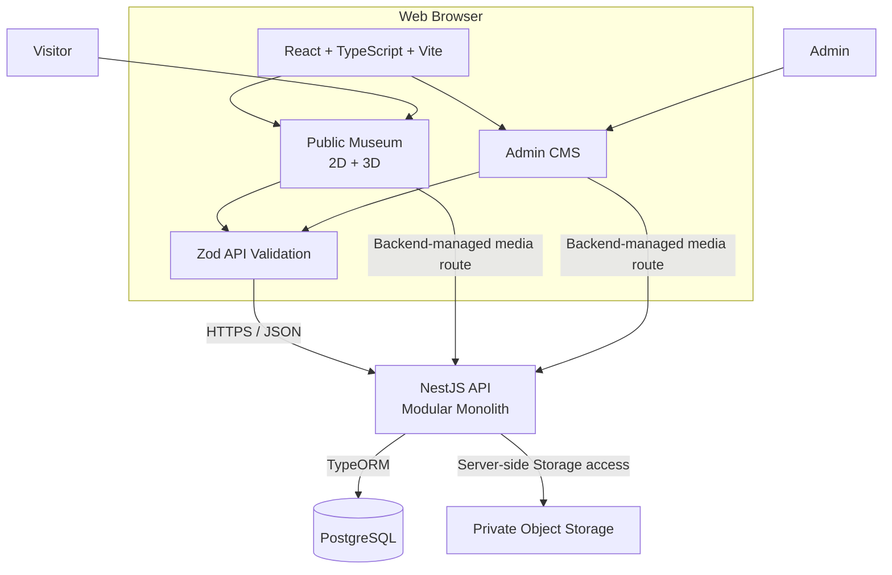

### Container Responsibilities

| Container | Technology | Responsibility |
|---|---|---|
| Web Application | React, TypeScript, Vite | Public Museum + Admin CMS |
| 3D Runtime | React Three Fiber / Three.js | Scene, exhibits, hotspots, navigation |
| API | NestJS | Public/Admin API, validation, auth, consistency |
| Database | PostgreSQL | Content, metadata, users, sessions, tour, idempotency |
| Object Storage | Supabase Storage hoặc equivalent | GLB, image, audio, VTT; private by default |

---

## 8. Frontend Architecture

Frontend là **một React application duy nhất**.

```text
React Web Application
│
├── Public Museum
│   ├── Landing
│   ├── 3D Museum
│   ├── Exhibit Detail
│   ├── Guided Tour
│   └── 2D Fallback
│
└── Admin CMS
    ├── Login
    ├── Exhibit Management
    ├── Hotspot Management
    ├── Media Management
    ├── Tour Configuration
    └── Draft Preview
```

### 8.1 Proposed Routes

```text
/
├── /museum
├── /museum/2d
│
├── /admin/login
├── /admin/exhibits
├── /admin/exhibits/:id
├── /admin/tour
└── /admin/preview/:id
```

### 8.2 Frontend Layers

```text
src/
├── pages/
├── layouts/
├── components/
├── hooks/
├── contexts/
├── reducers/
├── apis/
├── validations/
├── interfaces/
├── helpers/
└── utils/
```

### 8.3 Frontend Data Flow

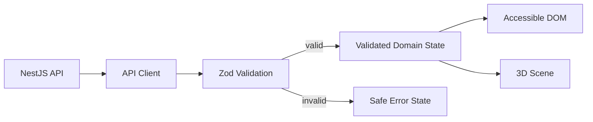

**Rule:** 2D DOM và 3D Scene dùng cùng validated domain state.

---

## 9. Public Museum Components — C4 Level 3

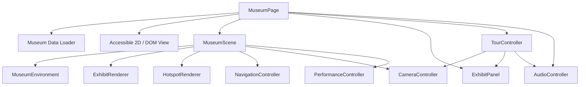

### 9.1 MuseumEnvironment

- room;
- floor;
- walls;
- lighting;
- static museum geometry.

Room layout là fixed environment trong MVP.

### 9.2 ExhibitRenderer

Input chính:

```text
modelUrl
position
rotation
scale
```

Chịu trách nhiệm:

- load GLB;
- apply transform;
- render placeholder nếu model lỗi;
- ánh xạ interaction/raycast về `exhibitId`.

### 9.3 HotspotRenderer

Input:

```text
hotspotId
exhibitId
position
localizedContent
```

Chịu trách nhiệm render marker và đồng bộ selection với accessible UI.

### 9.4 NavigationController

Desktop:

- keyboard;
- mouse;
- trackpad.

Mobile:

- touch;
- gesture;
- virtual control khi cần.

### 9.5 PerformanceController

Conceptual quality levels:

```text
HIGH
 ↓
MEDIUM
 ↓
LOW
 ↓
OFFER 2D
```

Threshold cụ thể nằm ở Performance/Test Plan.

---

## 10. Experience Mode Architecture

MVP có hai mode:

1. Standard 3D
2. Accessible 2D

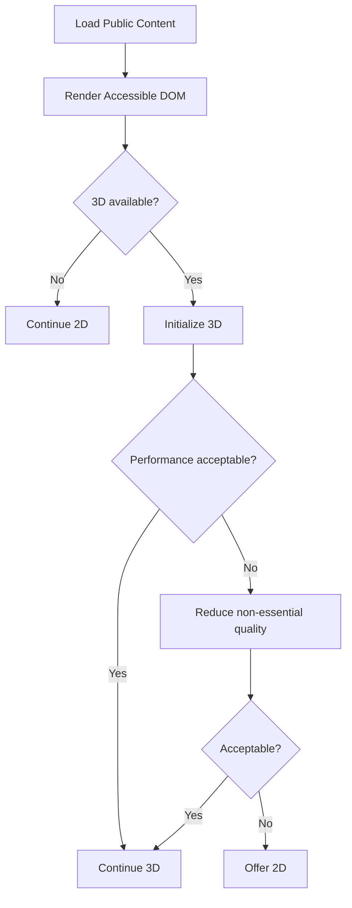

2D content có thể hiển thị trước khi model/audio hoàn tất.

---

## 11. WebXR Capability Detection and Future Extension Boundary

### 11.1 Capability Detection in MVP

`FR-32` yêu cầu capability detection ngay trong MVP. Frontend có một component/service cô lập:

```text
CapabilityDetector
├── WebGL capability
└── WebXR capability
```

`CapabilityDetector` chỉ phát hiện khả năng của browser/environment và cung cấp trạng thái cho UI/diagnostics. Nó không khởi tạo immersive session và không làm 3D/2D phụ thuộc WebXR.

### 11.2 Future XR Runtime

Immersive WebXR nằm ngoài MVP acceptance scope.

```text
Museum 3D Runtime
       │
       ├── CapabilityDetector   ← MVP
       │
       └── Future XR Adapter    ← outside MVP
```

MVP không triển khai:

- XR controller mapping;
- headset-specific UI;
- XR session lifecycle;
- VR performance tuning;
- headset acceptance testing.

Future XR Adapter chỉ được bổ sung khi scope WebXR immersive được phê duyệt sau MVP.

---

## 12. Guided Tour Architecture

### 12.1 Responsibility Split

Backend lưu:

- tour identity;
- ordered exhibit list;
- `autoDwellSeconds`.

Frontend giữ runtime state.

### 12.2 Tour Runtime Model

```text
mode   = AUTO | MANUAL
status = IDLE | RUNNING | PAUSED | WAITING_USER | FINISHED

currentStep
remainingDwellMs
activeAudioId
```

`autoDwellSeconds` là configuration lưu cùng Tour. MVP có thể seed/default theo baseline requirement; SRS không bắt buộc phải có Admin UI riêng để chỉnh giá trị này.

### 12.3 Detailed State Machine

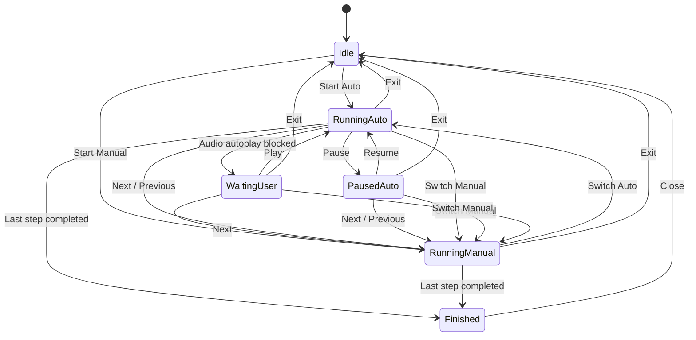

### 12.4 Auto Tour Step

Auto Tour luôn dùng **teleport tức thời**, không dùng camera fly liên tục.

```text
Instant teleport to safe exhibit viewpoint
        ↓
Open exhibit information
        ↓
Attempt audio playback
        ↓
┌────────────────────┬───────────────────────────┐
│ Audio plays        │ No audio / audio failed   │
│                    │                           │
│ wait onended       │ start dwell timer         │
└─────────┬──────────┴──────────────┬────────────┘
          │                         │
          └────────────┬────────────┘
                       ↓
                    Next step
```

Nếu browser chặn autoplay:

```text
AUTO RUNNING
     ↓
WAITING_USER
     ↓
Play → continue AUTO
or
Next → switch MANUAL
```

### 12.5 Pause / Resume

Pause phải:

- pause audio;
- pause dwell timer;
- lưu remaining dwell time;
- không tự chuyển step.

Resume phải:

- resume audio nếu đang pause;
- resume remaining dwell timer;
- tiếp tục cùng step.

### 12.6 Next / Previous During Auto

`Next` hoặc `Previous` trong Auto:

1. clear dwell timer;
2. stop/pause current Auto audio;
3. cancel pending auto transition;
4. chuyển `mode = MANUAL`;
5. cập nhật `currentStep`, nội dung hiện vật, tiến trình và directional guidance;
6. **không teleport tự động**. Visitor giữ quyền tự di chuyển hoặc chủ động chọn **Teleport**.

Phân biệt rõ:

```text
AUTO step transition
→ instant teleport

AUTO + Next / Previous
→ switch MANUAL
→ change currentStep
→ update content + guidance
→ no forced teleport
→ Visitor chooses Walk or Teleport
```

### 12.7 Switch Manual Without Changing Step

Khi Visitor chọn `Switch Manual` từ `RUNNING_AUTO`, `PAUSED_AUTO` hoặc `WAITING_USER`:

1. giữ nguyên `currentStep`;
2. giữ nguyên vị trí/camera hiện tại;
3. clear/pause dwell timer;
4. cancel pending auto transition;
5. stop/pause audio do Auto đang điều khiển;
6. chuyển `mode = MANUAL`;
7. giữ nội dung/chỉ dẫn của bước hiện tại.

`Switch Manual` **không tự gọi Next/Previous, không đổi bước và không teleport**.

```text
Switch Manual
→ keep currentStep
→ keep current position
→ cancel Auto timer/pending transition
→ stop Auto-controlled audio
→ MANUAL
```

### 12.8 Exit Cleanup

Exit Tour phải:

- clear mọi timer;
- remove event listener/audio `onended`;
- stop audio;
- cancel pending transition;
- reset Tour state;
- tránh callback cũ tự chuyển step sau khi đã Exit.

### 12.9 Reduced Motion

Khi `prefers-reduced-motion` bật:

- **tắt** animation không thiết yếu;
- tắt camera motion liên tục;
- Auto dùng instant teleport;
- chức năng cốt lõi không đổi.

---

## 13. Backend Architecture

Backend dùng **NestJS Modular Monolith**.

```text
src/
├── auth/
├── rooms/
├── exhibits/
├── hotspots/
├── tours/
├── media/
├── operations/
├── config/
└── health/
```

`operations/` chịu trách nhiệm idempotency/retry metadata; không phải message queue.

### 13.1 Standard Module Pattern

```text
Controller
    ↓
Service
    ↓
Repository
    ↓
TypeORM
    ↓
PostgreSQL
```

- Controller: HTTP concern, DTO, status code, guard.
- Service: business rules, validation, auth checks, transaction.
- Repository: persistence/database concern.

---

## 14. Backend Module Responsibilities

### 14.1 AuthModule

- login;
- logout;
- session validation;
- Admin identity;
- timeout/revocation.

MVP chỉ có một permission level: `ADMIN`.

### 14.2 RoomsModule

- public room retrieval;
- room metadata;
- fixed exhibition identity.

### 14.3 ExhibitsModule

- CRUD Exhibit;
- Draft/Published;
- localized content;
- transform;
- concurrency/version;
- publish/unpublish validation;
- public DTO.

### 14.4 HotspotsModule

- CRUD hotspot;
- hotspot position;
- localized content;
- exhibit association;
- parent Exhibit version update.

### 14.5 ToursModule

- read tour;
- Admin update order;
- exclude Draft/deleted exhibit from public tour;
- persist `autoDwellSeconds`.

### 14.6 MediaModule

- upload validation;
- immutable media objects;
- metadata;
- private Storage access;
- public/draft authorization;
- rights metadata;
- reference checks;
- cleanup of failed upload objects.

### 14.7 OperationsModule

- idempotency key registration;
- request hash validation;
- stored result lookup;
- pending/completed/failed state;
- stale operation cleanup.

---

## 15. API Architecture

API chia hai boundary:

```text
/api/v1/*          Public
/api/v1/admin/*    Authenticated Admin
```

### 15.1 Public API

```http
GET /api/v1/museum
GET /api/v1/rooms/:slug
GET /api/v1/exhibits/:id
GET /api/v1/tour
GET /api/v1/media/:id/content
```

Public API chỉ trả Published content.

### 15.2 Public Media Route

`GET /api/v1/media/:id/content`:

1. backend kiểm tra Media hiện có được tham chiếu bởi ít nhất một Published resource hay không;
2. nếu không public → `404` hoặc access-denied behavior theo API contract;
3. nếu public → backend stream/proxy binary từ private Storage;
4. route hỗ trợ behavior cần thiết như byte ranges nếu audio/model loader yêu cầu.

MVP **không cấp URL Storage public vĩnh viễn**.

### 15.3 Admin Authentication

```http
POST /api/v1/admin/auth/login
POST /api/v1/admin/auth/logout
GET  /api/v1/admin/auth/session
```

### 15.4 Exhibit Admin API

```http
GET    /api/v1/admin/exhibits
GET    /api/v1/admin/exhibits/:id
POST   /api/v1/admin/exhibits
PATCH  /api/v1/admin/exhibits/:id
DELETE /api/v1/admin/exhibits/:id

POST   /api/v1/admin/exhibits/:id/publish
POST   /api/v1/admin/exhibits/:id/unpublish

GET    /api/v1/admin/exhibits/:id/preview
```

### 15.5 Hotspot Admin API

```http
POST   /api/v1/admin/exhibits/:id/hotspots
PATCH  /api/v1/admin/hotspots/:id
DELETE /api/v1/admin/hotspots/:id
```

### 15.6 Media Admin API

```http
POST   /api/v1/admin/media
GET    /api/v1/admin/media/:id/content
DELETE /api/v1/admin/media/:id
```

Admin media route yêu cầu session hợp lệ và được phép đọc Draft Preview.

### 15.7 Tour API

```http
GET /api/v1/admin/tour
PUT /api/v1/admin/tour
```

### 15.8 Idempotency Header

Các CMS write quan trọng dùng:

```http
Idempotency-Key: <client-generated UUID>
```

Áp dụng tối thiểu cho:

- Create Exhibit;
- Save/PATCH Draft;
- Upload Media;
- Publish;
- Unpublish;
- Tour update.

Nếu cùng Admin reuse cùng key với payload khác, backend trả conflict thay vì chạy operation mới.

---

## 16. API Contract Boundary

Frontend không sử dụng TypeORM entity trực tiếp.

```text
Database Entity
      ↓
Service
      ↓
DTO
      ↓
JSON
      ↓
Zod
      ↓
Frontend Domain Model
```

Lợi ích:

- không leak internal field;
- dễ bảo vệ Draft;
- giảm coupling DB ↔ frontend;
- frontend phát hiện payload sai schema.

---

## 17. Authentication and Session Architecture

### 17.1 AdminUser

```text
AdminUser
---------
id
email
passwordHash
isActive
createdAt
updatedAt
```

Không cần trong MVP:

```text
roles
permissions
user_roles
role_permissions
```

### 17.2 AdminSession

Session state lưu trong PostgreSQL.

```text
AdminSession
------------
id
sessionTokenHash
adminId
createdAt
lastActivityAt
absoluteExpiresAt
revokedAt?
```

Cookie browser chỉ chứa **opaque random session ID/token**, không chứa quyền hoặc password.

### 17.3 Cookie

Production cookie:

```text
HttpOnly
Secure
SameSite=Lax
Path=/
```

Tên ví dụ:

```text
aura_session
```

Backend lưu hash/token representation phù hợp thay vì cần lưu raw token.

### 17.4 Session Expiry

Backend enforce:

- idle timeout theo SRS;
- absolute timeout theo SRS;
- logout → revoke ngay;
- account disabled → session không được tiếp tục dùng.

Mỗi authenticated request:

1. đọc session cookie;
2. lookup session;
3. kiểm tra revoked;
4. kiểm tra idle/absolute expiry;
5. kiểm tra Admin còn active;
6. cập nhật `lastActivityAt` theo chiến lược tránh write quá mức.

### 17.5 Deployment Origin Decision

**Target production:** frontend và API dùng **same origin**.

Ví dụ:

```text
https://museum.example/
https://museum.example/api/v1/*
```

Lợi ích:

- session cookie đơn giản hơn;
- không cần credentialed cross-origin CORS cho flow chính;
- giảm lỗi cấu hình.

Development có thể dùng Vite proxy tới backend.

### 17.6 CSRF / Unsafe Request Protection

Với same-origin + `SameSite=Lax`:

- backend kiểm tra `Origin` cho state-changing request;
- từ chối Origin không đúng production origin;
- chỉ chấp nhận `Content-Type`/request format đã định nghĩa.

Nếu deployment tương lai chuyển frontend/API sang cross-origin:

- phải chốt credentialed CORS allowlist;
- phải thêm CSRF mechanism phù hợp trước production.

---

## 18. Publication Architecture

MVP có hai state:

```text
DRAFT
PUBLISHED
```

Preview là action, không phải state.

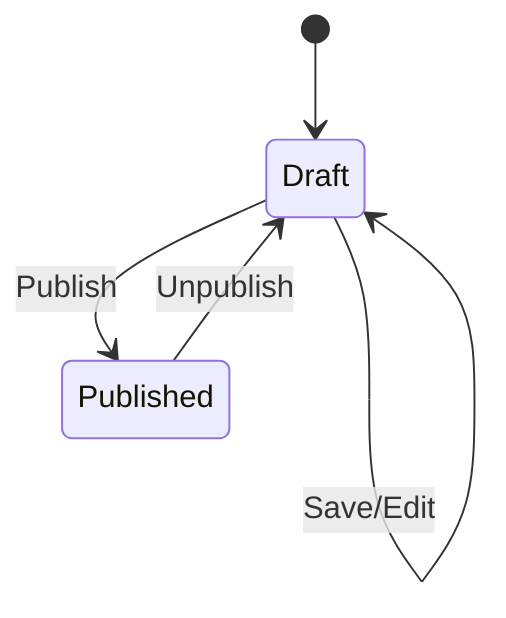

Không có:

- `IN_REVIEW`;
- `REJECTED`;
- multi-level approval;
- parallel Published + editable Draft revision;
- version history/rollback.

### 18.1 Write Protection Rules

Backend service layer phải enforce:

#### Khi Exhibit = `PUBLISHED`

Không cho phép:

- PATCH Exhibit;
- DELETE Exhibit;
- create/update/delete hotspot thuộc Exhibit;
- thay media reference;
- overwrite/xóa Media đang được Published Exhibit tham chiếu.

Admin phải:

```text
Published
   ↓ Unpublish
Draft
   ↓ Edit
Draft
   ↓ Publish
Published
```

### 18.2 Media Immutability

Binary của một Media record **không bị overwrite in-place**.

Thay asset:

1. upload Media mới;
2. gắn Media mới vào Draft;
3. Publish;
4. Media cũ chỉ được xóa khi không còn reference hợp lệ.

---

## 19. Concurrency Control

Nhiều Admin có cùng quyền, do đó mọi write liên quan Exhibit phải có concurrency control.

### 19.1 Exhibit Version

`Exhibit` có:

```text
version: integer
```

Mọi thay đổi ảnh hưởng snapshot của Exhibit phải increment version:

- translation;
- transform;
- image/model link;
- audio link/transcript/caption;
- hotspot create/update/delete.

### 19.2 Expected Version

Admin write request gửi:

```text
expectedVersion
```

Nếu DB version khác:

```http
409 Conflict
```

Không ghi đè silent.

### 19.3 Parent Lock Rule

Write vào child resource như Hotspot phải:

1. bắt transaction;
2. lock/read parent Exhibit;
3. xác nhận `DRAFT`;
4. xác nhận `expectedVersion`;
5. mutate child;
6. increment parent `version`;
7. commit.

Nhờ đó Publish có thể dùng parent version như consistency boundary.

---

## 20. Transactional Publish Flow

Dữ liệu được validate phải là **chính dữ liệu được commit**.

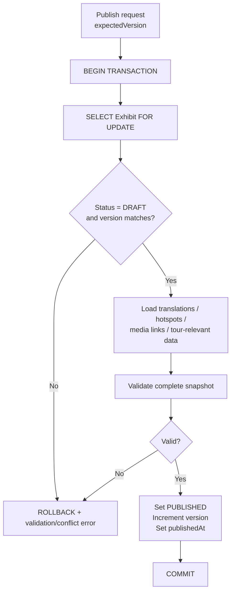

### 20.1 Publish Rules

Trong cùng transaction:

- lock parent Exhibit;
- kiểm tra status;
- kiểm tra version;
- đọc related translation/hotspot/audio/media reference;
- validate publish rules;
- update `PUBLISHED`;
- increment version;
- commit.

### 20.2 Unpublish

Unpublish cũng dùng transaction:

1. lock Exhibit;
2. verify `PUBLISHED`;
3. verify expectedVersion;
4. set `DRAFT`;
5. increment version;
6. commit.

Sau commit, public request mới phải không thấy Exhibit.

### 20.3 Delete Draft

Delete Draft transaction:

1. lock Exhibit;
2. verify `DRAFT`;
3. verify `expectedVersion`;
4. remove TourItem references;
5. cascade owned child records;
6. delete Exhibit;
7. **không cascade Media**;
8. commit.

Nếu `expectedVersion` không còn khớp, backend trả `409 Conflict` và không xóa dữ liệu.

---

## 21. Draft Preview Architecture

Preview dùng cùng renderer với Public Museum.

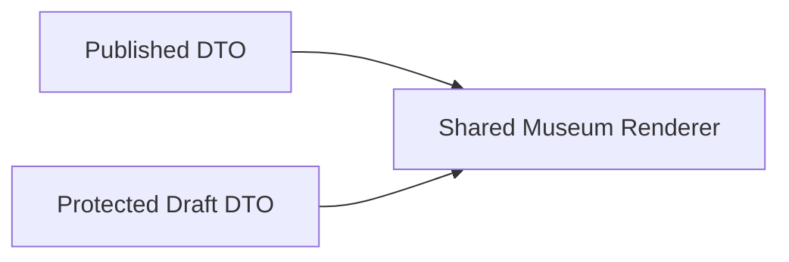

Preview endpoint:

- Admin-only;
- `Cache-Control: private, no-store`;
- không làm Draft xuất hiện ở public endpoint;
- Draft media dùng Admin-authorized media route.

---

## 22. Target Data Architecture

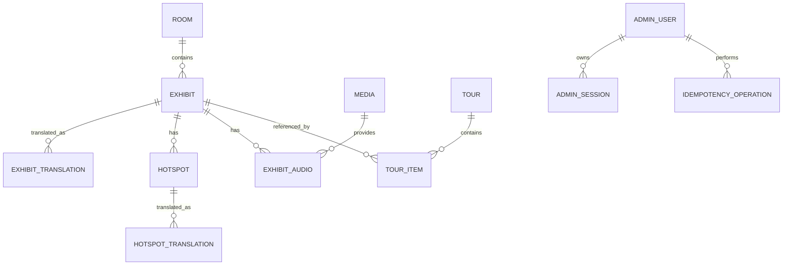

### 22.1 Room

```text
id
slug
name
description
```

### 22.2 Exhibit

```text
id
roomId
status: DRAFT | PUBLISHED
version

positionX
positionY
positionZ

rotationX
rotationY
rotationZ

scaleX
scaleY
scaleZ

modelMediaId
imageMediaId

createdAt
updatedAt
publishedAt?
```

### 22.3 ExhibitTranslation

```text
id
exhibitId
locale: vi | en
title
description
imageAltText
```

Constraint:

```text
UNIQUE (exhibitId, locale)
```

`imageAltText` nằm ở translation của Exhibit vì alt text phụ thuộc ngôn ngữ và context sử dụng ảnh.

### 22.4 ExhibitAudio

```text
id
exhibitId
locale
audioMediaId
captionMediaId
transcript
```

Constraint:

```text
UNIQUE (exhibitId, locale)
```

### 22.5 Hotspot

```text
id
exhibitId
positionX
positionY
positionZ
displayOrder
```

### 22.6 HotspotTranslation

```text
id
hotspotId
locale
title
description
```

Constraint:

```text
UNIQUE (hotspotId, locale)
```

### 22.7 Tour

```text
id
name
autoDwellSeconds
```

MVP có một Guided Tour.

### 22.8 TourItem

```text
id
tourId
exhibitId
displayOrder
```

Constraints:

```text
UNIQUE (tourId, exhibitId)
UNIQUE (tourId, displayOrder)
```

### 22.9 Media

```text
id
kind
storageKey
mimeType
sizeBytes
checksum

source
author
license

createdAt
```

Supported kinds:

```text
MODEL
IMAGE
AUDIO
CAPTION
```

### 22.10 AdminSession

```text
id
sessionTokenHash
adminId
createdAt
lastActivityAt
absoluteExpiresAt
revokedAt?
```

### 22.11 IdempotencyOperation

```text
id
adminId
idempotencyKey
operationType
requestHash
status: PENDING | COMPLETED | FAILED

executionGeneration
executionTokenHash?
executionStartedAt?
executionHeartbeatAt?

storageKey?
resultResourceId?
responseStatus?

createdAt
updatedAt
```

Constraint:

```text
UNIQUE (adminId, idempotencyKey)
```

`storageKey` được xác định một lần khi operation upload được nhận quyền thực thi và được tái sử dụng cho mọi retry của cùng operation.

---

## 23. Referential and Delete Rules

### 23.1 Delete Draft Exhibit

Khi delete Draft Exhibit:

```text
Exhibit
├── CASCADE ExhibitTranslation
├── CASCADE Hotspot
│   └── CASCADE HotspotTranslation
├── CASCADE ExhibitAudio links
├── DELETE related TourItem
└── DO NOT CASCADE Media
```

### 23.2 Media

Media không bị cascade theo Exhibit vì có thể dùng chung.

Các foreign key tới Media phải dùng `RESTRICT` / `NO ACTION` hoặc cơ chế tương đương:

```text
Exhibit.modelMediaId           → Media
Exhibit.imageMediaId           → Media
ExhibitAudio.audioMediaId      → Media
ExhibitAudio.captionMediaId    → Media
```

Delete Media chỉ thành công nếu không còn bất kỳ reference hợp lệ nào, bao gồm cả `captionMediaId`.

Delete Media không được triển khai theo kiểu:

```text
query references
→ thấy rỗng
→ xóa object ngoài transaction
```

vì một request khác có thể tạo reference mới trong khoảng trống đó.

Target flow:

```text
BEGIN
  ↓
lock/read Media row
  ↓
check all references
  ↓
DELETE Media metadata
  ↓
FK RESTRICT / NO ACTION = final database guard
  ↓
COMMIT
  ↓
delete binary object from Storage
```

Các operation attach/replace Media phải chạy trong transaction và tạo FK hợp lệ; database locking/FK enforcement phải ngăn race giữa việc tạo reference mới và xóa Media.

Nếu DB commit thành công nhưng xóa binary object thất bại:

- Media không còn được API expose;
- binary được xem là orphan;
- cleanup task/maintenance command xử lý sau;
- không rollback DB để tạo lại reference tới binary có trạng thái không chắc chắn.

Nếu còn reference hoặc phát sinh reference cạnh tranh → `409 Conflict`/database conflict phù hợp.

### 23.3 Published Exhibit

Published Exhibit không delete trực tiếp.

Phải:

```text
Published → Unpublish → Draft → Delete
```

---

## 24. Media Architecture and Storage Boundary

### 24.1 Strong Boundary

Frontend:

> **chỉ gọi NestJS API và backend-managed media routes.**

Frontend **không**:

- import/use Supabase Storage SDK trực tiếp;
- gọi Storage URL trực tiếp như data API;
- truy cập PostgreSQL/Supabase Database;
- giữ Storage service credential/public access logic.

### 24.2 Storage

Object Storage:

```text
PRIVATE by default
```

Binary asset không được public vĩnh viễn chỉ vì từng được Published.

### 24.3 Public Media Authorization

Media public khi:

```text
exists current reference from a PUBLISHED resource
```

Backend kiểm tra điều kiện này **mỗi request media mới**.

Media response dùng `Cache-Control: private, no-store`; reverse proxy không cache route này, kể cả `206 Partial Content`, để request mới thực sự tới backend kiểm tra quyền.

Nếu Exhibit bị Unpublish và Media không còn Published reference khác:

```text
GET /api/v1/media/:id/content
→ no longer serves content
```

### 24.4 Draft Media Authorization

Draft-only media:

```text
GET /api/v1/admin/media/:id/content
```

yêu cầu Admin session và cũng dùng:

```http
Cache-Control: private, no-store
```

### 24.5 CDN Future Option

MVP không phụ thuộc CDN public immutable URL.

Nếu sau này thêm CDN, architecture change phải xác định một trong:

- edge authorization mỗi request;
- revocable signed-cookie/token mechanism;
- synchronous invalidation có bằng chứng đáp ứng BR-22/NFR-12.

Không được chỉ dựa vào TTL “ngắn”.

---

## 25. Upload and Retry Architecture

### 25.1 Problem

Các trường hợp phải xử lý:

- Storage upload xong nhưng DB insert fail;
- DB commit xong nhưng HTTP response mất;
- browser retry operation;
- user click retry nhiều lần.

### 25.2 Operation Identity

Client tạo:

```text
Idempotency-Key = UUID
```

Backend dùng `IdempotencyOperation` làm single-operation record.

Khi nhận request, backend **xử lý idempotency trước business precondition như `expectedVersion`**:

1. tìm operation theo `(adminId, idempotencyKey)`;
2. nếu có, xác nhận `requestHash`/`operationType` trùng;
3. nếu `COMPLETED` → trả lại logical result đã lưu;
4. nếu `PENDING` → **không chạy operation lần hai**, trả trạng thái đang xử lý;
5. nếu `FAILED` → chỉ cho retry theo recovery policy của operation;
6. nếu chưa có → atomic `INSERT ... PENDING`; request insert thành công là **execution owner**.

### 25.2.1 Request Identity

`requestHash` không chỉ hash request body.

Canonical request identity phải bao gồm tối thiểu:

```text
HTTP method
+ canonical route
+ concrete target resource ID (nếu có)
+ normalized payload
```

Với upload, identity còn bao gồm:

```text
file checksum
+ normalized media metadata
```

Ví dụ hai request:

```text
PATCH /admin/exhibits/A   { "title": "X" }
PATCH /admin/exhibits/B   { "title": "X" }
```

không được coi là cùng operation dù body giống nhau.

Nếu cùng `Idempotency-Key` nhưng canonical request identity khác:

```http
409 Conflict
```

Điều này đặc biệt quan trọng cho Publish:

```text
Publish expectedVersion = 7
        ↓
operation succeeds
        ↓
Exhibit version = 8
        ↓
HTTP response lost
        ↓
retry same Idempotency-Key + expectedVersion = 7
        ↓
COMPLETED operation found first
        ↓
return previous success
```

Không được kiểm tra `expectedVersion` trước idempotency rồi trả nhầm `409`.

### 25.3 Single Executor and Recovery Fencing for `PENDING`

Chỉ request tạo/claim được operation `PENDING` mới sở hữu execution hiện tại.

Mỗi lần initial claim hoặc recovery claim phải tạo một execution identity gồm:

```text
executionGeneration  -- tăng đơn điệu mỗi lần claim/recover
executionToken       -- random secret chỉ executor hiện tại biết
```

Database lưu `executionGeneration` và hash/representation an toàn của token.

Request khác cùng key gặp `PENDING`:

```http
202 Accepted
```

hoặc response contract tương đương:

```json
{
  "status": "PENDING"
}
```

Request đó **không**:

- upload object lần hai;
- insert Media lần hai;
- chạy Publish/Unpublish lần hai;
- mutate Tour/Exhibit lần hai.

#### Recovery Claim

Timeout/stale detection **không tự chứng minh executor cũ đã chết**.

Recovery chỉ được claim atomically dưới database lock:

```text
lock IdempotencyOperation
        ↓
verify current generation/status is recoverable
        ↓
increment executionGeneration
        ↓
issue new executionToken
        ↓
commit claim
```

Sau claim, executor cũ bị fenced bởi generation/token mới.

#### Fencing Before Mutation / Finalization

Trước mọi business mutation hoặc finalization, transaction phải:

1. lock `IdempotencyOperation`;
2. verify `status = PENDING`;
3. verify `executionGeneration` đúng generation executor đang giữ;
4. verify execution token còn là token hiện tại;
5. chỉ sau đó mới mutate domain state hoặc mark operation `COMPLETED`.

Nếu token/generation không còn khớp, executor cũ phải abort:

```text
STALE_EXECUTOR / CONFLICT
```

và **không được commit, mark COMPLETED hoặc cleanup**.

Fencing check cũng áp dụng trước retry/recovery cleanup.

### 25.4 Database-only Write Operations

Với operation chỉ ghi PostgreSQL, ví dụ Create Exhibit, Save Draft, Publish, Unpublish, Tour update:

```text
BEGIN
  ↓
lock IdempotencyOperation
  ↓
verify PENDING + current executionGeneration/token
  ↓
business validation / expectedVersion
  ↓
mutation
  ↓
mark IdempotencyOperation = COMPLETED
+ store logical result
  ↓
COMMIT
```

**Fencing check, mutation và `COMPLETED` phải commit trong cùng database transaction.**

Nếu transaction rollback, operation không được xuất hiện như `COMPLETED`.

### 25.5 Media Upload Flow

Binary upload không giữ database transaction mở trong toàn bộ thời gian truyền file.

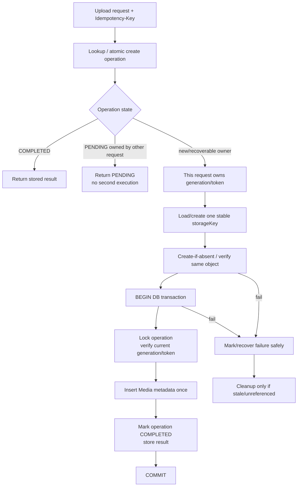

### 25.6 Stable Storage Key

Operation upload phải dùng **một storage key được xác định/lưu một lần**.

Ví dụ:

```text
uploads/{adminId}/{idempotencyKey}/payload
```

hoặc một `storageKey` được tạo ở lần đầu và lưu vào `IdempotencyOperation`.

Retry cùng key phải tái sử dụng **chính storage key đó**; không generate tên/object mới cho mỗi retry.

### 25.7 Storage-side Fencing

Database execution token không thể tự động ngăn một network upload cũ đã gửi tới Object Storage tiếp tục hoàn tất. Vì vậy binary object của operation phải tuân theo một trong các cơ chế an toàn sau:

1. ưu tiên **create-if-absent / conditional create** cho stable `storageKey`, không cho overwrite object đã tồn tại; hoặc
2. nếu Storage adapter không hỗ trợ conditional create đáng tin cậy, **không recovery/takeover upload khi transfer cũ vẫn có thể đang chạy**; chỉ recover sau khi execution cũ đã được xác nhận dừng/cancelled và trạng thái object được kiểm tra.

Media binary của cùng operation là immutable; executor cũ không được overwrite object đã được executor mới/finalization xác nhận.

Trước khi finalization vào DB, executor hiện tại vẫn phải thực hiện fencing check bằng `executionGeneration`/token trong transaction.

### 25.8 Partial Failure and Cleanup

Nếu object đã tồn tại nhưng DB chưa có Media metadata:

- execution owner/recovery path dùng lại object/storage key cũ;
- không tạo Media record thứ hai;
- có thể verify checksum/size trước khi resume.

Cleanup chỉ được xóa object khi:

1. cleanup worker/request đã claim quyền cleanup hợp lệ hoặc operation ở trạng thái cho phép cleanup;
2. lock operation và xác nhận generation/token hiện tại không thuộc một executor còn chạy;
3. operation là `FAILED` hoặc `PENDING` đã được xác nhận stale/recovered an toàn;
4. object không được Media record hợp lệ tham chiếu;
5. không có finalization hợp lệ đang chạy;
6. việc kiểm tra được thực hiện theo transaction/locking phù hợp để tránh race.

Executor cũ có generation/token đã bị thay thế **không được cleanup**.

Không xóa object chỉ vì thấy operation `PENDING` tại một thời điểm.

MVP không cần queue; cleanup có thể là maintenance command/job đơn giản.

---

## 26. CMS Write Retry Semantics

Tất cả write route phải trả trạng thái rõ:

- success;
- validation failure;
- conflict;
- failure;
- unknown/pending khi cần.

Frontend khi mất response:

1. không hiển thị success;
2. giữ form data trong memory của tab;
3. query trạng thái operation bằng Idempotency-Key hoặc retry cùng key;
4. backend xử lý idempotency trước `expectedVersion`/business precondition;
5. nếu operation trước đã `COMPLETED`, backend trả cùng logical result;
6. nếu operation còn `PENDING`, frontend hiển thị đang xử lý và không phát sinh execution thứ hai; recovery nếu có phải tuân theo execution generation/token fencing.

Không tạo:

- duplicate Exhibit;
- duplicate Media;
- duplicate TourItem do lost response.

---

## 27. 2D Fallback Architecture

2D không phải application khác.

```text
Validated Museum Domain State
         │
         ├──────────────┐
         ▼              ▼
   3D Experience     2D Experience
```

2D cung cấp:

- exhibit list;
- title/description;
- image;
- hotspot information;
- audio;
- transcript/captions;
- localization;
- tour content.

---

## 28. Failure Isolation

### 28.1 Model Error

```text
One GLB fails
    ↓
Placeholder + text content
```

### 28.2 Audio Error

```text
Audio fails
    ↓
Error feedback + transcript remains
```

### 28.3 WebGL/Renderer Error

```text
3D initialization fails
    ↓
Accessible 2D
```

### 28.4 Public API Error

```text
API fails
    ↓
Safe error state + Retry
```

### 28.5 CMS Lost Response

```text
Response lost
    ↓
Keep local form state
    ↓
Check/retry same Idempotency-Key
    ↓
Return prior result or complete once
```

---

## 29. Localization Architecture

Frontend giữ:

```text
currentLocale = vi | en
```

Locale state dùng chung cho:

- accessible DOM;
- exhibit panel;
- hotspot;
- audio;
- captions;
- Guided Tour.

Không rải logic dịch riêng trong từng Three.js component.

---

## 30. Accessibility Architecture

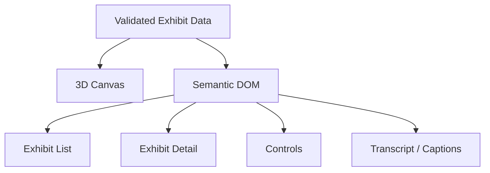

Canvas không phải accessibility tree duy nhất.

### 30.1 Reduced Motion

Khi `prefers-reduced-motion` bật:

- **tắt** animation không thiết yếu;
- tắt camera motion liên tục;
- dùng instant teleport;
- không làm mất chức năng cốt lõi.

---

## 31. Security Architecture

### 31.1 Trust Boundaries

```text
UNTRUSTED
Browser
    │
    ▼
────────────────── Trust Boundary
NestJS API
    │
    ▼
────────────────── Infrastructure Boundary
PostgreSQL + Private Object Storage
```

Backend enforce:

- authentication;
- session;
- publication state;
- concurrency/version;
- input validation;
- media access;
- file validation;
- destructive operations;
- Draft protection.

### 31.2 Password and Secrets

- password không lưu plaintext;
- password hash phù hợp;
- không expose server secret;
- không commit `.env`;
- không log credential/session token.

---

## 32. Cache and Public Freshness Strategy

Đây là quyết định MVP nhằm đáp ứng strict freshness của Publish/Unpublish/Delete.

### 32.1 Static Frontend Assets

Hashed JS/CSS/font/image thuộc **application build** có thể dùng long-lived cache vì không chứa CMS publication state.

### 32.2 Public JSON

Public content JSON trong MVP:

```http
Cache-Control: no-store
```

Không dùng TTL cache cho:

- museum content;
- exhibit detail;
- tour response.

Mục tiêu:

> request public mới sau khi Publish/Unpublish/Delete commit phải đọc trạng thái hiện tại.

Nếu sau này muốn cache JSON, phải dùng architecture change chứng minh cache/revalidation/invalidation vẫn đáp ứng BR-22/NFR-12.

### 32.3 Public and Admin Media

Trong MVP, response của cả:

```text
GET /api/v1/media/:id/content
GET /api/v1/admin/media/:id/content
```

phải sử dụng:

```http
Cache-Control: private, no-store
```

Policy này áp dụng cho:

- `200 OK`;
- `206 Partial Content`;
- response byte-range phục vụ audio/model loader;
- public media;
- Draft/Admin media.

Reverse proxy/hosting layer phải **bypass cache** cho các media route trên.

Mục tiêu là mọi media request mới đều tới NestJS để kiểm tra publication/current reference hoặc Admin session. Không được cấu hình browser/shared proxy/CDN cache theo cách khiến request bỏ qua authorization sau Unpublish.

### 32.4 Draft Preview

Preview JSON/HTML data:

```http
Cache-Control: private, no-store
```

Không dùng chung cache Public và Preview.

### 32.5 Client Snapshot

Visitor session đã tải content có thể giữ snapshot trong memory tới khi reload theo SRS.

MVP không yêu cầu realtime push khi content bị Unpublish.

---

## 33. Performance Architecture

### 33.1 Progressive Loading

```text
App shell
   ↓
Public structured content
   ↓
Accessible DOM
   ↓
3D runtime
   ↓
Needed models
   ↓
Audio on demand
```

### 33.2 Asset Optimization Candidates

- GLB;
- mesh/texture compression;
- lazy loading;
- adaptive DPR;
- giảm shadow/effects;
- quality levels.

### 33.3 Trade-off: Authorized Media Route

Backend-mediated media access làm consistency/security đơn giản hơn nhưng tăng API bandwidth.

MVP chấp nhận trade-off này để đáp ứng strict Unpublish semantics.

Nếu performance audit cho thấy đây là bottleneck, tối ưu CDN/edge authorization phải được thiết kế riêng mà không làm yếu BR-22/BR-04.

---

## 34. Scalability

Backend ban đầu có thể chạy một instance.

Nếu load test chứng minh cần:

```text
        Load Balancer
         /       \
        /         \
    API #1       API #2
        \         /
         \       /
       PostgreSQL
```

Vì session nằm PostgreSQL, nhiều API replica vẫn đọc cùng session state.

Không thiết kế distributed infrastructure trước khi có bằng chứng cần thiết.

---

## 35. Deployment Architecture

Target production ưu tiên same-origin.

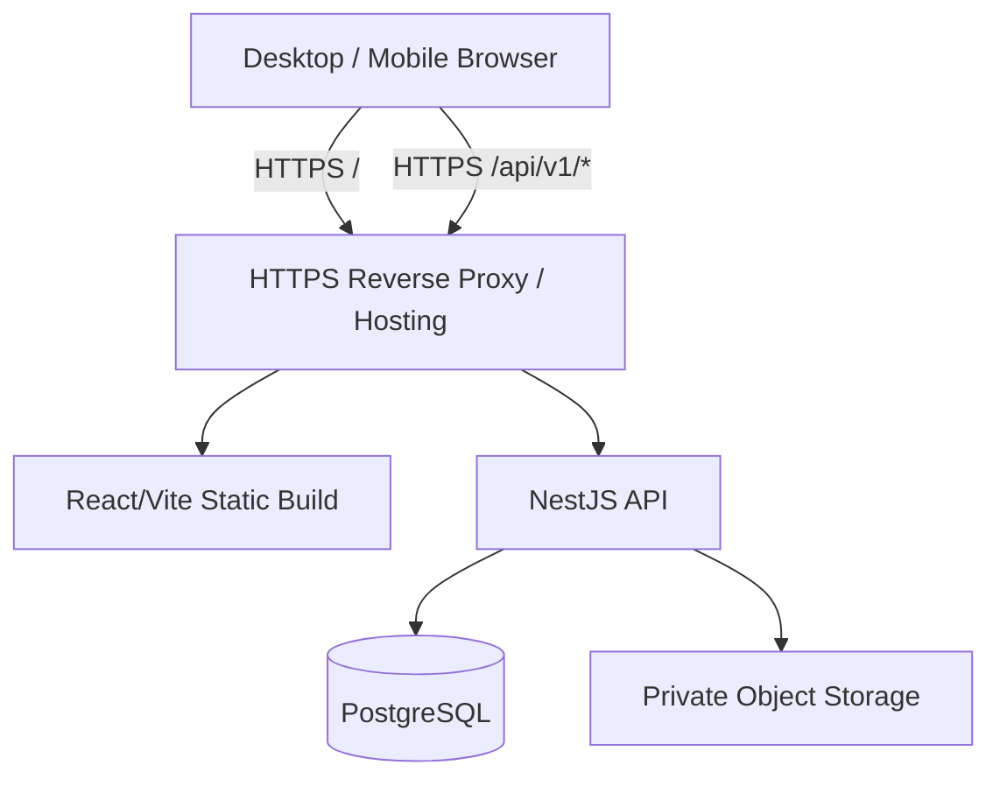

### 35.1 Environment

```text
Development
Staging
Production
```

Development có thể dùng Vite proxy tới NestJS để mô phỏng same-origin API path.

---

## 36. Observability

### 36.1 Health

```http
GET /health
```

Có thể bổ sung DB readiness khi deploy production.

### 36.2 Logging

Log nên có:

- timestamp;
- requestId;
- route;
- status;
- operation/idempotency ID khi có;
- error context.

Không log:

- password;
- raw session cookie/token;
- secret.

---

## 37. Database Migration Governance

Luôn giữ:

```text
synchronize = false
```

### 37.1 Approval Before Generation

Workflow:

```text
Target data model proposal
        ↓
DB owner / responsible member approval
        ↓
Generate TypeORM migration
        ↓
Review generated SQL / diff
        ↓
Approve migration artifact
        ↓
Apply to dev/staging
        ↓
Verify
```

**Không generate migration trước khi data-model change được phê duyệt.**

Không sửa migration đã chạy trên database dùng chung.

---

## 38. Quality Attribute Scenarios

### QA-01 — Accessibility

**Scenario:** Visitor không thể/không muốn dùng 3D.  
**Response:** Core content và controls vẫn có trong semantic DOM/2D mode.

### QA-02 — Renderer Failure

**Scenario:** WebGL/renderer không khởi tạo.  
**Response:** Ứng dụng cung cấp 2D fallback.

### QA-03 — Asset Failure

**Scenario:** Một model/audio lỗi.  
**Response:** Lỗi được isolate; text/transcript vẫn dùng được.

### QA-04 — Draft Confidentiality

**Scenario:** Visitor truy cập trực tiếp ID Draft hoặc Draft-only media.  
**Response:** Public API/media route không trả Draft content.

### QA-05 — Unpublish Freshness

**Scenario:** Admin Unpublish và backend đã commit thành công.  
**Response:** Request public mới không nhận Exhibit hoặc media chỉ còn gắn với Draft.

### QA-06 — Concurrent Publish

**Scenario:** Admin A sửa content trong khi Admin B publish version cũ.  
**Response:** version/row lock ngăn publish stale snapshot; một operation nhận conflict.

### QA-07 — Lost CMS Response

**Scenario:** Create/Upload/Publish đã thành công nhưng HTTP response bị mất.  
**Response:** retry cùng Idempotency-Key trả cùng logical result, không tạo duplicate.

### QA-08 — Session Expiration

**Scenario:** session idle/absolute expiry hoặc logout.  
**Response:** backend từ chối request tiếp theo kể cả Preview/API trực tiếp.

### QA-09 — Localization

**Scenario:** Visitor đổi `vi ↔ en`.  
**Response:** DOM, panel, hotspot, audio/captions và tour dùng locale mới nhất quán.

### QA-10 — Performance Degradation

**Scenario:** 3D performance thấp kéo dài.  
**Response:** tắt/giảm visual quality không thiết yếu; nếu vẫn không đạt thì đề xuất 2D.

---

## 39. Requirement-to-Architecture Traceability

| Requirement Area | Architecture Response |
|---|---|
| SR-01 / FR-01 | Public route không cần auth |
| SR-02 / FR-03 | MuseumScene + NavigationController |
| SR-03 | ExhibitPanel + shared state |
| SR-04 | HotspotRenderer + HotspotsModule |
| SR-05 | AudioController + MediaModule |
| SR-06 | Translation model + currentLocale |
| SR-07 / SR-08 | Detailed TourController state machine |
| SR-09 / FR-32 | `CapabilityDetector` trong MVP; Future XR Adapter ngoài MVP |
| SR-10 | MVP độc lập WebXR |
| SR-11 | Accessible DOM + 2D mode |
| SR-12 | PostgreSQL-backed session |
| SR-13 | ExhibitsModule + optimistic concurrency |
| SR-14 | Translation tables |
| SR-15 | Private media + backend route |
| SR-16 | Transform fields |
| SR-17 | Hotspot module + parent version |
| SR-18 | Transactional Draft/Published |
| SR-19 | Protected Preview |
| SR-20 | Tour + TourItem |
| BR-04 | Public API/media authorization |
| BR-21 | Published write protection + immutable media |
| BR-22 / NFR-12 | `no-store` public JSON + current-state media authorization |
| FR-93 / AC-41 | IdempotencyOperation + execution generation/token fencing + retry-safe writes |
| NFR-17 / AC-38 | PostgreSQL session + cookie + expiry |
| FR-95 / AC-43 | Disable non-essential motion |
| FR-98 / AC-46 | Detailed Auto/Manual Tour state machine |
| CON-16 | Frontend only → NestJS/backend-managed media |

---

## 40. Architecture Decision Records

### ADR-01 — Modular Monolith Backend

**Decision:** NestJS chia domain module nhưng deploy chung.  
**Rejected:** microservices trong MVP.

### ADR-02 — Single React Application

**Decision:** Public Museum và Admin CMS dùng chung React/Vite app.

### ADR-03 — NestJS Is the Only Application/Data Boundary

**Decision:** Frontend chỉ gọi NestJS API và backend-managed media routes.

Frontend không dùng trực tiếp:

- Supabase Database SDK;
- Supabase Storage SDK;
- PostgreSQL connection;
- public/private Storage API.

### ADR-04 — PostgreSQL for Structured Data

**Decision:** Content, metadata, Admin sessions và idempotency state lưu PostgreSQL.

### ADR-05 — Private Object Storage for Binary Assets

**Decision:** GLB/image/audio/VTT nằm ở private Object Storage; access do backend quyết định.

### ADR-06 — Shared Domain Data for 2D and 3D

**Decision:** Accessible DOM và canvas dùng cùng validated state.

### ADR-07 — Backend Protects Draft and Published State

**Decision:** Public API/media chỉ expose current Published resources; Published resources không edit trực tiếp.

### ADR-08 — Preview Reuses Public Renderer

**Decision:** Draft Preview tái sử dụng renderer/component core của Public Museum.

### ADR-09 — One Admin Permission Level

**Decision:** Không triển khai multi-role RBAC trong MVP.

### ADR-10 — PostgreSQL-backed Server Session

**Decision:** Server session lưu PostgreSQL; browser dùng opaque session cookie `HttpOnly`, `Secure` production, `SameSite=Lax`.

### ADR-11 — Same-origin Production

**Decision:** Public frontend và API dùng cùng origin/path trong target production.

### ADR-12 — Optimistic Concurrency + Parent Row Lock

**Decision:** Exhibit `version` + `expectedVersion`; write child lock parent/increment version; Publish lock+validate+commit trong một transaction.

### ADR-13 — Idempotent CMS Writes with Fencing

**Decision:** State-changing CMS request dùng client-generated Idempotency-Key và operation record. Mỗi execution/recovery claim có generation/token; finalization phải xác nhận ownership hiện tại để fence executor cũ.

### ADR-14 — Strict MVP Public Freshness

**Decision:** Public JSON `no-store`; media access được authorize tại backend cho mỗi request mới.

### ADR-15 — Media Is Immutable

**Decision:** Không overwrite binary của Media record; replacement tạo Media mới.

### ADR-16 — Guided Tour Runtime in Frontend

**Decision:** Backend lưu sequence/dwell configuration; frontend giữ runtime state/timer/audio lifecycle.

### ADR-17 — WebXR Capability Detection in MVP; XR Runtime Is Future

**Decision:** MVP triển khai `CapabilityDetector` độc lập theo FR-32 nhưng không xây immersive XR subsystem. Future XR Adapter nằm ngoài MVP.

### ADR-18 — No Infrastructure Without Evidence

**Decision:** Không mặc định Redis, queue, Kubernetes hoặc microservices.

---

## 41. Explicit Non-Goals

Architecture MVP không bao gồm:

- immersive VR/headset implementation;
- AR;
- microservices;
- Kubernetes;
- service mesh;
- mandatory Redis;
- message broker;
- multiplayer;
- Visitor account;
- AI guide;
- payment;
- multiple tours;
- partner API/commercial API key;
- analytics retention subsystem;
- content moderation/report workflow;
- Editor/Reviewer approval workflow;
- parallel Published revision + editable Draft;
- version history/rollback;
- CMS room editor;
- 3D mesh editor;
- public permanent media URL;
- CDN authorization/invalidation subsystem trong MVP.

---

## 42. Risks and Trade-offs

| Risk / Trade-off | Mitigation |
|---|---|
| Backend streaming media tăng bandwidth | Chấp nhận cho correctness MVP; tối ưu edge auth sau nếu cần |
| Public JSON `no-store` tăng API read load | Đo bằng load test; query/index tối ưu trước khi thêm cache |
| PostgreSQL session tạo write/read load | Session table indexed; lastActivity update có throttling |
| Optimistic locking tạo 409 khi cùng sửa | CMS hiển thị conflict và yêu cầu reload |
| Idempotency/recovery tăng complexity | Operation record + generation/token fencing + stored result ngăn duplicate và stale executor commit |
| Single frontend bundle lớn | Route/chunk lazy loading |
| Mobile 3D performance khác nhau | Device matrix + adaptive quality |
| Không revision history | Đúng MVP; bổ sung khi requirement đổi |
| Private Storage không tiện bằng public CDN | Đúng security/freshness requirement hiện tại |

---

## 43. Architecture Verification Checklist

Checklist dưới đây dùng để kiểm chứng khi triển khai; các mục chưa đánh dấu không phải kết quả kiểm thử đã đạt.

- [ ] Public API không lộ Draft.
- [ ] Public media route kiểm tra current Published reference.
- [ ] Public/Admin media response dùng `Cache-Control: private, no-store`, kể cả `206 Partial Content`.
- [ ] Reverse proxy bypass cache cho media route.
- [ ] Public JSON không cache stale state trong MVP.
- [ ] Frontend không dùng Supabase/Storage SDK trực tiếp.
- [ ] Public + Admin đi qua NestJS.
- [ ] API response được Zod validate.
- [ ] 2D và 3D dùng cùng domain data.
- [ ] Published Exhibit/hotspot/media không sửa trực tiếp.
- [ ] Publish validation nằm trong cùng transaction với publish commit.
- [ ] Exhibit writes dùng `version/expectedVersion`.
- [ ] Child write increment parent Exhibit version.
- [ ] Admin session lưu PostgreSQL và backend enforce expiry/logout.
- [ ] CMS write có Idempotency-Key/retry semantics.
- [ ] `PENDING` idempotency operation chỉ có một executor; request khác không chạy mutation lần hai.
- [ ] Recovery claim tăng `executionGeneration`/token và stale executor không thể finalization/cleanup.
- [ ] DB mutation/finalization lock operation và verify current generation/token.
- [ ] `requestHash` bao gồm method + target route/resource + normalized payload; upload thêm checksum/metadata.
- [ ] Retry `COMPLETED` được xử lý trước `expectedVersion`.
- [ ] Upload retry dùng lại đúng `storageKey`.
- [ ] Storage upload dùng create-if-absent/conditional create hoặc chỉ recovery khi transfer cũ đã dừng.
- [ ] Upload partial failure có resume/cleanup path an toàn.
- [ ] Delete Draft kiểm tra `expectedVersion` và không cascade Media.
- [ ] Media FK gồm model/image/audio/caption dùng `RESTRICT`/`NO ACTION`.
- [ ] Media metadata delete commit trước binary cleanup; cleanup không xóa object đang được reference.
- [ ] Translation/Audio/TourItem unique constraints tồn tại.
- [ ] Manual Next/Previous chỉ đổi step + guidance, không ép teleport.
- [ ] `Switch Manual` giữ nguyên currentStep/vị trí và chỉ hủy Auto timer/pending/audio.
- [ ] Auto step transition dùng instant teleport.
- [ ] Tour Exit clear timer/audio/listener.
- [ ] Reduced motion tắt animation không thiết yếu.
- [ ] Renderer failure có 2D fallback.
- [ ] Preview được bảo vệ và `no-store`.
- [ ] `CapabilityDetector` đáp ứng FR-32 trong MVP nhưng immersive XR runtime không phải dependency của MVP.
- [ ] Migration change được approve trước khi generate.
- [ ] Architecture component truy vết được về SRS.

---

## 44. Suggested Implementation Order

```text
1. Approve target data model + constraints
        ↓
2. Generate/review DB migrations
        ↓
3. Admin session + auth boundary
        ↓
4. Public API v1 + private media route
        ↓
5. Frontend API/Zod/domain mapping
        ↓
6. Accessible 2D Museum
        ↓
7. 3D Museum + exhibit interaction
        ↓
8. Hotspot + audio/captions
        ↓
9. Guided Tour state machine
        ↓
10. CMS CRUD + optimistic concurrency
        ↓
11. Draft / Preview / transactional Publish
        ↓
12. Idempotent upload/write retry
        ↓
13. Performance/fallback/accessibility hardening
```

---

## 45. Architecture Baseline and Updates

**Version:** v0.1  
**Status:** Initial Baseline

Architecture v0.1 được chốt làm bản đầu ngày **2026-10-08**, dựa trên Requirements Initial Baseline v0.1. Các quyết định chính của baseline:

1. Single React frontend cho Public + Admin.
2. Modular Monolith NestJS.
3. Same-origin production topology.
4. PostgreSQL-backed Admin session.
5. Strict `no-store` public JSON trong MVP.
6. Private Storage + backend-authorized media route.
7. Exhibit `version/expectedVersion` concurrency model.
8. Transactional Publish/Unpublish.
9. Idempotency-Key ownership/recovery strategy, gồm execution generation/token fencing.
10. Canonical request identity cho idempotency.
11. Target data model/constraints/delete rules.
12. Detailed Tour state machine, gồm Manual không ép teleport và Switch Manual giữ nguyên step/vị trí.
13. WebXR capability detection trong MVP; immersive XR runtime chỉ là future extension.
14. Media `no-store`/reverse-proxy bypass policy.

Khi cần điều chỉnh, cập nhật phiên bản tài liệu và ghi lý do, tác động, yêu cầu liên quan qua Git/PR. Thay đổi lớn về container boundary, persistence, session/auth, publication consistency, media access hoặc deployment topology được cập nhật trong ADR tương ứng.

Việc chốt architecture không thay thế phê duyệt riêng cho thay đổi database/migration theo mục 37 và `AGENTS.md`.
