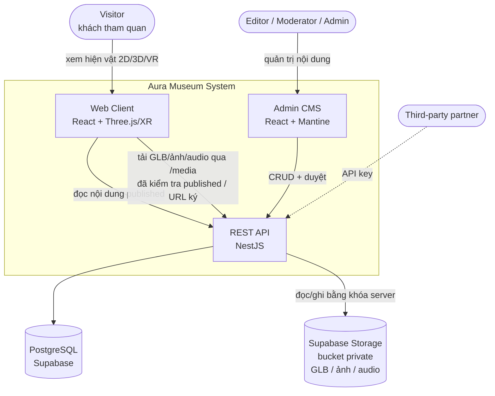
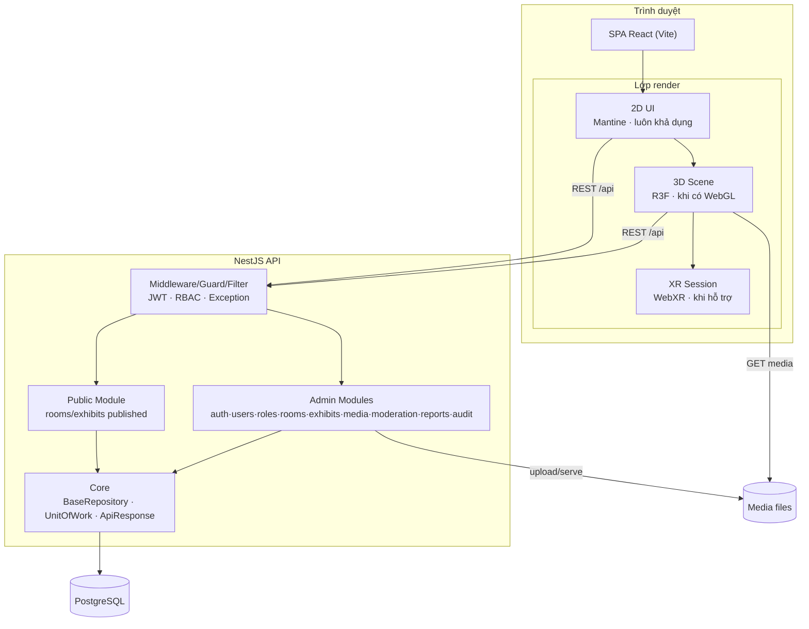

# 01 — Tổng quan hệ thống

## 1.1 Bối cảnh & mục tiêu

Aura Museum là **bảo tàng 3D/WebXR tương tác** chạy trực tiếp trên trình duyệt, đưa hiện vật lên
không gian trực tuyến. Mục tiêu MVP (đề tài 3D-WEB-03):

- Phòng trưng bày mẫu với **tối thiểu 5 hiện vật**, nội dung nạp **động từ API** (không hardcode).
- Chạy **desktop** (chuột/bàn phím), **mobile** (cảm ứng) và **immersive VR** khi thiết bị hỗ trợ.
- **CMS** tạo/sửa/xuất bản nội dung, quản lý media, có phân quyền.
- **Progressive fallback:** 2D hoạt động đầy đủ khi không có WebGL; từ chối XR không mất nội dung.
- **Accessibility** WCAG 2.2 AA cho toàn bộ giao diện 2D ngoài XR.

## 1.2 Các nhóm người dùng (actor)

| Actor | Mô tả | Kênh truy cập |
|---|---|---|
| **Visitor (khách)** | Người tham quan ẩn danh | Client 2D + 3D/XR (tour, collection) |
| **Editor** | Biên tập nội dung: tạo/sửa hiện vật, upload media, gửi duyệt | Admin CMS |
| **Moderator** | Kiểm duyệt, xuất bản/từ chối revision, xử lý báo cáo | Admin CMS |
| **Admin** | Quản trị user/role/permission, cấu hình, xem audit | Admin CMS |
| **Third-party (phase 3)** | Đối tác gọi API qua API Key có scope | Public API |

## 1.3 Yêu cầu phi chức năng (NFR)

| Nhóm | Chỉ tiêu |
|---|---|
| **Hiệu năng API** | Đọc public p95 ≤ 500ms, error rate < 1% (100–200 CCU) |
| **Hiệu năng 3D** | Desktop ≥ 60 FPS, Mobile ≥ 30 FPS; scene load ≤ 8s; UI tương tác ≤ 3s |
| **Khả dụng** | 2D hoạt động không cần WebGL; XR từ chối vẫn giữ nội dung; bắt context-loss |
| **Bảo mật** | JWT access/refresh (thu hồi phiên có hiệu lực ngay), RBAC theo permission `resource:action`, chống MIME spoof/SVG-XSS/GLB độc hại, rate-limit |
| **Accessibility** | WCAG 2.2 AA: điều hướng 100% bàn phím, focus trap modal, screen reader (NVDA/VoiceOver) |
| **Dữ liệu** | Draft/Published tách biệt, audit append-only, revision có lịch sử, backup RPO/RTO kiểm chứng |
| **Media** | GLB ≤ 20MB, ảnh JPEG/PNG/WebP ≤ 5MB, audio MP3/OGG ≤ 20MB, quarantine trước khi publish |

## 1.4 Stack công nghệ

```
Frontend   React 18 · Vite 6 · TypeScript · Three.js + @react-three/fiber (+ drei, xr)
           Mantine v7 (UI) · @mantine/form · @tanstack/react-query · zod · react-router
Backend    NestJS 10 · TypeORM 0.3 · class-validator/transformer · @nestjs/swagger · JWT · Passport
Database   PostgreSQL (Supabase) · JSONB cho metadata/translations
Hạ tầng    Static media (public/ hoặc Supabase Storage) · k6 (load) · Playwright (E2E)
```

## 1.5 Sơ đồ C4 — Mức 1: System Context



## 1.6 Sơ đồ C4 — Mức 2: Container



## 1.7 Môi trường & cấu hình

| Biến | Nơi dùng | Ví dụ |
|---|---|---|
| `DATABASE_URL` | BE | `postgres://...supabase...` |
| `PORT` | BE | `3001` |
| `FRONTEND_ORIGIN` | BE (CORS) | `http://localhost:5173` |
| `NODE_ENV` | BE | `production` (bật kiểm tra khóa bí mật) |
| `JWT_ACCESS_SECRET` / `MEDIA_URL_SIGNING_SECRET` | BE | (secret, ≥32 ký tự khi production) |
| `TRUST_PROXY` | BE | `1` khi có 1 reverse proxy; mặc định `false` |
| `VITE_API_BASE_URL` | FE | `http://localhost:3001/api` |
| `VITE_MEDIA_BASE_URL` | FE | `http://localhost:3001/media` |

> Chi tiết từng tầng: xem [02-backend-architecture.md](02-backend-architecture.md) và
> [03-frontend-architecture.md](03-frontend-architecture.md).
