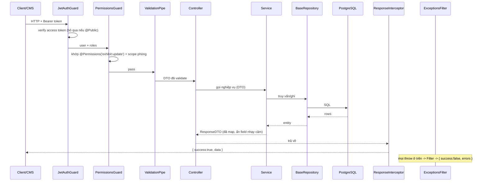

# 02 — Kiến trúc Backend (NestJS, Clean-inspired modular)

## 2.1 Triết lý

Không bê nguyên 6 project như bản .NET (API/Application/Domain/Dto/Core/Repository) — với NestJS
và timeline nhóm SV, cách idiomatic & dễ scale là **modular monolith**: mỗi nghiệp vụ là một
*module* tự chứa (controller → service → repository), dùng chung một tầng **`core`** và **`common`**.
Ta **mượn tinh thần Clean Architecture** ở 3 điểm quan trọng nhất:

| Khái niệm .NET (`Cdg.Core`) | Bản NestJS tương ứng | File |
|---|---|---|
| `IAsyncRepository<T>` + `RepositoryBase<T>` | `IBaseRepository<T>` + `BaseRepository<T>` (bọc TypeORM `Repository`) | `core/repository/` |
| `IUnitOfWork` / `UnitOfWork` | `TransactionManager` (TypeORM `QueryRunner`/`DataSource.transaction`) | `core/database/` |
| `ApiResponse<T>` | `ApiResponse<T>` + `ResponseInterceptor` | `core/http/` |
| `Exceptions/*` + `ExceptionHandlingMiddleware` | `HttpException` con + `AllExceptionsFilter` | `core/http/` |
| `Behaviours/ValidationBehaviour` | `ValidationPipe` (global) + DTO `class-validator` | `main.ts` |
| `AuthenticationFilter` / Authorization | `JwtAuthGuard` + `PermissionsGuard` + `@Permissions()` | `core/auth/` |
| `BaseDto` / `BaseQuery` (paging) | `PaginationQueryDto` / `BaseResponseDto` | `common/dto/` |

## 2.2 Cấu trúc thư mục đích

```
back-end/src/
├── main.ts                      # bootstrap: ValidationPipe, filter, interceptor, CORS, Swagger
├── app.module.ts                # ghép tất cả module
│
├── core/                        # hạ tầng dùng chung — KHÔNG chứa nghiệp vụ
│   ├── repository/
│   │   ├── base-repository.interface.ts   # IBaseRepository<T>  (port, ~ IAsyncRepository)
│   │   └── base.repository.ts             # BaseRepository<T>   (adapter TypeORM)
│   ├── database/
│   │   └── transaction.manager.ts         # chạy nhiều repo trong 1 transaction (UnitOfWork)
│   ├── http/
│   │   ├── api-response.ts                 # { success, data, message, errors, meta }
│   │   ├── response.interceptor.ts         # bọc mọi return thành ApiResponse
│   │   └── all-exceptions.filter.ts        # chuẩn hóa mọi lỗi -> ApiResponse lỗi
│   ├── auth/
│   │   ├── jwt-auth.guard.ts                # xác thực access token
│   │   ├── permissions.guard.ts            # RBAC theo action+scope
│   │   ├── permissions.decorator.ts        # @Permissions('exhibit:update')
│   │   ├── public.decorator.ts             # @Public() bỏ qua auth
│   │   └── current-user.decorator.ts       # @CurrentUser()
│   ├── exceptions/
│   │   ├── not-found.exception.ts
│   │   ├── validation.exception.ts
│   │   └── business.exception.ts
│   └── core.module.ts
│
├── common/                      # thứ dùng chung thuần (không phụ thuộc Nest DI)
│   ├── dto/  (pagination-query.dto.ts, id-param.dto.ts)
│   ├── enums/ (role.enum.ts, media-kind.enum.ts, revision-status.enum.ts, report-status.enum.ts)
│   ├── constants/  utils/  types/
│
├── config/                      # env.ts, data-source.ts (đã có)
├── database/                    # migrations/, seeds/
│
└── modules/                     # NGHIỆP VỤ — mỗi module 1 thư mục
    ├── auth/                    # login/logout/refresh  (Thắng)
    ├── users/                   # CRUD user, gán role   (Thắng)
    ├── roles/                   # role + permission      (Thắng)
    ├── rooms/                   # CRUD phòng             (Thành)
    ├── exhibits/                # hiện vật + revision    (Thành) [đã có, sẽ refactor]
    ├── media/                   # upload pipeline        (Thành)
    ├── moderation/              # duyệt/publish/reject   (Quang)
    ├── reports/                 # báo cáo vi phạm        (Quang)
    ├── audit/                   # nhật ký hệ thống       (Quang)
    └── public/                  # API đọc nội dung published cho client
```

### Cấu trúc 1 module (chuẩn áp dụng cho mọi module)

```
modules/exhibits/
├── exhibits.module.ts
├── exhibits.controller.ts        # route + @Permissions + Swagger; KHÔNG chứa logic
├── exhibits.service.ts           # nghiệp vụ; nhận/ trả DTO; dùng repository
├── exhibits.repository.ts        # extends BaseRepository<Exhibit> (truy vấn đặc thù)
├── entities/exhibit.entity.ts    # TypeORM entity (nội bộ, không lộ ra API)
└── dto/
    ├── create-exhibit.dto.ts     # input  (class-validator)
    ├── update-exhibit.dto.ts
    └── exhibit-response.dto.ts   # output (map từ entity -> không lộ field nhạy cảm)
```

## 2.3 Tầng `core/repository` — port & adapter

`IBaseRepository<T>` là **port** (hợp đồng), service chỉ phụ thuộc interface này — mượn trực tiếp từ
`IAsyncRepository<T>` của bản .NET nhưng rút gọn cho TypeORM:

```ts
// core/repository/base-repository.interface.ts
export interface IBaseRepository<T extends ObjectLiteral> {
  findById(id: string, relations?: string[]): Promise<T | null>;
  findOne(where: FindOptionsWhere<T>, options?: FindOneOptions<T>): Promise<T | null>;
  findMany(options?: FindManyOptions<T>): Promise<T[]>;
  paginate(options: PaginateOptions<T>): Promise<Paginated<T>>;   // { items, total, page, pageSize }
  exists(where: FindOptionsWhere<T>): Promise<boolean>;
  count(where?: FindOptionsWhere<T>): Promise<number>;
  create(data: DeepPartial<T>): T;
  save(entity: T, manager?: EntityManager): Promise<T>;           // manager -> dùng trong transaction
  update(id: string, data: QueryDeepPartialEntity<T>): Promise<void>;
  softDelete(id: string): Promise<void>;
  remove(entity: T): Promise<T>;
}
```

`BaseRepository<T>` là **adapter** bọc `Repository<T>` của TypeORM, triển khai sẵn các method trên.
Repository từng module `extends` nó và thêm truy vấn riêng:

```ts
@Injectable()
export class ExhibitsRepository extends BaseRepository<Exhibit> {
  constructor(@InjectRepository(Exhibit) repo: Repository<Exhibit>) { super(repo); }
  findPublishedByRoom(roomId: string) {
    return this.repo.find({ where: { roomId, currentRevision: { status: 'published' } }, relations: ['model','image','audio'] });
  }
}
```

> Lợi ích: service không bao giờ gọi thẳng TypeORM → dễ test (mock repo), đổi ORM không ảnh hưởng nghiệp vụ.

## 2.4 `ApiResponse` & xử lý lỗi (đồng nhất toàn hệ thống)

```ts
// core/http/api-response.ts
export interface ApiResponse<T> {
  success: boolean;
  data: T | null;
  message: string | null;
  errors?: { field?: string; code: string; message: string }[];
  meta?: { page: number; pageSize: number; total: number };   // cho list
}
```

- `ResponseInterceptor` bọc mọi giá trị controller trả về thành `{ success: true, data }`.
- `AllExceptionsFilter` bắt mọi exception → `{ success: false, message, errors }` + HTTP status đúng.
  Map: `NotFoundException→404`, `ValidationException→422`, `UnauthorizedException→401`,
  `ForbiddenException→403`, `BusinessException→409` (vd xung đột sửa đồng thời).

## 2.5 Vòng đời một request (sequence)



## 2.6 Transaction (UnitOfWork) — dùng cho revision/publish

Chuyển trạng thái revision (draft → pending → published) phải **nguyên tử**. `TransactionManager`
bọc `dataSource.transaction()` và truyền `EntityManager` cho các repo trong cùng giao dịch:

```ts
await this.tx.run(async (manager) => {
  await this.revisionRepo.save(newRevision, manager);
  await this.exhibitRepo.update2(exhibitId, { currentRevisionId: newRevision.id }, manager);
  await this.auditRepo.save(auditEntry, manager);   // audit cùng transaction
});
```

## 2.7 Bootstrap (`main.ts`) — bật toàn cục

```ts
app.setGlobalPrefix('api');
app.useGlobalPipes(new ValidationPipe({ whitelist: true, transform: true, forbidNonWhitelisted: true }));
app.useGlobalInterceptors(new ResponseInterceptor());
app.useGlobalFilters(new AllExceptionsFilter());
app.enableCors({ origin: env.FRONTEND_ORIGIN, credentials: true });
// Swagger tại /api/docs
```

## 2.8 Quy ước

- Controller **mỏng**: chỉ route + guard + Swagger. Logic nằm ở service.
- Service nhận/trả **DTO**, không trả entity.
- Mỗi module export service của mình; module khác import module (không import service lẻ qua đường vòng).
- Migration bắt buộc (không `synchronize: true` ở production). Seed 5 hiện vật mẫu trong `database/seeds`.
- Mọi endpoint ghi/sửa của admin → tạo `AuditLog` (qua service hoặc interceptor audit).
