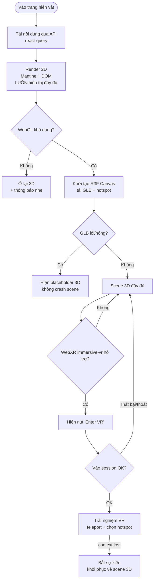

# 03 — Kiến trúc Frontend (React + Vite + Mantine v7)

## 3.1 Triết lý

Hai ứng dụng trong **một codebase** (monorepo FE, chia bằng route + layout):

- **Client (public):** trang chủ, collection 2D, chi tiết hiện vật, tour 3D/XR, audio, báo cáo.
- **Admin CMS:** dashboard, rooms, exhibits/revision, media, moderation, reports, audit, users/roles/permissions.

Nền tảng **progressive enhancement**: lớp 2D (Mantine + DOM) luôn chạy; 3D (R3F) và XR (WebXR) là
lớp phủ thêm, hỏng/không hỗ trợ thì **thoái lui êm** về 2D mà không mất nội dung.

**Chuẩn hóa từ bản Angular tham khảo sang Mantine + React:** ý tưởng `core/material/*-custom` (bộ
input/select/date/number/table/file dùng chung) và `services/common` được **viết lại** thành component
Mantine + hook React, không bê theme Metronic cũ.

## 3.2 Cấu trúc thư mục đích

```
front-end/src/
├── main.tsx · App.tsx · AppProviders.tsx
├── app/
│   ├── router.tsx                 # react-router: public routes + /admin routes (lazy)
│   ├── theme.ts                   # Mantine theme (token màu, sáng/tối, font)
│   └── providers/                 # MantineProvider, QueryClient, Auth, Notifications, Modals
│
├── core/                          # hạ tầng FE dùng chung (không nghiệp vụ)
│   ├── api/
│   │   ├── http-client.ts         # axios instance: baseURL, interceptor gắn token, refresh 401
│   │   ├── api-response.ts        # type ApiResponse<T> (khớp BE)
│   │   └── query-client.ts        # @tanstack/react-query config
│   ├── auth/
│   │   ├── auth.context.tsx       # user, token, login/logout
│   │   ├── use-auth.ts
│   │   ├── require-auth.tsx        # route guard (redirect /login)
│   │   └── require-permission.tsx  # ẩn/chặn theo permission (khớp RBAC BE)
│   └── config/env.ts              # đọc import.meta.env
│
├── shared/                        # BỘ UI DÙNG CHUNG — "custom component" chuẩn hóa trên Mantine
│   ├── components/
│   │   ├── form/                  # FormTextField, FormSelect, FormNumber, FormDate,
│   │   │                          # FormTextarea, FormFileUpload, FormSwitch  (bọc @mantine/form)
│   │   ├── data/                  # DataTable (mantine-react-table), Pagination, EmptyState, StatCard
│   │   ├── feedback/              # ConfirmModal, Toast helper, LoadingOverlay, ErrorBoundary
│   │   ├── layout/                # PageHeader, Section, Toolbar, SplitPane
│   │   └── a11y/                  # VisuallyHidden, SkipLink, FocusTrap wrapper
│   ├── hooks/                     # useDisclosure wrappers, useDebounce, usePagination, useMediaQuery
│   └── utils/                     # format (date/number), converts, validators (zod), constants
│
├── services/                      # GỌI API theo domain (thin, trả type đã map)
│   ├── auth.service.ts  users.service.ts  roles.service.ts  permissions.service.ts
│   ├── rooms.service.ts exhibits.service.ts media.service.ts
│   ├── moderation.service.ts reports.service.ts audit.service.ts
│   └── public-museum.service.ts   # nội dung published cho client
│
├── features/                      # mỗi nghiệp vụ: hook + component riêng của nó
│   ├── admin/
│   │   ├── dashboard/  users/  roles/  permissions/
│   │   ├── rooms/  exhibits/  media/  moderation/  reports/  audit/
│   ├── client/
│   │   ├── home/  collection/  exhibit-detail/  report-modal/
│   │   └── audio-player/
│   └── scene/                     # 3D/XR
│       ├── Canvas3D.tsx  Room3D.tsx  ExhibitModel.tsx  Hotspot.tsx
│       ├── controls/ (DesktopControls, TouchControls, XRControls)
│       ├── xr/ (XRSession, XRFallback)
│       └── fallback/ (WebGLGuard, ModelPlaceholder)
│
├── layouts/
│   ├── PublicLayout.tsx            # header/footer client
│   └── AdminLayout.tsx             # sidebar + topbar CMS (Mantine AppShell)
│
└── pages/                         # lắp feature vào route (mỏng)
    ├── client/ (HomePage, CollectionPage, ExhibitDetailPage, TourPage)
    └── admin/  (LoginPage, DashboardPage, UsersPage, RolesPage, PermissionsPage,
                 RoomsPage, ExhibitsPage, MediaPage, ModerationPage, ReportsPage, AuditPage)
```

### Ánh xạ component Angular → Mantine (chuẩn hóa)

| Angular `core/material/*-custom` | Bản React + Mantine (`shared/components`) |
|---|---|
| `input-custom`, `number-custom` | `FormTextField`, `FormNumber` (bọc `TextInput`/`NumberInput` + `@mantine/form`) |
| `select-custom`, `ng-select-custom`, `select-multiple-custom` | `FormSelect`, `FormMultiSelect` (`Select`/`MultiSelect`) |
| `date-custom` | `FormDate` (`@mantine/dates` DatePickerInput) |
| `checkbox-custom`, `radio-custom` | `FormSwitch`/`FormCheckbox`, `FormRadioGroup` |
| `file-custom` | `FormFileUpload` (`@mantine/dropzone` + validate MIME/size) |
| `grid-custom`, `*-table` | `DataTable` (mantine-react-table: sort/filter/paginate/row-action) |
| `ckeditor/quill-custom` | `RichTextEditor` (`@mantine/tiptap`) — dùng cho mô tả hiện vật |
| `tree-row-custom` | `PermissionTree` (Mantine `Tree`/custom) cho ma trận quyền |

## 3.3 Ba tầng render & progressive fallback



**Quy tắc vàng:** mọi dữ liệu hiện vật (tên, mô tả, transcript, audio) phải đọc & hiển thị được ở
tầng 2D trước. 3D/XR chỉ *thêm* trải nghiệm, không *giữ* nội dung.

## 3.4 Quản lý state

| Loại state | Công cụ |
|---|---|
| Server state (dữ liệu API) | **@tanstack/react-query** — cache, retry, invalidate sau mutation |
| Auth/session | `AuthContext` + token lưu memory (refresh qua httpOnly cookie hoặc storage có cân nhắc XSS) |
| Form | **@mantine/form** + schema **zod** |
| UI cục bộ (modal/tab/filter) | `useState`/`@mantine/hooks` `useDisclosure` |
| Scene 3D | state cục bộ trong `features/scene` (zustand nếu cần chia sẻ camera/selection) |

## 3.5 HTTP client & gắn RBAC vào UI

- `http-client.ts`: gắn `Authorization: Bearer`, tự refresh khi 401, unwrap `ApiResponse` → trả `data`,
  ném lỗi chuẩn hóa để react-query/Toast xử lý.
- `RequirePermission`: ẩn nút/route khi user thiếu quyền — **khớp đúng** `@Permissions` của BE
  (UI chỉ để trải nghiệm; chặn thật nằm ở BE guard).

## 3.6 Accessibility (WCAG 2.2 AA) — nền sẵn trong `shared`

- Điều hướng 100% bàn phím (Tab/Enter/Space/Esc), `SkipLink`, focus trap cho mọi modal (Mantine `Modal`
  có sẵn, bổ sung test).
- `VisuallyHidden`, nhãn ARIA cho control, tương phản màu đạt AA (định nghĩa trong `theme.ts`).
- Audio player: phím tắt play/pause/seek, transcript đồng bộ, dừng audio khi đổi hiện vật/đóng popup.
- Kiểm thử NVDA/VoiceOver + Playwright a11y (task phase 2).
