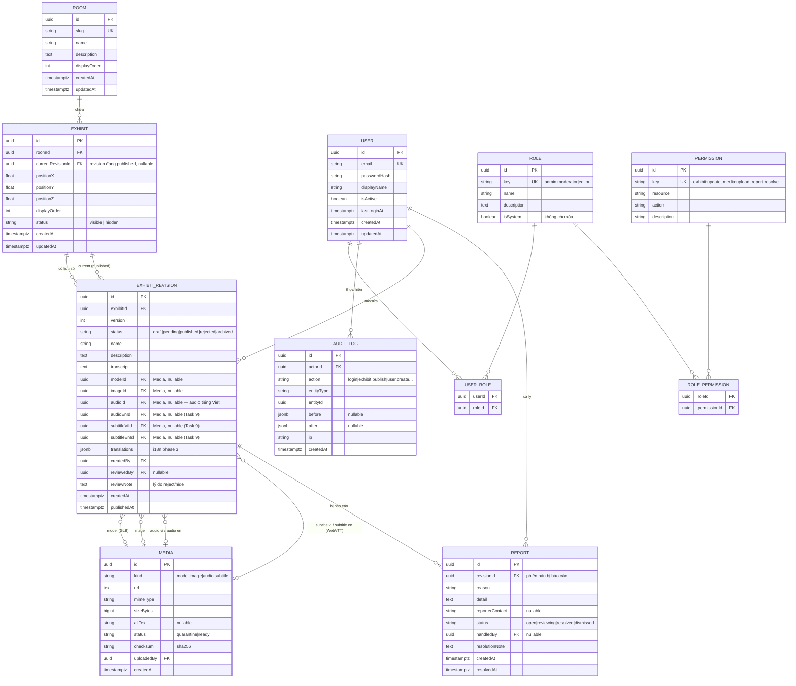
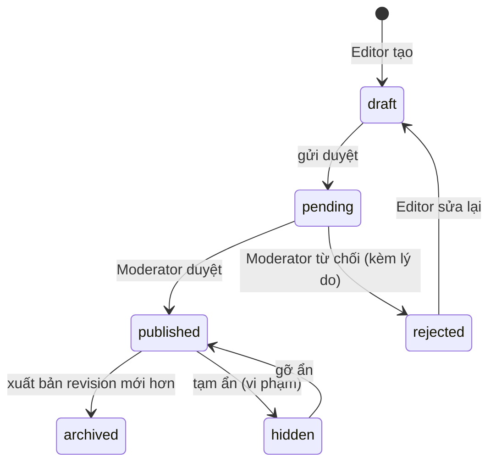

# 04 — Mô hình dữ liệu & ERD

> Đề xuất schema cho MVP + chỗ mở rộng phase 2/3. Người phụ trách DB (Thắng) chốt bản cuối;
> tài liệu này là điểm khởi đầu đã khớp với base code hiện có (`Room`, `Exhibit`, `Media`).

## 4.1 Nguyên tắc

- **Tách identity ↔ content qua Revision:** `Exhibit` giữ vị trí/thứ tự ổn định; nội dung (tên, mô tả,
  transcript, media) nằm trong `ExhibitRevision` có trạng thái `draft → pending → published → archived`.
  `Exhibit.currentRevisionId` trỏ bản **đang xuất bản** → API public chỉ đọc bản này.
- **Draft không lọt public:** query public luôn join theo `currentRevisionId` (published).
- **Audit append-only:** `AuditLog` chỉ insert, không update/delete.
- **UUID** khóa chính; `createdAt/updatedAt` mọi bảng; JSONB cho metadata/translations mở rộng.

## 4.2 ERD

## 4.3 Bảng mở rộng (phase 3 — để trước chỗ, chưa làm MVP)

| Bảng | Mục đích |
|---|---|
| `API_KEY` | key đối tác: `hashedKey`, `scopes[]`, `rateLimit`, `revokedAt` |
| `TRANSLATION` | bản dịch hiện vật (en/zh/ko/ja) — hoặc dùng cột `translations` JSONB trong revision |
| `ANALYTICS_EVENT` | sự kiện truy cập để báo cáo + scheduled cleanup |

## 4.4 Trạng thái Revision (state machine)

## 4.5 Khác biệt với base hiện tại (cần migrate)

| Hiện tại | Đề xuất | Lý do |
|---|---|---|
| `Exhibit` chứa thẳng name/description/transcript/media | tách sang `ExhibitRevision` | cần lịch sử phiên bản + draft/published |
| chưa có | `User/Role/Permission/UserRole/RolePermission` | RBAC phân hệ quản trị |
| chưa có | `Report`, `AuditLog` | báo cáo vi phạm + nhật ký |
| `Media` tối giản | thêm `sizeBytes/status/checksum/uploadedBy` | upload pipeline + quarantine |

> Migration & seed 5 hiện vật mẫu: `database/migrations`, `database/seeds` (task #1 của Thắng).
