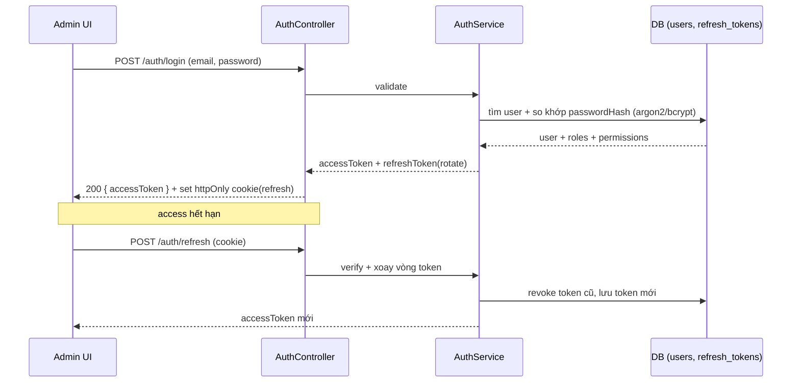
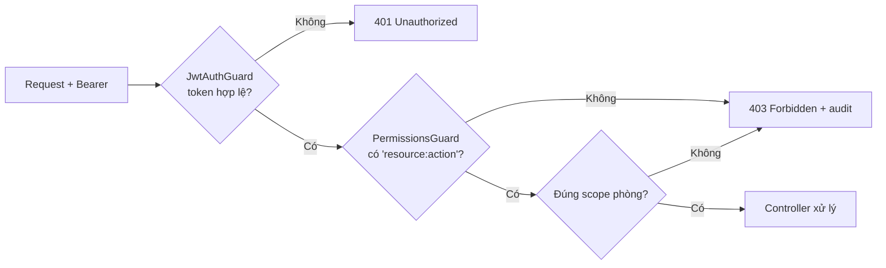

# 05 — Bảo mật & RBAC

## 5.1 Xác thực (Authentication) — JWT access + refresh

- **Access token** (JWT, ngắn hạn ~15 phút): mang `sub` (userId), `roles`, `permissions`.
- **Refresh token** (dài hạn ~7 ngày, lưu DB có thể thu hồi): xoay vòng (rotation) mỗi lần refresh,
  phát hiện token cũ bị tái dùng → thu hồi cả chuỗi. Lưu qua **httpOnly cookie** (hoặc store có phòng XSS).
- Endpoint: `POST /auth/login`, `POST /auth/refresh`, `POST /auth/logout`, `GET /auth/me`.
- Nhiều tab refresh đồng thời: khóa mềm (single-flight) ở FE `http-client` để tránh đăng xuất nhầm.



## 5.2 Phân quyền (Authorization) — RBAC theo action + scope

**Permission = `resource:action`.** Role gom nhiều permission. User gán nhiều role.
Guard đọc `@Permissions(...)` trên route và đối chiếu với quyền của user (và scope phòng nếu có).

```ts
@Post(':id/publish')
@Permissions('revision:publish')
publish(@Param('id') id: string, @CurrentUser() user: AuthUser) { ... }
```

### Danh mục role mặc định

| Role | Quyền chính |
|---|---|
| **admin** | toàn quyền: `user:*`, `role:*`, `permission:*`, `audit:read`, + mọi quyền của moderator |
| **moderator** | `revision:read/publish/reject/hide`, `report:read/resolve`, `room:read`, `exhibit:read` |
| **editor** | `room:*`, `exhibit:create/update`, `revision:create/submit`, `media:upload/attach` |

### Ma trận phân quyền (trích)

| Permission \ Role | admin | moderator | editor |
|---|:---:|:---:|:---:|
| `user:create` / `user:update` / `role:assign` | ✅ | ❌ | ❌ |
| `permission:read` | ✅ | ✅ | ❌ |
| `room:create` / `room:update` / `room:delete` | ✅ | ❌ | ✅ |
| `exhibit:create` / `exhibit:update` | ✅ | ❌ | ✅ |
| `revision:submit` | ✅ | ❌ | ✅ |
| `revision:publish` / `revision:reject` / `revision:hide` | ✅ | ✅ | ❌ |
| `media:upload` / `media:attach` | ✅ | ❌ | ✅ |
| `report:read` / `report:resolve` | ✅ | ✅ | ❌ |
| `audit:read` | ✅ | ✅(ro) | ❌ |

> UI dùng `RequirePermission` để ẩn nút; **BE guard mới là chốt chặn thật** (UI chỉ hỗ trợ UX).

## 5.3 Luồng kiểm quyền trên 1 endpoint

Thiếu quyền RBAC được biểu diễn bằng `PermissionDeniedException`. Filter toàn cục ghi
`access.denied` vào `audit_logs` với actor, request ID và JSON trong `reason` gồm method,
route pattern, quyền yêu cầu/quyền thiếu. `resourceType=access`; `resourceId` là UUID của
sự kiện, không đại diện một bản ghi nội dung. Không lưu token/cookie/body/query.
Nếu ghi audit thất bại, ghi cảnh báo theo request ID và vẫn trả 403. Lỗi 401 hoặc
403 do Origin của refresh/logout không thuộc loại sự kiện này.



## 5.4 Bảo mật upload (media pipeline)

| Rủi ro | Biện pháp |
|---|---|
| MIME giả mạo | kiểm **magic bytes** thực tế, không tin `Content-Type` |
| SVG XSS | **cấm SVG** cho media hiện vật, hoặc sanitize; ưu tiên PNG/JPEG/WebP |
| GLB chứa script độc | parse/validate cấu trúc GLB, giới hạn kích thước, tải trong sandbox FE |
| File quá lớn | giới hạn: GLB 20MB, ảnh 5MB, audio 20MB |
| Lọt file độc | **quarantine** → chỉ `ready` mới được gắn/hiển thị |

## 5.5 Bảo mật chung

- Mật khẩu: hash **argon2id** (hoặc bcrypt), không log plaintext.
- Rate limit: login, refresh, report (chống brute-force/spam) — `@nestjs/throttler`.
- CORS giới hạn `FRONTEND_ORIGIN`; Helmet headers.
- Validate mọi input bằng `class-validator`; chống SQLi nhờ TypeORM parameterized.
- Secret qua env, không commit `.env` (đã trong `.gitignore`).
- Audit append-only cho mọi hành động admin nhạy cảm.
