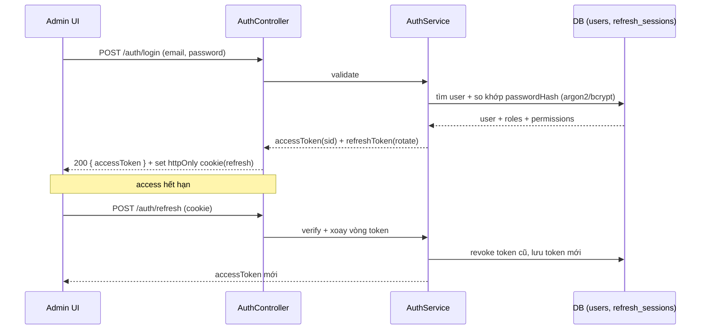
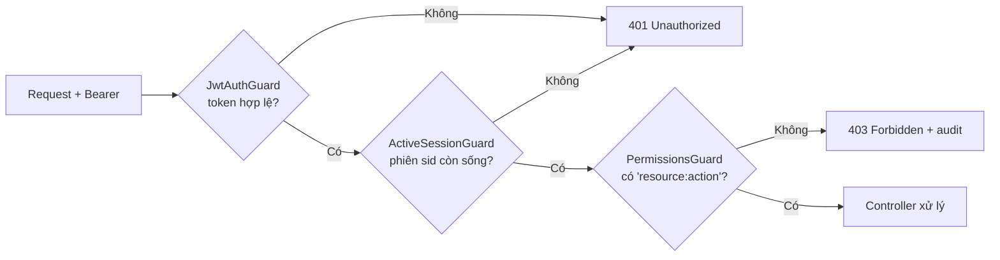

# 05 — Bảo mật & RBAC

## 5.1 Xác thực (Authentication) — JWT access + refresh

- **Access token** (JWT, ngắn hạn ~15 phút): mang `sub` (userId), `roles`, `permissions` và `sid`
  (id **phiên** = `family_id` của refresh token đã phát hành nó).
- **Refresh token** (dài hạn ~7 ngày, bảng `refresh_sessions`, chỉ lưu SHA-256): xoay vòng mỗi lần refresh,
  phát hiện token cũ bị tái dùng → thu hồi cả chuỗi (family). Lưu qua **httpOnly cookie** `SameSite=Lax`.
- **Phiên (session) = một family** = một thiết bị/trình duyệt. Một tài khoản đăng nhập được nhiều thiết bị.
- Endpoint: `POST /auth/login`, `POST /auth/refresh`, `POST /auth/logout`, `GET /auth/me`,
  `POST /auth/change-password`, `GET /auth/sessions`, `DELETE /auth/sessions/:id`,
  `POST /auth/sessions/revoke-others`, `POST /auth/logout-all` (chi tiết: [06 — API](06-api-contract.md)).
- Nhiều tab refresh đồng thời: khóa mềm (single-flight) ở FE `http-client` để tránh đăng xuất nhầm.



### 5.1.1 Thu hồi phiên có hiệu lực ngay — `ActiveSessionGuard`

Access JWT không tra DB, nên nếu chỉ thu hồi refresh token thì thiết bị cũ vẫn dùng được tới hết TTL.
`ActiveSessionGuard` (APP_GUARD, chạy sau `JwtAuthGuard`) kiểm family `sid` còn token chưa thu hồi và chưa hết hạn
(1 truy vấn `EXISTS` theo index partial `IDX_refresh_sessions_family_live`). Hết sống hoặc token không có `sid` → **401**;
FE thử refresh, thất bại thì về trang đăng nhập.

Các sự kiện thu hồi **mọi phiên** của một tài khoản (trong cùng transaction, khóa advisory theo user để token đang
xoay vòng song song cũng bị thu hồi):

| Sự kiện | Phiên bị thu hồi |
|---|---|
| Admin đặt lại mật khẩu / khóa / xóa (mềm) tài khoản | tất cả |
| Người dùng tự đổi mật khẩu | tất cả **trừ** phiên hiện tại |
| "Đăng xuất các thiết bị khác" | tất cả trừ phiên hiện tại |
| "Đăng xuất tất cả" | tất cả |
| Đăng xuất / đăng xuất 1 thiết bị | family đó |

Đăng nhập phát hành refresh dưới khóa user (shared) và đọc lại user: nếu Admin vừa đổi mật khẩu/khóa trong lúc so
bcrypt thì không cấp phiên bằng mật khẩu cũ.

### 5.1.2 Chống dò mật khẩu (NFR-57)

`AuthRateLimiter` (cửa sổ trượt trong bộ nhớ, module auth) → **429** + `Retry-After`:

| Endpoint | Giới hạn | Mục đích |
|---|---|---|
| `POST /auth/login` | **20 request/phút/IP** + **5 lần sai/15 phút/email** (tính cả sai mật khẩu hiện tại khi tự đổi mật khẩu) | chống dò mật khẩu |
| `POST /auth/refresh` (mọi request) | **300/phút/IP** (`REFRESH_RATE_LIMIT_PER_IP`) | trần chống flood, kiểm trước khi chạm DB |
| `POST /auth/refresh` có cookie khớp phiên | **30/phút/phiên** (`REFRESH_RATE_LIMIT_PER_SESSION`) | đếm theo family refresh token |
| `POST /auth/refresh` không có / sai cookie | **20/phút/IP** (`REFRESH_RATE_LIMIT_INVALID_PER_IP`) | chống dò refresh token |

Refresh **tách khỏi login** (issue #126): front-end giữ access token trong bộ nhớ nên mỗi lần tải lại trang tốn một
refresh; nếu chung bộ đếm IP với login, nhân viên ngồi chung IP văn phòng sẽ bị văng phiên. Bị chặn ghi audit
`auth.login_blocked` / `auth.refresh_blocked` một lần mỗi cửa sổ cho mỗi khóa.
Front-end (issue #128) chỉ kết thúc phiên khi refresh trả **401**; 429 / 5xx / mất mạng giữ phiên (refresh cookie còn) —
đang dùng thì request báo lỗi và lần sau refresh lại; khi tải lại trang thì hiện "Chưa khôi phục được phiên" kèm số giây
chờ (`Retry-After`, đã mở qua CORS `exposedHeaders`) và nút Thử lại / Đăng nhập lại.
Một instance là đủ; scale ngang cần store dùng chung (Redis). Sau reverse proxy phải đặt `TRUST_PROXY` (mục 5.5).

### 5.1.3 API key cho đối tác (cổng `/partner/v1`)

Đối tác không đăng nhập; họ gọi `/api/partner/v1/*` kèm header `X-API-Key`. Route đối tác là `@Public()` (bỏ qua
guard JWT của admin), chốt chặn là `PartnerApiKeyGuard`, chạy theo thứ tự:

1. **Xác thực:** băm SHA-256 khóa (`ak_live_…`) rồi tra `key_hash`; chỉ nhận key `active`, chưa xóa, chưa hết hạn → sai/thu hồi/hết hạn/xóa: **401** (hiệu lực ngay).
2. **Rate limit theo key:** `rate_limit_per_minute` (mặc định 60, 1–10000), cửa sổ trượt trong bộ nhớ → **429** + `Retry-After`; mọi response có `X-RateLimit-Limit`, `X-RateLimit-Remaining`.
3. **Scope của route** (`@PartnerScope`): thiếu → **403**. `public:read` bao trùm `rooms:read`, `exhibits:read`, `media:read`, `tour:embed` (không gồm `analytics:read`).
4. Cập nhật `last_used_at` (tối đa mỗi phút một lần/key).

Khóa thô chỉ hiện một lần khi tạo; DB chỉ lưu hash. Quản lý key (tạo/thu hồi/xóa mềm) cần `apikey:read`/`apikey:manage`.
Một instance là đủ cho bộ đếm; scale ngang cần store dùng chung (Redis).

## 5.2 Phân quyền (Authorization) — RBAC theo action

**Permission = `resource:action`.** Role gom nhiều permission. User gán nhiều role.
Guard đọc `@Permissions(...)` trên route và đối chiếu với quyền của user.

> **Không có phân quyền theo phòng (scope phòng).** `requirements.md` chỉ yêu cầu RBAC theo permission (FR-99, NFR-55);
> mọi permission áp dụng cho **tất cả** phòng — vd Editor có `exhibit:update` sửa được hiện vật ở mọi phòng.
> Giới hạn quyền theo từng phòng nằm ngoài phạm vi MVP.

```ts
@Post(':id/publish')
@Permissions('revision:publish')
publish(@Param('id') id: string, @CurrentUser() user: AuthUser) { ... }
```

### Danh mục role mặc định

Role là **xóa mềm** (`is_deleted`). Không xóa được vai trò `admin` và vai trò đang gán cho tài khoản chưa xóa;
editor/moderator chỉ là vai trò có sẵn, xóa được khi không ai dùng. Mã vai trò chỉ duy nhất trong các vai trò chưa xóa.
Vai trò đã xóa **không cấp quyền nào** (kể cả qua liên kết cũ của tài khoản đã xóa); khôi phục tài khoản bỏ các liên kết đó,
khôi phục vai trò bị chặn khi mã đã thuộc vai trò khác.
Tài khoản có vai trò `admin` không xóa được (phải bỏ vai trò trước); không khóa/bỏ vai trò Admin hoạt động cuối cùng.

| Role | Quyền chính |
|---|---|
| **admin** | toàn quyền: `user:*`, `role:*`, `permission:*`, `audit:read`, + mọi quyền của moderator |
| **moderator** | `revision:read/publish/reject/hide`, `report:read/resolve`, `room:read`, `exhibit:read` |
| **editor** | `room:*`, `exhibit:create/update`, `revision:create/submit`, `media:upload/attach` |

### Ma trận phân quyền (trích)

| Permission \ Role | admin | moderator | editor |
|---|:---:|:---:|:---:|
| `user:create` / `user:update` / `role:assign` | ✅ | ❌ | ❌ |
| `permission:read` | ✅ | ✅ | ❌ |
| `room:create` / `room:update` / `room:delete` | ✅ | ❌ | ✅ |
| `exhibit:create` / `exhibit:update` | ✅ | ❌ | ✅ |
| `revision:submit` | ✅ | ❌ | ✅ |
| `revision:publish` / `revision:reject` / `revision:hide` | ✅ | ✅ | ❌ |
| `media:upload` / `media:attach` | ✅ | ❌ | ✅ |
| `report:read` / `report:resolve` | ✅ | ✅ | ❌ |
| `audit:read` | ✅ | ✅(ro) | ❌ |

> UI dùng `RequirePermission` để ẩn nút; **BE guard mới là chốt chặn thật** (UI chỉ hỗ trợ UX).

## 5.3 Luồng kiểm quyền trên 1 endpoint

Thiếu quyền RBAC được biểu diễn bằng `PermissionDeniedException`. Filter toàn cục ghi
`access.denied` vào `audit_logs` với actor, request ID và JSON trong `reason` gồm method,
route pattern, quyền yêu cầu/quyền thiếu. `resourceType=access`; `resourceId` là UUID của
sự kiện, không đại diện một bản ghi nội dung. Không lưu token/cookie/body/query.
Nếu ghi audit thất bại, ghi cảnh báo theo request ID và vẫn trả 403. Lỗi 401 hoặc
403 do Origin của refresh/logout không thuộc loại sự kiện này.

Thứ tự `APP_GUARD`: **JwtAuthGuard → ActiveSessionGuard → PermissionsGuard** (route `@Public()` bỏ qua cả ba).



## 5.4 Bảo mật upload (media pipeline)

| Rủi ro | Biện pháp |
|---|---|
| MIME giả mạo | kiểm **magic bytes** thực tế, không tin `Content-Type` |
| SVG XSS | **cấm SVG** cho media hiện vật, hoặc sanitize; ưu tiên PNG/JPEG/WebP |
| GLB chứa script độc | parse/validate cấu trúc GLB, giới hạn kích thước, tải trong sandbox FE |
| File quá lớn | giới hạn: GLB 20MB, ảnh 5MB, audio 20MB |
| Lọt file độc | **quarantine** → chỉ `ready` mới được gắn/hiển thị |

## 5.5 Bảo mật chung

- Mật khẩu: hash **argon2id** (hoặc bcrypt), không log plaintext.
- Rate limit: login/refresh/đổi mật khẩu qua `AuthRateLimiter` (mục 5.1.2); báo cáo public qua `@nestjs/throttler` (5 lần/phút).
- CORS giới hạn `FRONTEND_ORIGIN`; Helmet headers.
- Validate mọi input bằng `class-validator`; chống SQLi nhờ TypeORM parameterized.
- Secret qua env, không commit `.env` (đã trong `.gitignore`). Khi `NODE_ENV=production`, `validateEnvironment`
  **từ chối khởi động** nếu `JWT_ACCESS_SECRET` hoặc `MEDIA_URL_SIGNING_SECRET` không được đặt (rơi về khóa dev trong
  mã nguồn), trùng khóa mẫu của `.env.example` hoặc ngắn hơn 32 ký tự; lỗi chỉ nêu tên biến, không in giá trị.
- **IP client sau reverse proxy** (`TRUST_PROXY`, áp bằng `app.set('trust proxy', …)` trong `main.ts`): mặc định `false`
  → `req.ip` là IP kết nối trực tiếp. Sau proxy phải đặt **số hop** (vd `1`) hoặc danh sách IP/subnet của proxy
  (`loopback`, `10.0.0.0/8`) để rate limit đăng nhập, phiên và audit thấy IP thật thay vì IP proxy (không thì mọi người
  dùng chung một bộ đếm 20 request/phút). Không đặt `true`/số hop khi API nhận request trực tiếp: client tự giả được
  `X-Forwarded-For`.
- Audit append-only cho mọi hành động admin nhạy cảm.
