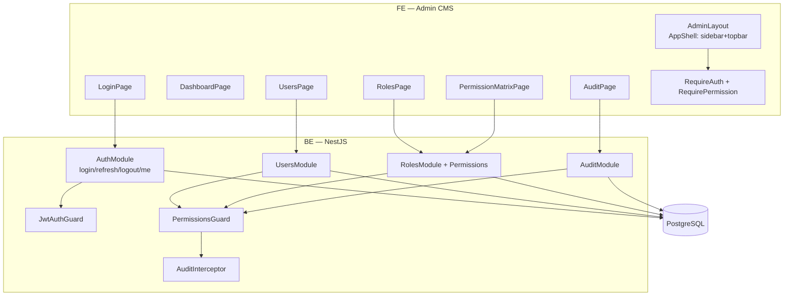
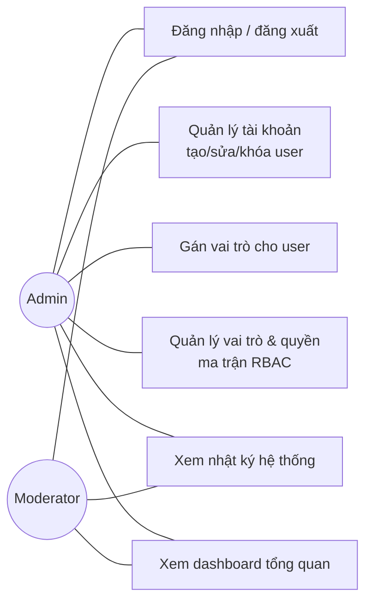
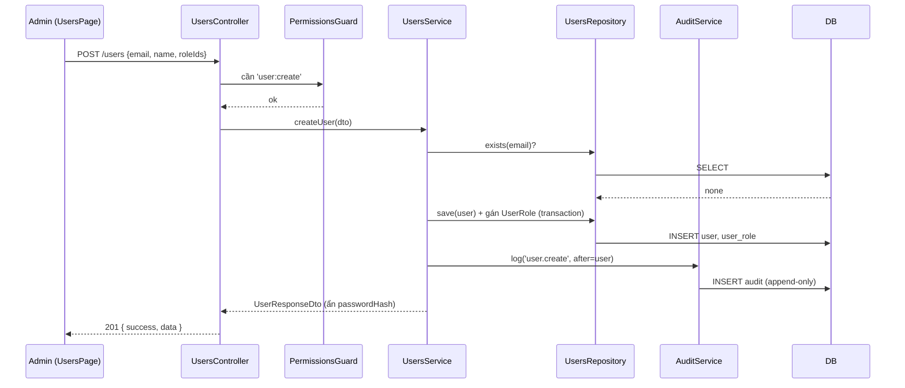

# 07 — Phân hệ Quản trị hệ thống (dựng trước)

> Đây là phần nhóm **dựng khung trước tiên**. Bao gồm xác thực, quản lý người dùng, vai trò,
> phân quyền (RBAC) và nhật ký hệ thống — nền tảng cho mọi module CMS khác.

## 7.1 Phạm vi

| Module BE | Màn hình CMS (FE) | Người phụ trách (theo plan) |
|---|---|---|
| `auth` | `LoginPage`, `ChangePasswordPage`, `SessionsPage` | Thắng (task #2) |
| `users` | `UsersPage` (accounts.html) | Thắng (task #3) |
| `roles` + `permissions` | `RolesPage`, `PermissionsPage`, `PermissionMatrixPage` | Thắng (task #4) |
| RBAC guard | (áp cho toàn bộ Admin API) | Thắng (task #5) |
| `audit` | `AuditPage` (audit.html) | Quang (task #24) |
| `dashboard` | `DashboardPage` (admin.html) | Quang (task #21) |

## 7.2 Sơ đồ thành phần phân hệ quản trị

## 7.3 Use-case phân hệ quản trị

## 7.4 Luồng tạo user & gán role (sequence)

## 7.5 Màn hình & component (FE, dùng `shared`)

| Màn hình | Thành phần chính |
|---|---|
| **LoginPage** | `FormTextField` (email), password, `Button`; xử lý 401; focus-trap; a11y |
| **DashboardPage** | `StatCard` ×4 (phòng, hiện vật, báo cáo mở, chờ duyệt), `@mantine/charts`, trạng thái hệ thống |
| **UsersPage** | `DataTable` (list user, trạng thái, role) có chọn nhiều + `BulkActionBar` xóa hàng loạt (tài khoản Admin không chọn được), `ConfirmModal` khóa/xóa, drawer tạo/sửa + `FormSelect` role |
| **RolesPage** | `DataTable` role + mô tả có chọn nhiều + xóa hàng loạt (vai trò Admin không chọn được), tạo/sửa role |
| **ChangePasswordPage** (`/admin/change-password`) | menu tài khoản → Đổi mật khẩu; form mật khẩu hiện tại / mới / nhập lại |
| **SessionsPage** (`/admin/sessions`) | menu tài khoản → Phiên đăng nhập; `DataTable` thiết bị (User-Agent, IP, đăng nhập lúc, hoạt động gần nhất, "Thiết bị này"); đăng xuất từng thiết bị / các thiết bị khác / tất cả |
| **PermissionMatrixPage** | `PermissionTree`/bảng checkbox role×permission, lưu `PUT /roles/:id/permissions` |
| **AuditPage** | `DataTable` nhật ký + filter (actor/action/khoảng thời gian), xem chi tiết before/after |

## 7.6 AuditInterceptor (ghi vết tự động)

- Bọc các route ghi/sửa của admin; sau khi service thành công → tạo `AuditLog`
  (`actorId`, `action`, `entityType`, `entityId`, `before/after`, `ip`).
- Append-only: chỉ INSERT. Không cho sửa/xóa bản ghi audit.
- Các hành động nhạy cảm cũng ghi khi **thất bại quyền** (403) để truy vết truy cập trái phép.

## 7.7 Thứ tự dựng khung (gợi ý trong 1–2 PR đầu)

1. BE `core` (BaseRepository, ApiResponse, filter, interceptor, guards) + `common` (enums, dto).
2. Entities + migration: `User, Role, Permission, UserRole, RolePermission, AuditLog`.
3. `AuthModule` (login/refresh/me) + `JwtAuthGuard` + seed admin đầu tiên.
4. `UsersModule`, `RolesModule` (+ permissions), `AuditModule` + `PermissionsGuard` + `AuditInterceptor`.
5. FE: `core/api`, `core/auth`, `shared/components` (form + DataTable), `AdminLayout`,
   `LoginPage`, `DashboardPage`, `UsersPage`, `RolesPage`, `PermissionMatrixPage`, `AuditPage`.

> Khung skeleton (code mẫu biên dịch được) sẽ nằm trong các PR tiếp theo, mỗi PR một mảng rõ ràng.
