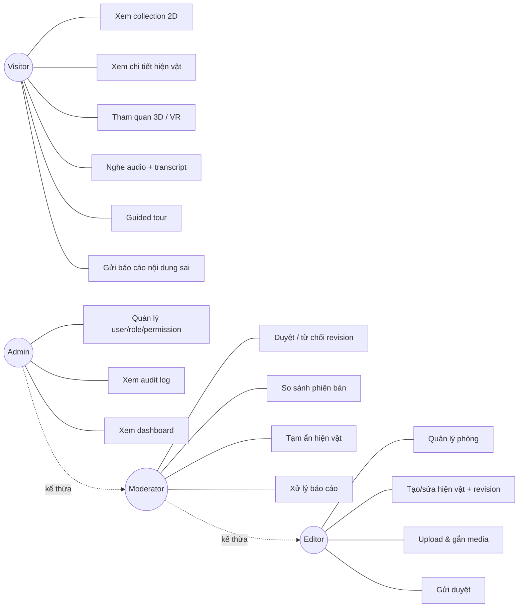
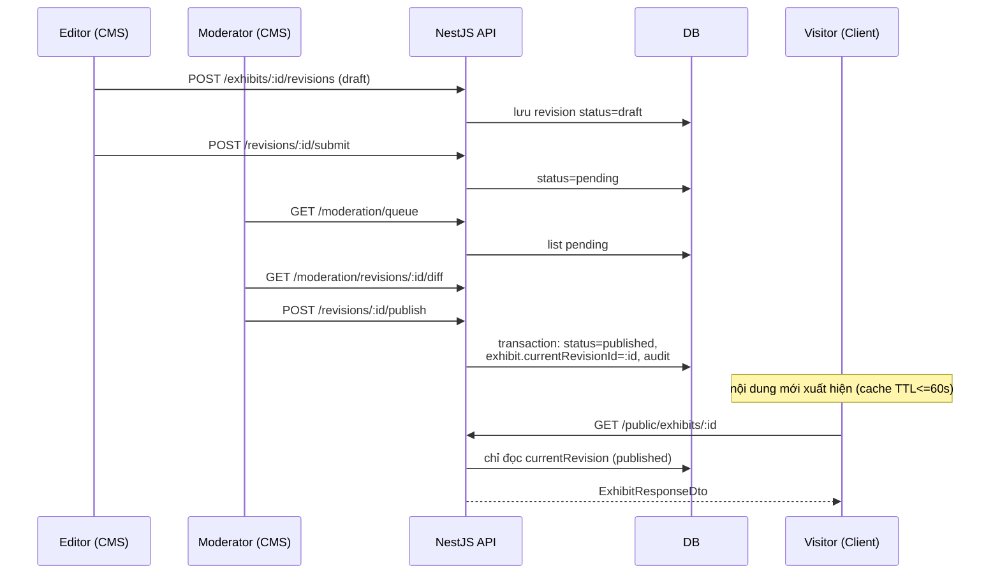
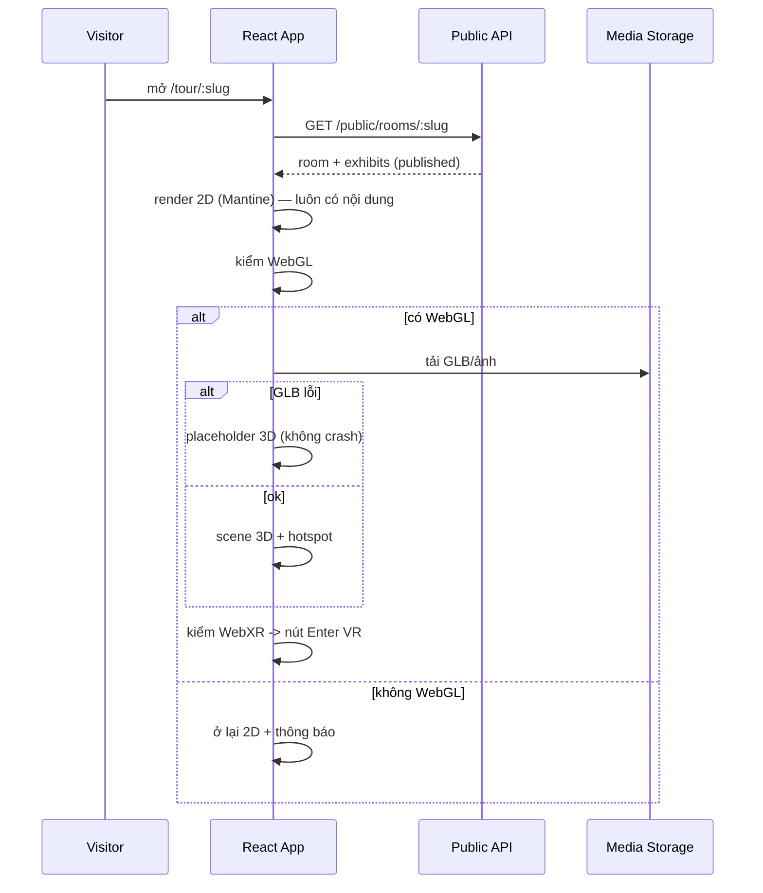
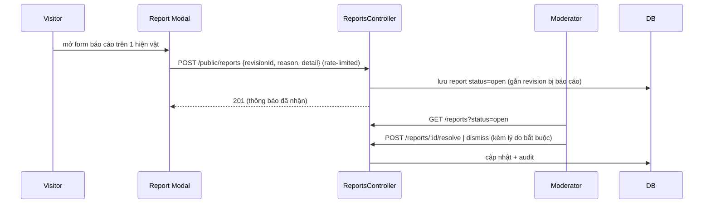
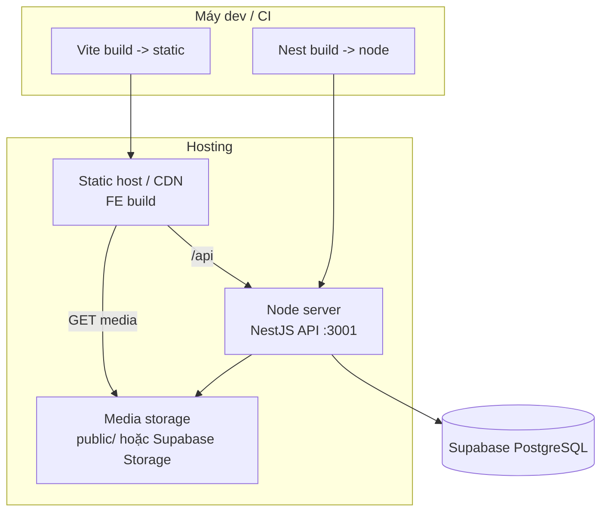

# 08 — Use-case tổng thể & các sơ đồ chính

## 8.1 Use-case toàn hệ thống

## 8.2 Luồng xuất bản nội dung (Editor → Moderator → Client)

## 8.3 Luồng client đọc nội dung + fallback render

## 8.4 Luồng gửi & xử lý báo cáo vi phạm

## 8.5 Sơ đồ triển khai (deployment, MVP)

> Các sequence/flow phân hệ quản trị chi tiết: xem [07-admin-subsystem.md](07-admin-subsystem.md).
