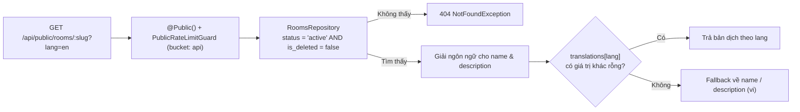

# 06 — Module Phòng trưng bày (`modules/rooms/`)

> Mã nguồn: `back-end/src/modules/rooms/` (`admin-rooms.controller.ts`, `public-rooms.controller.ts`, `room.entity.ts`, `rooms.repository.ts`, `rooms.service.ts`).

`RoomsModule` quản lý không gian trưng bày cấp cao nhất của bảo tàng — mỗi phòng chứa nhiều hiện vật (`Exhibit`) và có slug duy nhất phục vụ URL tham quan (`/tour.html?room=<slug>` hoặc app mobile `/room/<slug>`).

## 1. Entity `Room` (`rooms`)

| Cột | Kiểu | Ràng buộc & Ghi chú |
|---|---|---|
| `id` | `uuid` | Khóa chính |
| `slug` | `varchar(120)` | Unique — định danh URL công khai |
| `name` | `varchar(200)` | Tên phòng tiếng Việt (ngôn ngữ gốc) |
| `description` | `text` (nullable) | Mô tả phòng tiếng Việt |
| `translations` | `jsonb` (`default {}`) | Bản dịch `{ name?: Partial<Record<SupportedLocale, string>>, description?: ... }` |
| `status` | `varchar(12)` | `active` \| `archived` (`CHK_rooms_status`) |
| `is_deleted` / `deleted_at` | `boolean` / `timestamptz` | Khớp ràng buộc `CHK_rooms_deleted`: `is_deleted = (deleted_at IS NOT NULL)` |

## 2. Danh mục Endpoint

### Admin CRUD (`AdminRoomsController` — `/api/admin/rooms`)
| Method & Route | Quyền | `@Audit` | Mô tả |
|---|---|---|---|
| `GET /api/admin/rooms` | `room:read` | — | Danh sách phòng phân trang, lọc trạng thái/thùng rác (`DeletedFilterDto`) |
| `GET /api/admin/rooms/:id` | `room:read` | — | Chi tiết 1 phòng theo UUID |
| `POST /api/admin/rooms` | `room:create` | `room.create` | Tạo phòng mới (kiểm trùng `slug`) |
| `PATCH /api/admin/rooms/:id` | `room:update` | `room.update` | Cập nhật tên, mô tả, bản dịch, slug hoặc trạng thái `active`/`archived` |
| `DELETE /api/admin/rooms/:id` | `room:delete` | `room.delete` | Xóa mềm 1 phòng |
| `POST /api/admin/rooms/bulk-delete` | `room:delete` | `room.delete` | Xóa mềm hàng loạt trong transaction |
| `POST /api/admin/rooms/bulk-restore` | `room:delete` | `room.restore` | Khôi phục hàng loạt phòng từ thùng rác |

### Public Read-only (`PublicRoomsController` — `/api/public/rooms`)
| Method & Route | Guard | Mô tả |
|---|---|---|
| `GET /api/public/rooms?lang=...` | `@Public()`, `PublicRateLimitGuard` | Danh sách phòng `status = active` & `is_deleted = false` kèm text đã giải ngôn ngữ |
| `GET /api/public/rooms/:slug?lang=...` | `@Public()`, `PublicRateLimitGuard` | Chi tiết phòng công khai theo `slug` (trả `404` nếu `archived` hoặc đã xóa) |

*(Lưu ý: API lấy phòng **kèm danh sách hiện vật đã xuất bản** cho Web/Mobile Tour nằm ở `GET /api/rooms` và `GET /api/rooms/:slug` trong `ExhibitsController` — xem tài liệu 07.)*

## 3. Bản dịch đa ngôn ngữ JSONB và Luật xóa mềm

- **Cấu trúc `RoomTranslations` (Migration #13 `1793900000000-AddRoomTranslations`)**:
  - Tiếng Việt (`vi`) luôn lưu trực tiếp ở hai cột gốc `name` và `description`.
  - Các ngôn ngữ bổ sung (`en`, `fr`, `zh`, `ko`, `ja` theo `SUPPORTED_LOCALES`) lưu trong cột JSONB `translations`.
  - Khi client gọi endpoint công khai với `?lang=en` (hoặc ngôn ngữ khác), `RoomsService.getPublicList` / `getPublicBySlug` tự động chọn bản dịch tương ứng; nếu chuỗi trống hoặc chưa có bản dịch thì **tự động rơi về tiếng Việt (`vi`)** để không bao giờ hiển thị tiêu đề rỗng.
- **Bảo vệ toàn vẹn khi xóa (`remove` / `removeMany`)**:
  - Trước khi xóa mềm, repository kiểm tra xem phòng còn chứa hiện vật hoạt động hay không; nếu bị ràng buộc sẽ ném `DeletionBlockedException` (`409`) kèm danh sách lý do thay vì để lại hiện vật mồ côi.
  - `removeMany` và `restoreMany` thực thi trong `TransactionManager` để bảo đảm tính toàn vẹn nguyên tử.

## 4. Luồng xử lý đa ngôn ngữ khi truy vấn phòng công khai

