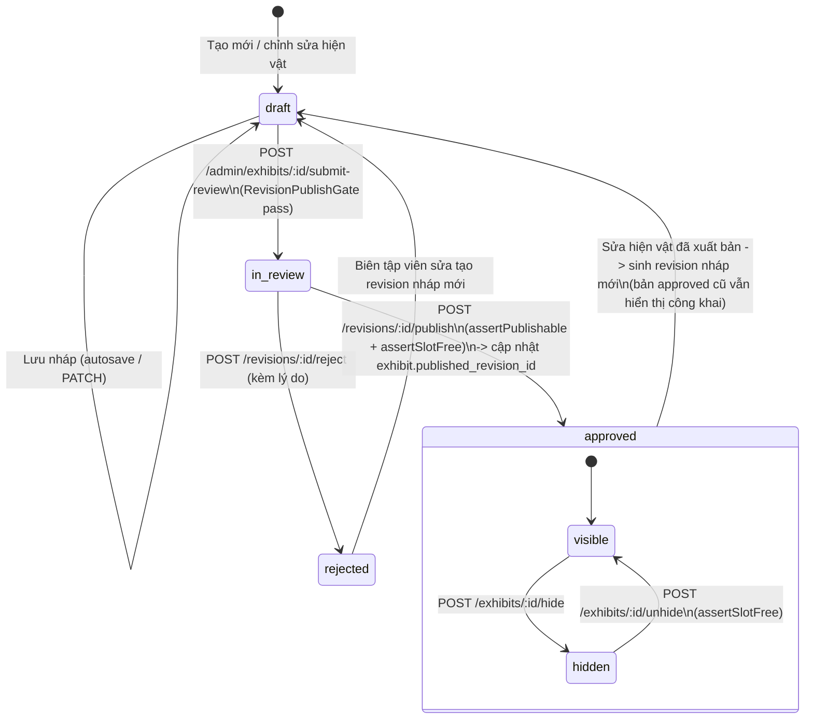

# 07 — Hiện vật, Phiên bản (Revision), Hotspot và Bục trưng bày (`modules/exhibits/`)

> Mã nguồn: `back-end/src/modules/exhibits/` (`controllers/`, `entities/`, `services/`, `repositories/`, `constants/`, `dto/`, `utils/`).

`ExhibitsModule` là trung tâm quản lý nội dung hiện vật 3D của bảo tàng, tách biệt hoàn toàn giữa **bản nháp đang biên tập (`draft` / `in_review`)** và **bản đã xuất bản (`published_revision_id`)** hiển thị cho khách.

## 1. Ba Entity chính

- **`Exhibit` (`exhibits`)**: thuộc một `Room` (`room_id`), mang `display_order` (thứ tự tour), `visibility` (`visible` | `hidden`), `published_revision_id` (con trỏ tới revision đang công khai), `is_deleted` / `deleted_at`. Index `(room_id, display_order, id)` bảo đảm thứ tự tìm kiếm và phân trang ổn định.
- **`ExhibitRevision` (`exhibit_revisions`)**: lưu từng phiên bản (`revision_no >= 1`, unique theo `(exhibit_id, revision_no)`), `state` (`draft` | `in_review` | `approved` | `rejected`), nội dung JSONB `content` (`name`, `description`, `position {x,y,z}`, `transcript`, `placeholderShape`, `placeholderColor`, cùng nhánh đa ngôn ngữ), 6 khóa ngoại media (có 6 partial index phục vụ BR-21 và kiểm quyền phân phối file), `created_by`, `reviewed_by`, `review_note`.
- **`Hotspot` (`hotspots`)**: gắn với một `ExhibitRevision`, lưu tọa độ 3D (`position_x`, `position_y`, `position_z`), nhãn/nội dung thuyết minh và `display_order`.

## 2. Năm Controller (Public & Admin)

| Controller | Prefix & Route chính | Quyền / Guard | Ghi chú |
|---|---|---|---|
| `ExhibitsController` | `GET /api/rooms`, `GET /api/rooms/search`, `GET /api/rooms/:slug`, `GET /api/rooms/:slug/exhibits/:exhibitId/model` | `@Public()`, `PublicRateLimitGuard` (`media` cho route `/model`) | `search` phải khai báo **trước** `:slug`. Header `Cache-Control: no-cache` để Publish/Hide có hiệu lực ngay; `/model` stream GLB `model/gltf-binary` với `AbortController` hủy đọc Storage khi client ngắt. |
| `PublicExhibitsController` | `GET /api/public/exhibits/:id/location` | `@Public()`, `PublicRateLimitGuard` | Tra cứu phòng chứa hiện vật cho liên kết QR `/e/<id>`; trả `404` nếu chưa công khai |
| `PublicSitemapController` | `GET /api/public/sitemap.xml` | `@Public()`, `PublicRateLimitGuard` | Trả `StreamableFile` `application/xml; charset=utf-8`, `Cache-Control: public, max-age=3600` |
| `AdminExhibitsController` | `/api/admin/exhibits` (`GET`, `GET :id`, `GET :id/preview`, `GET :id/revisions`, `GET :id/revisions/:revId`, `POST`, `PATCH :id`, `POST :id/submit-review`, `DELETE :id`, `DELETE :id/revisions/:revId`, `POST bulk-delete`, `POST bulk-restore`, `PUT rooms/:roomId/reorder`) | `exhibit:read/create/update`, `revision:submit` | Mọi thao tác ghi gắn `@Audit(...)`; preview tạo URL media đã ký HMAC |
| `AdminExhibitTransferController` | `GET /api/admin/exhibits/export`, `POST /api/admin/exhibits/import` | `exhibit:read`, `exhibit:create` (`@Audit('exhibit.import')`) | Xuất/nhập hàng loạt hiện vật dạng bảng |

## 3. Gallery Template V1 — 5 Bục trưng bày cố định (`constants/gallery-slots.ts`)

| Slot ID | Nhãn | Tọa độ `(x, y, z)` (mét) |
|---|---|---|
| `S01` | Bục 01 – Trung tâm | `(0, 0, -2)` |
| `S02` | Bục 02 – Trái sau | `(-4.3, 0, -4.2)` |
| `S03` | Bục 03 – Phải sau | `(4.3, 0, -4.2)` |
| `S04` | Bục 04 – Trái trước | `(-4.3, 0, 2.1)` |
| `S05` | Bục 05 – Phải trước | `(4.3, 0, 2.1)` |

Hàm `matchGallerySlot(position)` so khớp trong sai số `GALLERY_SLOT_TOLERANCE = 0.05m` (đồng bộ 1:1 với `front-end/src/helpers/gallerySlots.ts` và `mobile/`). Tọa độ tự do không khớp bục nào (phòng legacy) trả `null` và không bị ràng buộc đụng bục.

## 4. Sáu slot media cục bộ hóa & Cổng xuất bản `RevisionPublishGate`

### 4.1 Nguồn sự thật 6 slot media (`constants/revision-media-slots.ts`)
| Key | Cột DB | Trường DTO | `MediaKind` | Locale |
|---|---|---|---|---|
| `model` | `model_media_id` | `modelId` | `model` | — |
| `image` | `image_media_id` | `imageId` | `image` | — |
| `audioVi` | `audio_media_id` | `audioViId` | `audio` | `vi` |
| `audioEn` | `audio_en_media_id` | `audioEnId` | `audio` | `en` |
| `subtitleVi` | `subtitle_vi_media_id` | `subtitleViId` | `subtitle` | `vi` |
| `subtitleEn` | `subtitle_en_media_id` | `subtitleEnId` | `subtitle` | `en` |

### 4.2 Luật kiểm định của `RevisionPublishGate`
Được dùng chung bởi cả `ExhibitsService` (khi `submit-review`) và `ModerationService` (khi `publish` / `unhide`), luôn chạy **bên trong transaction**:
1. **Khóa media `FOR SHARE` (`MediaReferenceValidator.lockAndCheck`)**: ngăn media bị xóa trong lúc đang gửi duyệt/xuất bản; kiểm tra tồn tại (`media_not_found`), trạng thái sẵn sàng (`media_not_ready`) và đúng `MediaKind` (`media_kind_mismatch`).
2. **Kiểm tra nội dung & trợ năng (§5.2 SRS)**:
   - Nội dung tiếng Việt/Anh bắt buộc đầy đủ theo quy định; các ngôn ngữ tùy chọn (`fr`, `zh`, `ko`, `ja`) không bắt buộc.
   - Ảnh phải có alt text (`image_alt_text_missing`), audio phải kèm transcript và phụ đề WebVTT tương ứng (`audio_transcript_missing`, `audio_subtitle_missing`, `subtitle_without_audio`), media phải khai báo quyền sử dụng (`media_rights_missing`).
   - Mọi vi phạm gom trả về `422 DomainValidationException` với mảng `{ field, code, message }[]`.
3. **Chống trùng bục (`assertSlotFree`)**: khóa các vị trí công khai hiện tại của phòng (`lockPublicPlacements`); nếu 2 hiện vật công khai cùng rơi vào 1 slot `S01..S05`, ném `422` mã `gallery_slot_occupied`.

## 5. Sắp xếp tour, lưu nháp tự động và Import/Export

- **Sắp xếp thứ tự tour (`PUT /api/admin/exhibits/rooms/:roomId/reorder`)**: cập nhật `display_order` theo phạm vi phòng, kiểm tra toàn bộ ID thuộc đúng `roomId`.
- **Lưu nháp tự động (Draft Autosave — VT-079)**: `PATCH /api/admin/exhibits/:id` cho phép lưu bản nháp khi chỉ cần kiểm tham chiếu media tồn tại/đúng loại, chưa ép đủ điều kiện xuất bản §5.2; xử lý tránh ghi đè dữ liệu cũ bằng kiểm tra phiên bản.
- **Bulk Transfer (`ExhibitTransferService`)**: hỗ trợ xuất/nhập hàng loạt theo danh mục cột cố định (`exhibit-transfer.columns.ts`), chống CSV injection và xác thực từng dòng trước khi ghi.
- **Tìm kiếm công khai**: chi tiết thuật toán lọc và thứ tự cố định `roomId, displayOrder, id` xem tại [public-exhibit-search.md](public-exhibit-search.md).

## 6. Máy trạng thái vòng đời `ExhibitRevision`

