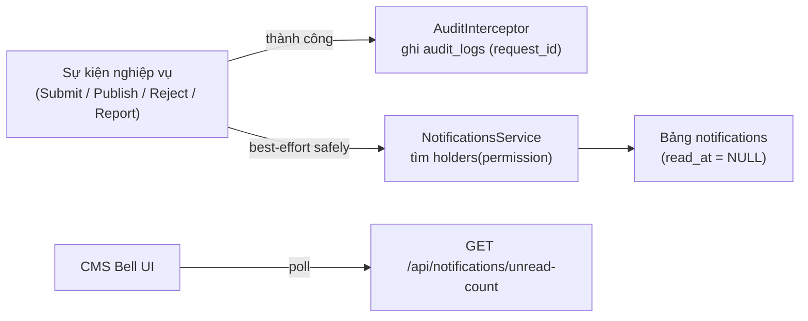

# 10 — Nhật ký Hệ thống (Audit) và Thông báo CMS (`modules/audit/`, `modules/notifications/`)

> Mã nguồn: `back-end/src/modules/audit/` và `back-end/src/modules/notifications/`.

## 1. Module Nhật ký Hệ thống (`AuditModule`)

`AuditModule` cung cấp cơ chế ghi vết **append-only** (không sửa/xóa bản ghi nhật ký) bằng 3 con đường kết hợp:

1. **Tự động qua `@Audit(action, resourceType)` + `AuditInterceptor` (đăng ký `APP_INTERCEPTOR`)**:
   - Chỉ kích hoạt trên route gắn metadata `@Audit(...)`, chạy sau khi handler thành công.
   - Tự tách một hoặc nhiều `resourceId` (hỗ trợ cả thao tác đơn lẻ lẫn `bulk-delete`/`bulk-restore` trả về `{ ids: [...] }`).
   - Với `resourceType === 'revision'`, tự điền thêm khóa ngoại `revision_id` để truy vết chéo.
2. **Ghi vết từ chối truy cập qua `PermissionDeniedFilter`**:
   - Đăng ký ở cuối chuỗi `useGlobalFilters` trong `main.ts` nên bắt mọi `PermissionDeniedException` (`403`) kể cả route chỉ đọc không có `@Audit`.
   - Ghi sự kiện `action = 'access.denied'`, `resource_type = 'access'`, `reason` là JSON gồm status, method, route pattern, quyền yêu cầu và quyền thiếu; không bao giờ lưu token, cookie, body hay query string. Nếu ghi DB thất bại vẫn trả `403` và log cảnh báo kèm `request_id`.
3. **Ghi trực tiếp qua `AuditService.record()` / `recordSafely()`**:
   - Dùng cho các sự kiện đặc thù không qua decorator như đăng nhập/đăng xuất, phát hiện reuse refresh token, hay cron dọn media (`media.purge` với `actor_id = null`).

### Entity `AuditLog` (`audit_logs`) & Endpoint (`AuditController` — `/api/audit`)
- **Cột chính**: `actor_id` (UUID, nullable), `action` (`varchar(100)`), `resource_type` (`varchar(40)`), `resource_id` (UUID, nullable), `revision_id` (UUID, nullable), `reason` (`text`), `request_id` (`varchar(100)` khớp `X-Request-Id`), `ip` (`varchar(64)`), `user_agent` (`varchar(512)`), `created_at`. Index `IDX_audit_logs_resource_time`.
- **Endpoint** (đều yêu cầu quyền `audit:read`):
  - `GET /api/audit`: lọc theo `actorId`, `action`, `resourceType`, `resourceId`, khoảng thời gian và phân trang.
  - `GET /api/audit/export`: xuất tệp CSV (`audit-csv.util.ts` + `csv.util.ts` chống formula injection), trả kèm header `Content-Disposition` (đã mở trong CORS `exposedHeaders`).
  - `GET /api/audit/:id`: chi tiết 1 dòng nhật ký.

## 2. Module Thông báo trong CMS (`NotificationsModule`)

Phục vụ biểu tượng chuông thông báo theo từng tài khoản đăng nhập (không cần quyền RBAC riêng — chỉ cần JWT + phiên sống vì mọi truy vấn đều lọc cứng theo `userId = currentUser.id`).

### Entity `Notification` (`notifications`)
- Cột: `user_id` (`ON DELETE CASCADE`), `type` (`NotificationType`), `title` (`varchar(200)`), `body` (`text`, nullable), `link` (`varchar(300)`, đường dẫn điều hướng trong CMS), `read_at` (`timestamptz`, nullable), `created_at`.
- Index tối ưu cho hộp thư và badge số chưa đọc: `IDX_notifications_user_created (user_id, created_at)` và partial index `IDX_notifications_user_unread (user_id) WHERE read_at IS NULL`.

### 5 Loại sự kiện (`NotificationType`) & Cơ chế phát an toàn
| `NotificationType` | Nguồn phát | Người nhận |
|---|---|---|
| `revision.submitted` | Editor gửi duyệt hiện vật | Tài khoản active có quyền duyệt (`revision:publish`) |
| `revision.approved` | Moderator xuất bản revision | Biên tập viên tạo revision |
| `revision.rejected` | Moderator từ chối revision | Biên tập viên tạo revision |
| `report.created` | Khách gửi báo cáo vi phạm mới | Tài khoản active có quyền `report:resolve` |
| `report.assigned` | Phân công xử lý báo cáo | Người được phân công (`assignedTo`) |

Mọi lệnh phát thông báo đi qua hàm `safely()` trong `NotificationsService`: lỗi tạo thông báo chỉ ghi log cảnh báo, **không bao giờ làm rollback hay thất bại luồng nghiệp vụ chính** (như gửi duyệt hoặc gửi báo cáo công khai).

### Endpoint (`NotificationsController` — `/api/notifications`)
- `GET /api/notifications`: danh sách thông báo phân trang của chính người dùng.
- `GET /api/notifications/unread-count`: trả `{ count }` cho badge chuông.
- `POST /api/notifications/read-all`: đánh dấu toàn bộ đã đọc, trả `{ updated }`.
- `PATCH /api/notifications/:id/read`: đánh dấu 1 thông báo đã đọc (`404` nếu không thuộc về mình).
- `DELETE /api/notifications/:id`: xóa 1 thông báo thuộc về mình.

