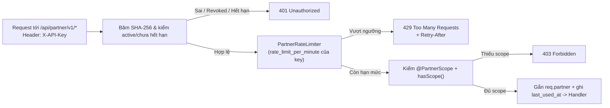

# 11 — Đa ngôn ngữ (CMS i18n) và Cổng API Đối tác (`modules/translations/`, `modules/partner-api-keys/`)

> Mã nguồn: `back-end/src/modules/translations/` và `back-end/src/modules/partner-api-keys/`.

## 1. Module Bản dịch Đa ngôn ngữ (`TranslationsModule`)

Quản lý toàn bộ chuỗi giao diện đa ngôn ngữ cho trang khách và CMS, đồng bộ 6 mã ngôn ngữ với front-end (`translations/constants/locales.ts`):

- **`SUPPORTED_LOCALES`**: `vi` (ngôn ngữ gốc), `en`, `fr`, `zh`, `ko`, `ja`.
- **`OPTIONAL_CONTENT_LOCALES`**: `fr`, `zh`, `ko`, `ja` (khi xuất bản hiện vật, thiếu các ngôn ngữ này sẽ tự động fallback về `vi`).
- **`sanitizeValues()`**: lọc map JSONB từ client để chỉ giữ các khóa nằm trong `SUPPORTED_LOCALES`, ép kiểu chuỗi và `trim()` khoảng trắng thừa trước khi lưu DB.

### Entity `Translation` (`translations`) & Endpoint
- Bảng `translations` lưu khóa chuỗi (`key` duy nhất, có phân nhóm namespace) cùng cột JSONB `values` chứa bản dịch theo từng locale.
- **Public (`PublicTranslationsController`)**:
  - `GET /api/public/translations` (`@Public()`, `PublicRateLimitGuard`): trả từ điển chuỗi giao diện công khai cho Web/Mobile visitor.
- **Admin (`TranslationsController` — `/api/translations`)**:
  - `GET /api/translations` (`translation:read`): liệt kê, tìm kiếm và lọc chuỗi dịch.
  - `POST /api/translations`, `PATCH /api/translations/:id`, `DELETE /api/translations/:id` (`translation:manage`, gắn `@Audit(...)`): tạo, sửa hoặc xóa bản dịch từ giao diện CMS i18n.

## 2. Module API Key & Cổng Đối tác (`PartnerApiKeysModule`)

Cho phép đối tác tích hợp đọc dữ liệu bảo tàng đã xuất bản qua một cổng riêng `/api/partner/v1/*` mà không dùng JWT admin.

### Entity `PartnerApiKey` (`partner_api_keys`)
- Lưu `partner_name`, `description`, `scopes` (JSONB mảng string), `status` (`active` / `revoked`), `key_prefix` (hiển thị định danh), **`key_hash`** (`char(64)` SHA-256 unique — không bao giờ lưu plaintext key), `last4` / `env`, `expires_at`, `last_used_at`, `revoked_at`, `rate_limit_per_minute` (mặc định `60`), `is_deleted`, `deleted_at`.

### Phạm vi quyền (`constants/scopes.ts`)
6 scope hợp lệ: `public:read`, `exhibits:read`, `rooms:read`, `media:read`, `tour:embed`, `analytics:read`.
- Hàm `hasScope()` quy ước **`public:read` bao trùm** 4 scope đọc nội dung (`rooms:read`, `exhibits:read`, `media:read`, `tour:embed`), nhưng **không** bao gồm `analytics:read`.

### Endpoint Quản trị & Cổng Đối tác
| Controller | Method & Route | Guard / Scope / Quyền | Mô tả |
|---|---|---|---|
| `PartnerApiKeysController` | `GET /api/partner-api-keys` | `apikey:read` | Danh sách API key (chỉ hiển thị prefix, không lộ key gốc) |
| `PartnerApiKeysController` | `POST /api/partner-api-keys` | `apikey:manage`, `@Audit('apikey.create')` | Cấp key mới (trả plaintext **duy nhất 1 lần** khi tạo) |
| `PartnerApiKeysController` | `POST /api/partner-api-keys/:id/revoke` | `apikey:manage`, `@Audit('apikey.revoke')` | Thu hồi ngay lập tức API key |
| `PartnerApiKeysController` | `DELETE /api/partner-api-keys/:id` | `apikey:manage`, `@Audit('apikey.delete')` | Xóa mềm API key |
| `PartnerApiController` | `GET /api/partner/v1/rooms` | `@Public()`, `PartnerApiKeyGuard` (`rooms:read`) | Danh sách phòng công khai |
| `PartnerApiController` | `GET /api/partner/v1/rooms/:slug` | `@Public()`, `PartnerApiKeyGuard` (`rooms:read`) | Chi tiết phòng & hiện vật đã xuất bản |
| `PartnerApiController` | `GET /api/partner/v1/rooms/:slug/tour` | `@Public()`, `PartnerApiKeyGuard` (`tour:embed`) | Danh sách điểm dừng tour theo `displayOrder` |
| `PartnerApiController` | `GET /api/partner/v1/rooms/:slug/exhibits/:exhibitId/model` | `@Public()`, `PartnerApiKeyGuard` (`media:read`) | Stream GLB `model/gltf-binary` với `AbortController` hủy đọc Storage khi đối tác ngắt kết nối |

### Thứ tự kiểm tra trong `PartnerApiKeyGuard`

