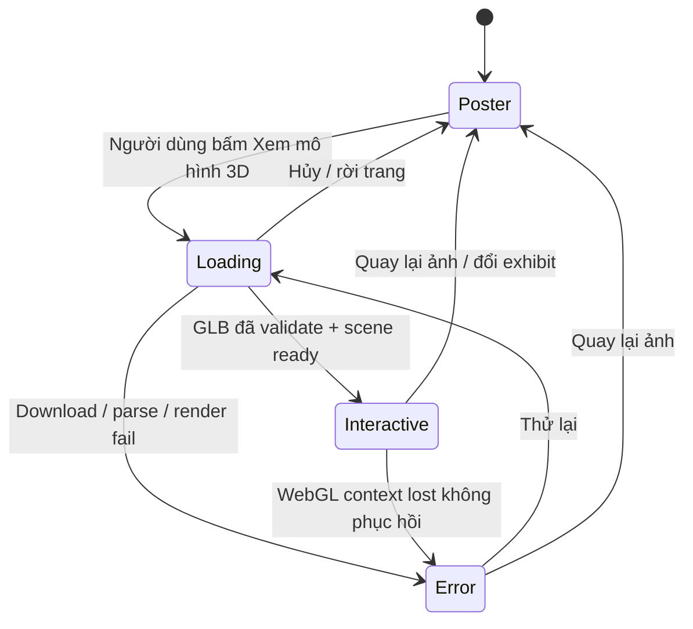
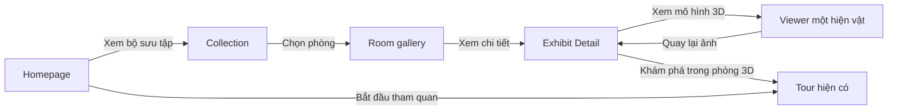

# AURA MUSEUM — PUBLIC PORTAL DESIGN SPECIFICATION

**Đặc tả thiết kế giao diện và trải nghiệm người dùng: Homepage · Collection · Exhibit Detail**

| Thuộc tính | Thông tin |
|---|---|
| Mã tài liệu | AURA-FE-SDD-PUBLIC-001 |
| Phiên bản | 1.0|
| Ngày | 13/11/2026 |
| Dự án | Aura Museum (ailabs26/ailabs-museum) |
| Loại tài liệu | Software Design Description (SDD) / UI–UX Detailed Design Specification |
| Phạm vi | Public Portal: `/`, `/collection`, `/collection/:roomSlug/exhibits/:exhibitId`; Public Shell dùng chung |
| Không thuộc phạm vi | Thiết kế lại kiến trúc phòng 3D `/tour`, Admin CMS, migration/database/API mới, kế hoạch triển khai và phân chia PR |
| Cơ sở source | Nhánh `dev`, commit `3af8fb73adef29a83462c13580cbc341ee4b1085` (kiểm tra ngày 13/11/2026) |
| Trạng thái | Đã duyệt |

> **Quy ước:** **MUST** = bắt buộc để nghiệm thu; **SHOULD** = mong muốn, có thể điều chỉnh theo kiểm thử; **MAY** = tùy chọn. Kích thước/giá trị mang tính thiết kế, không được hiểu là kết quả đo đạc thực tế. Các mockup ảnh là tham chiếu thị giác, không phải dữ liệu lịch sử đã xác thực.

---

## 1. Mục đích, bối cảnh và đối tượng

### 1.1. Mục đích

Tài liệu này là **nguồn thống nhất cho quyết định thiết kế** của ba trang public. Người thực hiện cần đọc được tài liệu để dựng giao diện cùng bố cục, ngôn ngữ thị giác, xử lý dữ liệu và hành vi mà không phải tự suy đoán. Tài liệu mô tả **kết quả cần đạt**, không chia nhân sự, task, nhánh hay PR.

### 1.2. Vấn đề hiện tại

- Homepage đang dùng hero trang trí Three.js, gradient/glow và bento grid thiên về giới thiệu tính năng. Thiết kế mới chuyển trọng tâm sang **hiện vật, câu chuyện và lời mời tham quan**.
- Collection đã có lọc theo phòng, tìm kiếm, yêu thích, so sánh và Tour 2D; cần tổ chức lại theo kiểu **catalogue triển lãm**, dễ quan sát và đọc lướt.
- Exhibit Detail đã có ảnh fallback, mô tả, audio, transcript, hotspot, ghi chú và Reading Mode; cần nâng cấp thành trang kể chuyện; thêm **viewer 3D tải theo yêu cầu** khi model hợp lệ.
- Cần dùng chung hệ màu/typography và hành vi responsive, không thay đổi cơ chế CMS hay phần 3D Tour hiện có.

### 1.3. Người dùng và kịch bản chính

| Nhóm | Nhu cầu | Hành động trọng tâm |
|---|---|---|
| Khách tham quan lần đầu | Hiểu bảo tàng có gì, biết bắt đầu từ đâu | Xem hero → chọn bộ sưu tập/3D |
| Người tìm hiểu di sản | Duyệt hiện vật theo phòng, tìm tên/từ khóa | Tìm/lọc → mở chi tiết |
| Người muốn quan sát kỹ | Xoay model GLB nếu có, xem hotspot | Chủ động bật viewer 3D → zoom/rotate |
| Người cần nội dung dễ tiếp cận | Đọc, nghe, điều hướng bàn phím, chuyển 2D | Dùng transcript, Reading Mode, fallback |
| Người quay lại | Tiếp tục xem, đánh dấu hoặc ghi chú | Favorites, Recently Viewed, Notes, 2D Guided Tour |

### 1.4. Mục tiêu và tiêu chí thành công

1. Giao diện ba trang có bản sắc thống nhất theo mock đã chọn; hiện vật nổi bật hơn yếu tố trang trí.
2. Hoàn thành luồng chính `Home → Collection → Detail → /tour` bằng dữ liệu xuất bản từ CMS.
3. Không tự tải model GLB/Three.js ở lần mở trang Detail nếu người dùng chưa yêu cầu.
4. Không mất tính năng public đã có: locale, favorite, compare, notes, report, reading, audio/transcript, Guided Tour 2D, 2D fallback.
5. Không làm thay đổi API, bản ghi CMS, chính sách xuất bản hoặc cấu trúc phòng 3D.

---

## 2. Phạm vi, nguyên tắc và tính tương thích

### 2.1. Trong phạm vi

- Public Shell: header, navigation, theme, language select, footer và giới hạn chiều rộng.
- Homepage: hero có ảnh hiện vật lớn, CTA, curated featured, phần dẫn vào trải nghiệm 3D/audio.
- Collection: banner, room selector, search, room feature, exhibit gallery, tương tác sẵn có.
- Exhibit Detail: hero media + thông tin, audio dock, story/transcript/hotspots, visitor actions và viewer GLB kích hoạt thủ công.
- State loading/empty/error, mobile/tablet/desktop, keyboard/a11y, bản dịch, media fallback, hiệu năng và kiểm thử.

### 2.2. Ngoài phạm vi

- Không tạo route `/about` hay `/gallery` mới chỉ để giống hình mock (chỉ hiển thị liên kết nếu route thực tồn tại).
- Không thiết lập taxonomy (`Đồ đồng`, `Đồ gốm`, `Điêu khắc`) khi CMS chưa có trường phân loại tương ứng.
- Không dựng lại phòng 3D, camera Guided Tour, WebXR hay collision.
- Không tạo/sửa API, schema DB, thao tác phê duyệt hay UI quản trị CMS. Có thể định nghĩa đề xuất metadata tương lai nhưng **không dùng nó trong V1**.
- Không suy diễn niên đại, chất liệu, bảo vật quốc gia, xuất xứ từ tên hiện vật; chỉ hiển thị nếu có dữ liệu công khai được kiểm duyệt.

### 2.3. Bất biến hệ thống

- `react-router-dom` giữ nguyên route thực: `/`, `/collection`, `/collection/:roomSlug/exhibits/:exhibitId`, `/tour`, `/e/:exhibitId` (shortlink).
- Data xuất bản lấy qua `museumService` và `useMuseumRooms`; `roomSchema` kiểm tra dữ liệu; không render DTO chưa xác thực.
- Chỉ phát media đã xuất bản, dùng đường dẫn media/API do backend trả về; giữ credit/license.
- Locale công khai qua `PublicLocaleProvider`; thiếu bản dịch hiển thị nội dung gốc và thông báo tương ứng.
- Admin CMS và theme/layout admin không bị ảnh hưởng bởi CSS/tokens mới của public.
- Thao tác 3D không tự động gọi `requestFullscreen`, mở VR/XR hay phát audio khi người dùng mới vào trang detail.

### 2.4. Tham chiếu hình ảnh đã duyệt

- **REF-HOME-01**: ảnh Homepage do người dùng xác nhận — thanh điều hướng ivory, hero nền charcoal có trống đồng lớn, tiêu đề serif bên trái, hàng hiện vật nổi bật và khối giới thiệu trải nghiệm 3D.
- **REF-COLL-01**: ảnh Collection do người dùng xác nhận — banner trống đồng, hàng filter/search, thẻ phòng nổi bật bên trái, grid hiện vật bên phải.
- **REF-DETAIL-01**: đặc tả trong tài liệu này; **kế thừa** REF-HOME-01 và REF-COLL-01, không tái sử dụng khối bento/glow cũ.

Các ảnh là **mood/composition reference**, không phải bản sao từng pixel. Nội dung trên ảnh (ví dụ các nhãn phân loại/niên đại hay phòng có tên bất kỳ) chỉ hiển thị khi dữ liệu hiện tại cung cấp; tránh hardcode văn bản/thông tin của mẫu vào UI thật.

---

## 3. Hiện trạng công nghệ và hợp đồng dữ liệu

### 3.1. Nền tảng đã có

| Thành phần | Công nghệ hoặc module hiện tại | Quy định thiết kế |
|---|---|---|
| Frontend | React 18, TypeScript, Vite 6, Mantine 7 | Tái sử dụng hiện có, không yêu cầu thay framework |
| Router | `front-end/src/app/router.tsx` | Không đổi route public |
| Design tokens | `front-end/src/styles/aura.css`, Mantine theme | Token mới có scope public, không làm đổi admin |
| API + cache | Axios client, TanStack Query, `museumService` | Không thêm fetch trùng lặp không cần thiết |
| i18n | `PublicLocaleProvider`, CMS UI translations, `localizeExhibit` | Không chèn text chưa đưa qua `t(key, fallback)` |
| Ảnh | `ExhibitImage` / `ExhibitPreview` | Ảnh đã xuất bản → fallback placeholder theo CMS |
| 3D | `@react-three/fiber` 8, `three` 0.170, GLB pipeline sẵn có | Chỉ lazy-load viewer riêng khi bấm |
| Audio | `AudioPlayer` | Giữ một nguồn đang phát, không autoplay |
| Visitor | Favorites, Recently Viewed, Compare, Notes, Reading Mode | Không mất hành vi/persistence hiện tại |
| E2E | Playwright + Vitest | Xác nhận các hành vi trước/sau redesign |

### 3.2. API hiện có được sử dụng

| Nguồn | Sử dụng | Ghi chú |
|---|---|---|
| `GET /rooms` | Danh sách phòng công khai | Chỉ phòng backend công bố |
| `GET /rooms/:slug` | Room detail + hiện vật | Tên, mô tả, `displayOrder`, ảnh, model, audio, hotspot |
| `GET /rooms/search?q=&page=&pageSize=` | Tìm hiện vật ở các phòng khác | Chỉ dữ liệu tóm tắt; khi mở chi tiết mới lấy room detail |
| `GET /public/translations?locale=` | Chuỗi UI ngôn ngữ public | Fallback chuỗi mặc định khi thiếu/lỗi |
| `GET /rooms/:slug/exhibits/:id/model?version=...` | Binary GLB của **một** hiện vật | URL đến từ `PublicModel`; dùng `museumService.getModelBinary` |

**Không có trong public DTO hiện được kiểm tra:** danh mục chất liệu/thời kỳ, nhãn “bảo vật”, ảnh gallery nhiều tệp, cờ `featured`, số liệu thành tích của bảo tàng. Vì vậy trong V1 không thiết kế UI bắt buộc những trường này.

### 3.3. Dữ liệu chính cần render

| Nội dung | Trường/nguồn | Fallback |
|---|---|---|
| Tên phòng | `RoomSummary.name`, `RoomDetail.name` | Không tạo phòng giả |
| Mô tả phòng | `description` | Ẩn đoạn mô tả khi `null` |
| Tên hiện vật | `exhibit.name`, bản dịch `i18n` | Tên gốc tiếng Việt |
| Mô tả hiện vật | `exhibit.description`, bản dịch `i18n` | “Chưa có mô tả” |
| Thứ tự | `displayOrder` | Giữ thứ tự đã xuất bản |
| Ảnh poster | `exhibit.image?.url` và alt localized | Placeholder `shape/color` hiện có |
| Model | `exhibit.model` (`url`, `sizeBytes`, `checksumSha256`) | Poster, không giả vờ có mô hình |
| Audio | `audio?.vi` hiện hữu | “Chưa có audio” nếu không có |
| Transcript | `localizedTranscript` | Ẩn khi không có |
| Hotspot | `hotspots` (label/body/order/position) | Ẩn section khi rỗng |
| Nguồn & bản quyền | `collectMediaCredits()` | Ẩn section nếu không có |

### 3.4. Quy tắc chọn hiện vật nổi bật trong V1

- Chỉ xét danh sách phòng/hiện vật xuất bản được xác minh từ API.
- Giữ logic baseline: phòng được chọn đầu tiên nếu không có lựa chọn; trong phòng đó chọn tối đa **3 hiện vật theo `displayOrder`**. Có thể thay bố cục card mà không đổi tiêu chí dữ liệu.
- Hero dùng hiện vật đầu tiên trong danh sách đã chọn **có ảnh hợp lệ**; nếu không có ảnh thì dùng artwork trung tính mang nhận diện Aura hoặc placeholder hiện có; **không trình bày một ảnh giả như ảnh lịch sử có thật**.
- Khi phòng không có hiện vật: dùng Hero branding trung tính, Featured hiển thị empty state; không hardcode số lượng phòng/hiện vật.
- Nếu sau này CMS có cờ `featured` và thứ tự curated, phải cập nhật đặc tả/hợp đồng trước khi đổi logic.

---

## 4. Hệ thống thiết kế trực quan (Visual Design System)

### 4.1. Ngôn ngữ thị giác

**Định vị:** “Contemporary Heritage Editorial” — thanh lịch, mang cảm giác catalogue triển lãm: **ảnh hiện vật lớn, serif có cá tính, nền giấy/đá ấm, màu xanh bảo tàng và bronze kiềm chế**. Trang thông tin phải dễ đọc hơn màn hình quảng cáo.

- **Chủ đạo:** bố cục dựa trên ảnh/hiện vật và khoảng trống, không dùng nhiều thẻ tính năng đồng kích thước.
- **Chuyển động:** tương tác tinh tế, không glow/pulse liên tục, không parallax làm khó đọc.
- **Bản sắc:** chữ serif cho tiêu đề nghệ thuật, sans cho chức năng; họa tiết trống đồng dùng như chi tiết nền, không che nội dung.
- **Tính xác thực:** không đưa dữ kiện lịch sử vào giao diện nếu backend không xác nhận.

### 4.2. Token màu (proposal; dùng token, không hardcode trực tiếp trong page)

| Token đề xuất | Hex | Vai trò |
|---|---|---|
| `--public-bg` | `#F5EFE5` | Nền trang ivory |
| `--public-paper` | `#FFF9F0` | Card/khối nội dung sáng |
| `--public-sand` | `#E9DDCD` | Vùng phụ, separator |
| `--public-ink` | `#1B2723` | Chữ chính |
| `--public-muted` | `#555A53` | Chữ phụ, metadata |
| `--public-forest` | `#064735` | CTA, link chính, active |
| `--public-forest-hover` | `#0B5D47` | Hover/active contrast |
| `--public-charcoal` | `#17221F` | Nền hero tối |
| `--public-bronze` | `#B28B56` | Trang trí, border nghệ thuật, đường dẫn thị giác |
| `--public-bronze-text` | `#73512D` | Chữ nhỏ liên quan bronze trên nền sáng (cần đo tương phản) |
| `--public-border` | `#D9CDBB` | Hairline/outline |
| `--public-focus` | `#174E96` | Focus ring dễ nhận biết, không phụ thuộc màu emerald |
| `--public-error` | `#A82F37` | Thông báo lỗi/khôi phục |

**Quy tắc bắt buộc:** Kiểm tra tương phản đo được trên cả hai theme; chữ thường ≥4.5:1, chữ lớn ≥3:1, thành phần đồ họa tương tác ≥3:1. Bronze nhạt chỉ dùng trang trí nếu không đạt contrast. CTA dark forest nền ivory, chữ trắng/ivory; không dùng chữ bronze nhạt trên nền sáng.

### 4.3. Dark theme

- Duy trì `ThemeToggle` đã có; không xóa dark mode vì mock chủ yếu dùng light.
- Light là biến thể ưu tiên để khớp concept. Dark: nền `#121C1A`, surface `#1B2824`, chữ `#F2E9DB`, muted `#D1C5B2`, accent bronze giảm độ sáng hợp lý.
- Hero charcoal có thể giữ ổn định giữa hai theme; trạng thái khác như search, modal, footer cần biến thể tối đồng nhất.
- Token public phải scope trong `.public-portal`/layout wrapper hoặc public theme layer để **không thay Admin CMS**.

### 4.4. Typography

| Cấp | Font đề xuất | Kích thước desktop | Mobile | Ghi chú |
|---|---|---|---|---|
| Display/H1 | `Noto Serif` (hoặc serif đã thử đủ dấu Việt) | 56–72 px | 36–44 px | Weight 600–700; line-height 1.1–1.18 |
| H2 | `Noto Serif` | 36–48 px | 28–34 px | Tương phản rõ với body |
| H3/card title | `Noto Serif` | 21–26 px | 20–23 px | Không ép uppercase tên hiện vật |
| Body | `Be Vietnam Pro` hoặc `Inter` | 16–17 px | 15–16 px | line-height 1.65–1.8 |
| UI/Navigation | Sans | 14–16 px | 14–16 px | Gọn, rõ, touch target đủ lớn |
| Metadata | Sans | 12–13 px | 12–13 px | Không chứa thông tin thiết yếu ở cỡ quá nhỏ |

- Font phải hỗ trợ đầy đủ tiếng Việt, tiếng Anh và các locale hiện hỗ trợ; dùng fallback có chiều cao chữ tương đương khi tải lỗi.
- Không áp dụng serif cho input, bảng trạng thái, error/label kỹ thuật hay đoạn văn quá dài.
- Chiều dài đoạn đọc lý tưởng khoảng 60–75 ký tự/line; không viết text lên ảnh nếu chưa đủ nền tương phản.

### 4.5. Grid, spacing, radius, media

| Thuộc tính | Giá trị thiết kế |
|---|---|
| Max container | 1360 px cho section editorial; nội dung đọc tối đa 760 px |
| Gutter desktop | 32–48 px (min 24 px) |
| Gutter tablet | 24 px |
| Gutter mobile | 16 px |
| Spacing scale | 4, 8, 12, 16, 24, 32, 48, 64, 96 px |
| Section spacing | Desktop 72–112 px; mobile 48–72 px |
| Card radius | 12–16 px, không bo tròn quá mức |
| Button radius | 8–10 px |
| Shadow | Offset + blur mềm; không glow xanh liên tục |
| Image fitting | Product/media frame `object-fit: contain`; ảnh editorial có thể crop nếu nguồn phù hợp và không mất hiện vật |
| Skeleton | Khung nội dung tương ứng, tông đá trung tính, không shimmer khi reduced motion |

### 4.6. Common components

| Component thiết kế | Trách nhiệm | Quy tắc |
|---|---|---|
| `PublicSiteHeader` | Brand, 3 route chính, locale/theme, CTA 3D | Không tạo đường dẫn chưa có |
| `PublicSiteFooter` | Giới thiệu ngắn, liên kết public, attribution | Không chèn claims chưa kiểm chứng |
| `PublicPageBanner` | Tiêu đề + hình minh họa của trang | Có fallback khi không có ảnh |
| `ExhibitMediaFrame` | Ảnh poster/placeholder + trạng thái loading/error | Dữ liệu từ CMS; alt đúng locale |
| `ExhibitCard` | Preview, tên, mô tả, click to detail, action phụ | Toàn bộ card/đường dẫn có focus rõ; action lồng không gây nested interactive |
| `RoomFeaturePanel` | Tên, mô tả phòng, vào 3D/2D tour | Ẩn nội dung không có |
| `PublicButton` | Primary/secondary/ghost link/button | Dùng link cho điều hướng, button cho hành động |
| `ExhibitModelViewer` | **Lazy** one-model 3D preview | Chủ sở hữu riêng resource, không mount trước click |
| `ExhibitAudioDock` | Audio + phụ đề, có thể sticky | Không chặn nội dung, không phát tự động |

---

## 5. Kiến trúc thông tin và điều hướng

```text
/                               Homepage
├── /collection                 Bộ sưu tập; ?room=<slug> chọn phòng
│   └── /collection/:roomSlug/exhibits/:exhibitId
│                               Trang chi tiết hiện vật
└── /tour                       Không gian tham quan 3D hiện có

/e/:exhibitId                    Shortlink QR hiện có → room/detail hợp lệ
```

- Header chỉ có 3 nav chính đã hỗ trợ: **Trang chủ, Bộ sưu tập, Tham quan 3D**. Trên mock có “Không gian trưng bày/Giới thiệu” nhưng V1 không tự tạo route mới; nếu muốn thêm, cần quyết định nội dung + route riêng sau.
- Header desktop sticky, cao dự kiến 76–84 px; mobile 64–72 px, logo + CTA/trigger + menu drawer.
- Khi vào một hiện vật từ Collection, đường quay lại phải giữ `roomSlug` bằng `?room=`. Đi link sang tour dùng helper `guidedTour3dPath` đang có.
- Search/favorites/compare không bị reset bất ngờ khi đổi locale; URL room và selection phải bền vững khi back/forward.
- **Không buộc** người dùng đi qua model 3D viewer để đến `/tour`.

---

## 6. Chi tiết màn hình H01 — Homepage (`/`)

### 6.1. Mục đích

Gây ấn tượng bằng hiện vật, trình bày nhanh bản sắc bảo tàng và dẫn tới 2 hành động: **Bắt đầu tham quan 3D** hoặc **Khám phá bộ sưu tập 2D**.

### 6.2. Layout và phân cấp desktop

```text
┌────────────────────── HEADER / NAV / LOCALE / THEME ──────────────────────┐
│                              HERO DARK                                    │
│  Editorial heading + short copy          Large artifact visual            │
│  [Bắt đầu tham quan] [Xem bộ sưu tập]     Name/caption + link detail        │
├──────────────────────────── CURATED COLLECTIONS ──────────────────────────┤
│  Editorial intro (25%)         Exhibit cards (3, dynamically populated)   │
├────────────────────────────── IMMERSIVE STORY ────────────────────────────┤
│  About 3D/audio                         Photo/illustration of gallery      │
├────────────────────────────── FOOTER ─────────────────────────────────────┤
└───────────────────────────────────────────────────────────────────────────┘
```

#### H01.1. Hero

- Full-bleed nền charcoal, texture/ornament rất nhẹ. Mục tiêu làm rõ hiện vật, không phải render particle field 3D.
- Desktop chia hai vùng: copy 38–42%, media 58–62%; hero chiều cao **520–660 px** theo viewport.
- H1 gợi ý “**Bước vào di sản sống**” (chuỗi UI dịch được). Subtitle tối đa khoảng 120–180 ký tự, không có tuyên bố lịch sử không được CMS xác nhận.
- CTA: Primary “Bắt đầu tham quan” → `/tour`, Secondary “Xem bộ sưu tập” → `/collection`. Hai CTA rõ ràng, theo thứ tự tab hợp lý.
- Visual: ảnh hiện vật xuất bản (ưu tiên tỉ lệ phù hợp). Thông tin nhỏ ở cạnh ảnh gồm **tên hiện vật thật** và link “Khám phá hiện vật” → route detail; chỉ khi có exhibit hợp lệ. Không ép ảnh có alpha transparent; nếu ảnh có background thì dùng framing studio dark phù hợp.
- Không tải WebGL/`HeroCanvas` ở hero V1. Nhằm tránh tranh GPU với Viewer 3D và tải không cần thiết. Hero động nếu có chỉ ở mức ảnh chuyển nhẹ được phép tắt.

#### H01.2. Featured Exhibits

- Nền ivory, mở section bằng H2 biên tập “Khám phá những giá trị di sản tiêu biểu”, mô tả ngắn và link toàn bộ Collection.
- V1 hiển thị **tối đa 3** hiện vật thực của phòng selected đầu tiên theo thứ tự CMS; desktop dùng **3 cột** nếu đủ rộng hoặc hàng cuộn ngang truy cập bàn phím được; không bắt buộc 4 vật để giống ảnh mock.
- Mỗi card: media 4:3 (hoặc 3:4 nếu ảnh thật phù hợp) → tên (2 dòng tối đa; có khả năng expand) → mô tả tóm tắt 2–3 dòng → “Xem chi tiết”. Không thêm năm/chất liệu chưa có trường.
- Empty: “Chưa có hiện vật công khai” + link Collection/3D chỉ khi route hữu ích; error: hiển thị nút Thử lại theo query hiện có.

#### H01.3. Giới thiệu trải nghiệm

- Phần giới thiệu 3D + audio: đoạn copy ngắn bên trái, một ảnh tham chiếu phòng thực/đã duyệt ở bên phải. Khi chưa có ảnh phòng chính thức, hiển thị surface minh họa trung tính/texture, **không gắn ảnh AI như ảnh phòng đã vận hành**.
- Hai điểm thông tin: “Tham quan trong không gian 3D” và “Lắng nghe thuyết minh” kèm icon đồng bộ; không dùng bento lớn.
- CTA phụ đến `/tour` và liên kết “Xem bộ sưu tập 2D” để tương thích thiết bị không hỗ trợ WebGL.

### 6.3. Responsive H01

- `>=1200px`: hero hai vùng, featured 3 cột, section immersive 2 cột.
- `768–1199px`: hero copy/media có thể 50/50 hoặc xếp dọc từ khoảng 900px; featured 2 cột; đảm bảo text không che hiện vật.
- `<=767px`: ảnh hero trên/dưới copy theo hierarchy được duyệt, không cắt mất đối tượng; CTA xếp dọc hoặc wrap; featured card dạng 1 cột; immersive ảnh sau copy. Không tự động bật video/3D.
- 320px và zoom 200%: không xuất hiện scroll ngang; các link và CTA luôn nhìn thấy.

### 6.4. Trạng thái và hành vi H01

| ID | Điều kiện | Kết quả |
|---|---|---|
| H01-S01 | API room đang tải | Hero branding tĩnh + featured skeleton nhẹ; CTA vẫn truy cập được |
| H01-S02 | Không phòng hoặc không hiện vật | Hero không gắn tên/ảnh của hiện vật giả; featured empty |
| H01-S03 | Ảnh lỗi | Frame chuyển placeholder; CTA sang chi tiết vẫn hợp lệ nếu exhibit có thật |
| H01-S04 | Có ảnh và metadata | Hero đồng bộ ảnh/tên/link của **cùng một** hiện vật |
| H01-S05 | Đổi locale/theme | Chữ và màu cập nhật; không thay đổi hiện vật đã chọn vô cớ |
| H01-S06 | Reduced motion | Không animation entrance/parallax bắt buộc |

---

## 7. Chi tiết màn hình C01 — Collection (`/collection`)

### 7.1. Mục đích

Khách duyệt **hiện vật được xuất bản trong một phòng**, tìm kiếm từ khóa, chuyển phòng, mở chi tiết và có thể bước vào không gian 3D tương ứng.

### 7.2. Bố cục desktop

```text
┌────────────────────── HEADER ──────────────────────────────────────────────┐
│ BANNER DARK: “Bộ sưu tập hiện vật” + mô tả + ảnh minh họa                 │
├────────────────────────── BROWSE TOOLBAR ────────────────────────────────┤
│ [Phòng A] [Phòng B] ...                       [Tìm hiện vật...] [Làm mới] │
├───────────────────────────────────────────────────────────────────────────┤
│ ROOM FEATURE 24–27%      │  EXHIBIT GALLERY 73–76%                       │
│ Room name/description    │  Count, favorites toggle, compare tray       │
│ [Tham quan 3D]           │  3-column responsive cards                   │
│ [Guided Tour 2D]         │  Loading/empty/error/global search          │
└───────────────────────────────────────────────────────────────────────────┘
```

### 7.3. Chi tiết từng vùng

#### C01.1. Banner

- Bề ngang toàn nội dung; chiều cao khoảng 240–310 px desktop, 190–240 px mobile.
- Nền charcoal với ảnh crop hiện vật **đã xác thực** hoặc motif trừu tượng; H1 “Bộ sưu tập hiện vật”. Mô tả tối đa 2–3 dòng.
- Không đặt nút quan trọng lên vùng ảnh có độ tương phản khó đo. Sử dụng gradient overlay tĩnh chỉ để làm đọc chữ nếu ảnh hỗn tạp.

#### C01.2. Room selector và search

- **Filter chip trong ảnh được ánh xạ thành danh sách phòng thật từ `/rooms`**, không thành taxonomy chất liệu. Chip dùng tên phòng, có active/aria-pressed hoặc aria-current rõ. Nếu số phòng nhiều, horizontal scroll có affordance, menu “Các phòng khác” hoặc dropdown truy cập được.
- Room chọn từ `?room=<slug>`; thao tác chọn cập nhật URL (back/forward hoạt động).
- Search field: label rõ, hint “Tìm theo tên hoặc mô tả”, có clear, giữ giá trị trong phiên tương tác; lọc case-insensitive trong phòng như logic hiện có.
- `GlobalExhibitSearch`: vẫn hiển thị kết quả **ở phòng khác** sau debounce 300 ms và tối thiểu 2 ký tự. Phân biệt rõ 2 danh sách để không gây hiểu nhầm.
- Nút Refresh là action phụ, không chiếm vị trí CTA chính.
- **Không đưa dropdown “Sắp xếp: nổi bật/được xem nhiều” nếu API không cung cấp thứ tự đó**. Giữ thứ tự `displayOrder` từ CMS. Nếu muốn sort theo tên ở client, đánh dấu là mở rộng sau và có tiêu chí rõ.

#### C01.3. Room feature panel

- Sidebar 24–27% desktop; hiển thị tên phòng, mô tả có thực, tổng số hiện vật, nút “Vào phòng trưng bày 3D”, cùng nút Guided Tour 2D có điều kiện.
- Hình ảnh: ảnh phòng chính thức nếu có trong tương lai; hiện DTO phòng **chưa có room image** → dùng background art/motif trung tính, không chọn tùy tiện một hiện vật và coi là ảnh toàn phòng.
- Khi phòng không có hiện vật: vẫn hiện phòng + thông báo rỗng; các action cần có disable/giải thích hợp lý, không để CTA dẫn tới tình trạng bất ngờ.
- Không sticky toàn màn hình nếu sidebar có nội dung dài; chiều cao không vượt viewport, cho cuộn hoặc chuyển thành phần đầu trang.

#### C01.4. Exhibit gallery

- Desktop vùng nội dung rộng dùng 3 cột khi đủ chỗ; tablet 2; mobile 1. Card tối thiểu khoảng 230–260 px để tên hiện vật không bị bó.
- Frame ảnh cùng tỷ lệ, không cắt mất hiện vật (`contain` khi cần); ảnh thiếu → placeholder đã có. Trên hover, chỉ chuyển màu viền/nhấc nhẹ; keyboard focus phải tương đương.
- Card chứa tên, mô tả ngắn từ CMS, link detail, nút yêu thích và so sánh; báo nội dung giữ lại nhưng có thể chuyển vào menu action phụ, không ẩn hoàn toàn khỏi bàn phím.
- Giữ `ExhibitComparison`, favorite filter, count kết quả và `VisitorStorageStatus`.
- Không tự tạo nhãn niên đại/văn hóa/chất liệu trong card nếu không có trường.

### 7.4. Responsive C01

| Viewport | Composition |
|---|---|
| >= 1280 px | Sidebar 280–320 px + gallery 3 cột |
| 768–1279 px | Sidebar 240 px hoặc card full-width ở trên + gallery 2 cột |
| <= 767 px | Room feature trước gallery, chips cuộn ngang, search full width, card 1 cột, compare tray không che nút thiết yếu |
| 320 px / zoom 200% | Không overflow ngang; phần tử có nhãn dài phải wrap/truncate hợp lệ |

### 7.5. Trạng thái, lỗi, rỗng C01

| ID | Tình huống | UI bắt buộc |
|---|---|---|
| C01-S01 | Tải danh sách phòng | Skeleton/pending status có `aria-live` không spam |
| C01-S02 | Lỗi tải phòng | Alert + Thử lại, không show mock data |
| C01-S03 | Slug phòng không công khai | Thông báo chọn phòng khác, không tự lộ dữ liệu |
| C01-S04 | Phòng có 0 hiện vật | Empty illustration nhẹ + nội dung rỗng; phòng vẫn chọn được |
| C01-S05 | Tìm không thấy trong phòng | Giữ query, hiện “Không có kết quả…”; cho clear |
| C01-S06 | Có kết quả phòng khác | Dưới gallery, section độc lập “Ở các phòng khác” |
| C01-S07 | Favorites-only rỗng | Hướng dẫn bỏ lọc/đánh dấu thích; không xóa state |
| C01-S08 | Compare chọn 2–3 | Tray accessible, có xóa/deselect/close, không tràn mobile |
| C01-S09 | Chuyển locale, refresh | Không đảo thứ tự tùy tiện, room slug giữ nguyên |

---

## 8. Chi tiết màn hình D01 — Exhibit Detail (`/collection/:roomSlug/exhibits/:exhibitId`)

### 8.1. Mục đích

Trình bày thông tin và câu chuyện hiện vật với hình ảnh/mô hình ở vị trí nổi bật, cho phép đọc–nghe–tương tác nhưng **vẫn nhẹ khi vừa mở trang**. 3D viewer riêng chỉ xuất hiện khi được yêu cầu; `/tour` là lối đi độc lập để xem hiện vật trong không gian bảo tàng.

### 8.2. Desktop layout và thứ tự thông tin

```text
HEADER (Public Shell)
Breadcrumb: Bộ sưu tập / <Tên phòng> / <Tên hiện vật>
┌────────────────────────────────────┬────────────────────────────────────┐
│ MEDIA HERO (55–60%)                │ CONTENT SUMMARY (40–45%)           │
│ Poster lớn / placeholder           │ H1 Tên hiện vật                     │
│ [Xem mô hình 3D] (nếu có GLB)      │ Phòng, mô tả ngắn                  │
│ [Quay lại ảnh] khi viewer bật      │ [Khám phá trong phòng 3D]          │
│                                    │ [Yêu thích] [Báo nội dung]         │
└────────────────────────────────────┴────────────────────────────────────┘
AUDIO DOCK: player / captions / playback state
STORY: Mô tả đầy đủ, văn bản chiều rộng đọc phù hợp
TRANSCRIPT: nếu có
HOTSPOTS: nếu có, dạng mục/chỉ dấu có thể mở rộng
READING CONTROLS + PERSONAL NOTES + CREDITS
OTHER EXHIBITS IN ROOM: link điều hướng nhẹ (không cần API mới)
FOOTER
```

### 8.3. D01.1. Media Hero — poster trước, viewer theo yêu cầu

- Khung media nền charcoal có chiều cao desktop **450–600 px**, tablet khoảng 380–480 px, mobile khoảng 300–400 px (điều chỉnh theo tỷ lệ model/ảnh).
- Khi vào trang: render `ExhibitImage` từ ảnh đã xuất bản (hoặc placeholder shape/color). **Không import `three`, không tạo Canvas, không fetch GLB**.
- Nếu `exhibit.model === null`: **không hiển thị nút mở viewer**; vẫn có thể điều hướng sang tour nếu route hiện vật hợp lệ.
- Nếu có model: hiện nút “Xem mô hình 3D” với kích thước touch target ≥44×44 px; kích hoạt bằng click/Enter/Space.
- Khi tải: giữ poster phía sau và overlay trạng thái “Đang tải mô hình 3D”, tiến độ chỉ khi có tỷ lệ đáng tin cậy; có “Hủy”/“Quay lại ảnh”.
- Khi đã sẵn sàng: thay poster bằng 1 canvas interactive, hỗ trợ xoay ngang/dọc, zoom có giới hạn, reset góc, hướng dẫn ngắn; không cần walk/WASD hoặc dựng toàn phòng.
- Click “Quay lại ảnh”: unmount viewer và giải phóng GPU/đối tượng của phiên khi an toàn. Đổi exhibit/room khi tải phải hủy request cũ và không render nhầm asset.
- Fallback khi thiếu WebGL, model lỗi, timeout, từ chối GPU: quay lại poster, hiển thị thông báo rõ và action “Thử lại” (nếu phù hợp), không làm lỗi toàn trang.
- Ảnh là **poster mặc định**, không chỉ là error fallback. Điều này làm chi phí mở trang thấp ngay cả khi model lớn.

### 8.4. D01.2. Thông tin tóm tắt và CTA

- H1 tên hiện vật lớn 40–56 px desktop, 32–40 mobile; room name làm breadcrumb/context.
- Mô tả rút gọn (khoảng 2–4 dòng) chỉ dùng nội dung CMS hiện có; không tạo metadata niên đại/chất liệu giả.
- Primary CTA “Khám phá trong phòng 3D” → `guidedTour3dPath(roomSlug, exhibitId)`; nếu đang theo Guided Tour 2D thì giữ logic pause/continue hiện có.
- Secondary: Yêu thích, Báo nội dung; mục sao chép link có thể dùng route hiện tại (không bắt buộc V1).
- Breadcrumb quay về `/collection?room=<slug>`; không đưa thêm các breadcrumb/route không tồn tại.

### 8.5. D01.3. Audio Storytelling

- Player hiển thị ngay dưới hero hoặc nằm trong vùng content đầu tiên; **không autoplay**.
- Dùng `AudioPlayer` hiện có (play/pause/seek/volume/subtitle/status/error); audio mặc định hiện tại là tiếng Việt. Chỉ thêm chọn track EN nếu backend thật sự có track hợp lệ và thống nhất xử lý locale.
- Desktop sticky trong phạm vi đọc khi đủ không gian; trên mobile ưu tiên static hoặc thanh thu gọn không che content/navigation. Chỉ có **một player owner** đang hoạt động, không lặp audio cho từng thành phần trang.
- Khi không có audio: hiển thị trạng thái không có thuyết minh, không render fake wave/audio duration.
- Transcript là mục văn bản riêng, không bị che nếu audio lỗi.

### 8.6. D01.4. Story / Transcript / Hotspot / Visitor

- **Story:** nội dung `description` được ngắt đoạn theo dữ liệu gốc; typography 16–18 px, line-height 1.75, max 72ch; không tự sinh timeline hay tiêu đề lịch sử bổ sung.
- **Transcript:** từ `localizedTranscript`, chỉ render nếu có. Không mô tả đây là phụ đề EN khi audio phát VI.
- **Hotspots:** render theo `displayOrder`, mỗi item có nhãn, nội dung; nếu viewer đang mở và có cách mapping hotspot/normalization tương thích, hành động “Tập trung điểm” có thể nối vào viewer; **V1 vẫn phải truy cập được toàn bộ text hotspot khi không bật WebGL**.
- **Reading Mode:** giữ `ReadingControls`, scale 1.0–1.5, reset/persist; nếu bật Reading Mode thì viewer chuyển sang ảnh tĩnh hoặc vẫn có nút kích hoạt nhưng không chiếm cột đọc. Không để sticky player che tiêu đề/câu chuyện.
- **Visitor Notes:** giữ ghi chú theo roomId+exhibitId, autosave/giới hạn đang có; không đưa văn bản người dùng vào HTML không được escape.
- **Favorite & Report:** giữ action/permission hiện có; report gắn revisionId xuất bản đang xem.
- **Credits:** dùng `collectMediaCredits`, hiển thị dưới phần nội dung và media liên quan; không xóa nguồn để tăng thẩm mỹ.
- **Related exhibits:** tối đa 3 hiện vật khác **trong cùng phòng**, loại trừ exhibit đang mở; sort theo `displayOrder`, không tuyên bố “liên quan theo AI”/cùng thời kỳ nếu không có dữ liệu.

### 8.7. Responsive D01

| Kích cỡ | Thiết kế |
|---|---|
| Desktop ≥1200 px | Hero media 58% + summary 42%; audio/story max 760 px |
| Tablet 768–1199 px | Có thể giữ 50/50 nếu đủ; xếp dọc từ breakpoint làm text chật |
| Mobile ≤767 px | Breadcrumb → title → media → 3D CTA và visitor actions → audio → story → hotspots → notes/credits |
| 320 px / zoom 200% | Controls wrap; canvas không khóa scroll ngoài vùng thao tác, không overflow ngang |

### 8.8. State machine của viewer



| State | UI | Tài nguyên |
|---|---|---|
| `poster` | Image/placeholder + nút mở nếu model | **Không** load JS renderer, không fetch GLB |
| `loading` | Poster, tiến trình/Cancel | Một AbortController/owner, import viewer lazily |
| `interactive` | Canvas, rotate/zoom/reset/back | Chỉ 1 GLB + scene nhẹ, frameloop demand |
| `error` | Poster + lỗi + retry/back | Thả tài nguyên lỗi/đang tải |
| `unavailable` | Poster, không có nút 3D | Không khởi tạo renderer |

### 8.9. Yêu cầu kỹ thuật viewer (D01-3D)

1. **Lazy load cấp JS**: Viewer component và các import nặng (`@react-three/fiber`, Three.js, GLTF loader) chỉ nằm ở dynamic chunk được gọi khi bấm; xác minh bằng Network tab và bundle analyzer.
2. **Lazy load cấp binary**: chỉ gọi `museumService.getModelBinary(model, signal, progress)` khi có hành động người dùng; không prefetch GLB vì hover/viewport intersection.
3. **Dùng lại pipeline kiểm chứng**: tận dụng `loadMuseumModel`, `modelNormalization`, `sanitizeModel`/model diagnostics và logic disposal, nhưng không tái sử dụng `useRoomModels` như bộ tải **mọi** hiện vật trong phòng. Owner của Detail chỉ quản lý 1 model.
4. **URL bảo toàn**: lấy `PublicModel.url`/checksum từ DTO đã validate; không tự suy diễn raw storage URL hoặc truy cập private bucket.
5. **Giới hạn kỹ thuật**: render một Canvas, camera Orbit/turntable với min/max distance, zoom clamps, DPR theo tier, `frameloop="demand"`, lighting cơ bản màu trung tính và không dùng postprocessing.
6. **Vòng đời tài nguyên**: abort stale fetch; object URLs (nếu dùng) phải revoke; dispose geometries, textures/materials, skeletons, environment, controls/renderer theo đúng ownership. Không dispose tài nguyên được chia sẻ còn active ở scene khác.
7. **Tương thích 3D Tour**: route `/tour` vẫn có lifecycle và renderer riêng; khi chuyển từ Detail sang Tour, viewer detail phải unmount/cleanup trước hoặc không duy trì hai Canvas đang chạy.
8. **Keyboard/a11y**: Canvas có tên accessible; các nút zoom/reset/back điều khiển bằng bàn phím; cung cấp mô tả text/hotspot thay thế, không bắt buộc thao tác drag.
9. **Fallback và bảo mật**: file GLB ngoài hợp đồng, lỗi format, oversize/corrupt hoặc WebGL context lost không làm sập trang. Không render HTML từ metadata mô hình không tin cậy.
10. **Không yêu cầu model optimization mới trong V1**; có thể đo và đề xuất Draco/Meshopt/KTX2 sau, nhưng không khẳng định backend đã hỗ trợ.

### 8.10. Các trường hợp đặc biệt D01

| ID | Tình huống | Kết quả |
|---|---|---|
| D01-S01 | Không tìm thấy slug/UUID sai | Trang lỗi thích hợp, link quay lại Collection |
| D01-S02 | Không có ảnh nhưng có GLB | Placeholder poster + nút mở 3D |
| D01-S03 | Có ảnh, GLB lỗi | Ảnh giữ nguyên; thông báo lỗi 3D không ảnh hưởng nội dung |
| D01-S04 | Không có audio/transcript | Không xuất hiện player giả/nội dung rỗng không cần thiết |
| D01-S05 | Đổi locale trong lúc xem | Nội dung UI đổi đúng locale; không restart model nếu không đổi asset |
| D01-S06 | Đổi hiện vật khi GLB đang tải | Hủy/cô lập request; không có stale scene |
| D01-S07 | WebGL bị mất/recover thất bại | Poster + hướng dẫn phù hợp |
| D01-S08 | Reading Mode, zoom 200%, keyboard-only | Nội dung đầy đủ, không chặn tương tác cơ bản |
| D01-S09 | Không có hotspots/credits | Section tương ứng ẩn, bố cục co gọn |
| D01-S10 | 3D Tour đang có tiến trình | Dùng helper đồng bộ/pause hiện tại, không phá Guided Tour |

---

## 9. Các luồng tương tác cần bảo toàn

### 9.1. Khám phá cơ bản



### 9.2. Tìm kiếm và chia sẻ

- Chọn room chip → URL cập nhật `?room=...`, skeleton/updated count đúng.
- Gõ query → lọc trong phòng; query ≥2 ký tự → tìm thêm ở phòng khác qua API có debounce.
- Click card → detail chứa roomSlug/exhibitId thật.
- Mở từ QR `/e/:exhibitId` → giữ luồng shortlink đã có, không render trang mới khác style.
- Return link detail về đúng phòng trước đó (trừ khi phòng không còn công khai).

### 9.3. Guided Tour và tính năng khách

- `useGuidedTour2D` vẫn điều khiển Start/Pause/Resume/Previous/Next/Exit trên Collection và Detail; redesign chỉ thay wrapper/UI.
- Khi tiếp tục từ 2D sang 3D phải dùng `guidedTour3dPath`, giữ thứ tự/currentStep đã được xác thực.
- Favorites/compare/notes/recent không thể mất state vì đổi layout/theme; trường hợp storage blocked vẫn có graceful fallback như source.
- Report content vẫn gắn đúng `exhibitId + revisionId`; không thêm hành động báo cáo vào nền carousel không thể tiếp cận.

---

## 10. Chi tiết kiến trúc component và state

### 10.1. Ranh giới sở hữu (thiết kế, không phải phân công)

| Layer | Nguồn chân lý | Vai trò |
|---|---|---|
| `PublicLayout` | Router + locale/theme provider | Header, footer, responsive shell |
| `HomePage` | `useMuseumRooms` | Nội dung hero/featured từ room/public data |
| `CollectionPage` | `useMuseumRooms`, search params | Room selection, query/filter, guided tour, compare |
| `ExhibitDetailPage` | Validated room + selected exhibit | Media state, story, visitor actions |
| `ExhibitModelViewer` (đề xuất) | 1 model + explicit activation | Load/parse/render/cancel/retry/cleanup |
| Shared `ExhibitCard`/`ExhibitImage` | Validated exhibit DTO | Card và fallback nhất quán |
| `AudioPlayer` | Một audio instance cho detail | Playback/caption, không autoplay |
| Visitor stores | Stores hiện có | Favorite/notes/reading/recent |

### 10.2. State đề xuất

| State | Nguồn/lưu ở đâu | Quy tắc |
|---|---|---|
| Selected room | URL search param `room` | Back/forward, deep link |
| Search query | Local page state (V1) | Giữ trong phiên page; không tự thành server filter |
| Favorites-only | State/store hiện có | Giữ semantics, không làm mất dữ liệu |
| Exhibit selection | Router URL params | Validate UUID và membership trong room |
| Viewer status | Component state local của Detail | Không đặt global theo room/tour |
| Viewer asset | Owner riêng, cache trong vòng đời viewer | Không load cả room |
| Locale/theme | Provider hiện có | Không reset selected exhibit |
| Audio | `AudioPlayer` | Tối đa một nguồn active |

### 10.3. Nguyên tắc CSS và thư viện

- Tránh override toàn cục `.mantine-*` ảnh hưởng Admin. Dùng CSS Modules cho page, tokens scope public wrapper.
- Giữ Mantine components cho form, input, modal, Tooltip nhưng custom skin/tokens; không viết lại accessibility của UI form nếu không cần.
- Một component shared phải chịu được ảnh lỗi, tên 200 ký tự, mô tả rỗng, locale dài và chữ có dấu.
- `HomeFeaturedExhibits` giữ logic query hiện có; có thể tách presentational card thay vì nhân đôi API.
- Page content không phụ thuộc `window` trong render path, cleanup event listeners và avoid duplicate fetch/Canvas mounts.

---

## 11. Responsive, accessibility, localization và content safety

### 11.1. Responsive matrix

| Nội dung | 1440 px desktop | 1024 px tablet | 390 px mobile | 320 px / zoom |
|---|---|---|---|---|
| Header | Full nav + locale/theme/CTA | Co nav | Burger + CTA rõ | Không overflow |
| Home hero | 40/60 text/media | 50/50 hoặc stack | Stack | CTA wrap |
| Featured | 3 cards | 2 cards | 1 card | 1 card |
| Collection | Room sidebar + 3 grid | Sidebar/collapse + 2 grid | Room panel top + 1 grid | Full width |
| Detail hero | Media + info | Có thể stack | Stack | Full width |
| Audio | Sticky trong phạm vi | Sticky tùy chỗ | Static/collapsible | Không che nút |
| Viewer | Aspect tùy khung | Height clamp | Touch + buttons | Có fallback text |

### 11.2. WCAG 2.2 AA design gates

- Focus visible, thứ tự tab, skip link, heading order H1 duy nhất, landmark main/nav/footer; không đặt nút bên trong link tạo nested interaction.
- Tap target phù hợp: kích thước thuận tiện ≥44 px ưu tiên, khoảng cách đủ, hỗ trợ keyboard-only; Escape trong modal/viewer theo đúng thứ tự focus.
- `aria-live` trạng thái tải/tìm kiếm có throttling; đừng đọc toàn bộ danh sách mỗi lần gõ.
- Form labels thật, error và retry được liên kết; disabled action có lời giải thích.
- Contrast kiểm tra trên màu nền thực kể cả overlay trên ảnh; không chỉ tin rằng màu token đạt chuẩn.
- Không chèn text vào ảnh (trừ illustration decorative), ảnh có `alt` hoặc `alt=""` hợp lý; nguồn ảnh poster từ CMS được kiểm duyệt/rights.
- `prefers-reduced-motion`: tắt cinematic, scale, shimmer liên tục và animated waves; không làm nội dung biến mất do animation.
- Canvas 3D không thay thế thông tin quan trọng; caption/story/hotspots/audio vẫn truy cập được dưới dạng DOM.
- Test 200–400% zoom, keyboard, screen reader NVDA/VoiceOver và orientation; không chỉ dùng automated axe test.

### 11.3. i18n

- Mọi copy UI mới dùng key có namespace ổn định, ví dụ `ui.home.*`, `ui.collection.*`, `ui.exhibit.*`, `ui.viewer.*` (đề xuất, thêm seed UI strings khi triển khai).
- `PublicLocaleProvider` lấy `GET /public/translations`; không đổi sang hardcode Việt trong component.
- Nội dung exhibit/room lấy bản dịch nếu có, thiếu dùng tiếng Việt kèm note hiện tại; alt text qua `localizedAltText`.
- Không bật audio EN chỉ vì UI đang dùng EN nếu nguồn audio EN chưa có; hiện player ở Detail đang sử dụng audio `vi`.
- Không tự tạo các thông tin văn hóa/niên đại khi nội dung thiếu bản dịch.

### 11.4. Quyền dữ liệu và an toàn

- Không yêu cầu authenticated CMS để xem trang public; API vẫn áp chính sách published-only.
- Không đưa storageKey/private URL hoặc access token vào UI, log hay analytics.
- Media rights cần giữ rõ nguồn/author/license; không dùng ảnh AI minh họa như ảnh hiện vật đã xác minh.
- URL và ID dùng helper encode/sanitize hiện có; link detail chỉ dẫn tới data đã xác thực.
- Error UI không lộ stack traces, private storage path hoặc token.

---

## 12. Hiệu năng và ngân sách tài nguyên

### 12.1. Nguyên tắc

1. Lần mở Homepage/Collection/Detail **không tải Three.js chunk/model GLB** (ngoại trừ visit `/tour` hoặc kích hoạt viewer rõ ràng).
2. Ảnh dùng intrinsic size, lazy loading cho phần dưới fold; ảnh hero ưu tiên tải phù hợp viewport. API hiện chưa có biến thể ảnh/resizing metadata — nếu cần sẽ xử lý bằng pipeline media sau, không giả định có.
3. Giao diện dùng skeleton theo kích thước thật để giảm CLS, tránh animation liên tục gây tiêu thụ GPU.
4. CSS/layout không làm thay đổi FPS của Tour; khi chuyển khỏi Detail viewer cần release GPU.
5. Giới hạn số liệu phải đo trên bản build production và mạng/thiết bị được định nghĩa, không coi thông số ý tưởng là thành tích đạt được.

### 12.2. Performance acceptance targets (mục tiêu đề xuất, cần benchmark)

| Chỉ số | Mục tiêu | Phương pháp xác nhận |
|---|---|---|
| GLB network requests trước khi bật viewer | **0** | DevTools Network/Playwright request interception |
| Three/R3F viewer chunk tải trước click | **0** | Vite bundle/network tracing |
| Số WebGL Canvas trên Detail | 0 khi poster; tối đa 1 khi interactive | DOM + WebGL context counter |
| Model tải sau activation | Chỉ 1 model tương ứng exhibit | Network, instrumentation |
| Model fetch stale sau route change | Abort hoặc cô lập, không commit stale | Unit + browser regression |
| CLS/LCP | Đo theo Web Vitals; mục tiêu CLS ≤0.1, LCP ≤2.5s ở profile mục tiêu | Lighthouse/real device; không coi là đã đạt |
| Idle rendering | Không render vô hạn khi không tương tác | Profiler/frame count |
| Responsive | Không overflow ngang ở 320px/zoom 200% | Playwright/visual QA |
| Canvas/GPU cleanup | Không tăng vô hạn qua 10 chu kỳ mở/đóng trong profile đo | Browser profiler; review disposal |

**Ghi chú:** Asset GLB trong repo mẫu có thể lớn hàng chục MB; việc tải on-demand là điều kiện bắt buộc, không có nghĩa bảo đảm thời gian tải trên mọi mạng. Không cần có performance score tuyệt đối trước khi xác lập môi trường đo.

---

## 13. Yêu cầu chức năng (traceability)

| ID | Yêu cầu bắt buộc | Màn hình |
|---|---|---|
| FR-PUB-01 | Dùng chung public header/footer/tokens; admin không đổi | All |
| FR-PUB-02 | UI dịch được, locale/theme toggle đúng | All |
| FR-HOM-01 | Hero có 2 CTA đến route thật | Home |
| FR-HOM-02 | Hero hiện vật nếu có data; không invent nội dung khi rỗng | Home |
| FR-HOM-03 | Featured tối đa 3 mục theo thứ tự đã xuất bản | Home |
| FR-COL-01 | Chọn phòng đúng URL query, hỗ trợ deep link/back | Collection |
| FR-COL-02 | Tìm trong phòng và kết quả phòng khác đúng logic hiện có | Collection |
| FR-COL-03 | Favorite/compare/report/Guided Tour 2D không mất | Collection |
| FR-COL-04 | Room panel và item list đúng empty/loading/error | Collection |
| FR-DET-01 | Breadcrumb và nội dung đúng exhibit đã xác thực | Detail |
| FR-DET-02 | Poster/placeholder trước; GLB chỉ tải sau click | Detail |
| FR-DET-03 | 3D viewer xử lý cancel/retry/error/dispose đúng | Detail |
| FR-DET-04 | Audio, transcript, hotspot, credits, notes, reading giữ nguyên | Detail |
| FR-DET-05 | Link sang `/tour` giữ selected exhibit/Guided Tour | Detail |
| FR-NFR-01 | WCAG 2.2 AA, reduced motion, zoom, mobile | All |
| FR-NFR-02 | Performance gates, không GLB eager, không ảnh hưởng CMS | All |

---

## 14. Tiêu chí nghiệm thu (Acceptance Criteria)

### 14.1. Visual acceptance

- [ ] Homepage giống tinh thần REF-HOME-01: hero dark với hiện vật chủ đạo, headline serif, CTA rõ, featured theo dữ liệu, phần giới thiệu 3D/audio bên dưới.
- [ ] Collection giống tinh thần REF-COLL-01: banner dark, room chips/search, room panel và item cards có thứ bậc rõ.
- [ ] Exhibit Detail dùng cùng hệ chữ/màu/khoảng trống: media hero nổi bật, story và audio dễ đọc, không mang cảm giác một trang CMS form.
- [ ] Không còn giao diện glow/bento/parallax là yếu tố chính; không đánh đổi tính dễ đọc để có hiệu ứng.
- [ ] Các ảnh/card hiển thị tốt với nội dung thật dài/ngắn; không méo/cắt mất cổ vật.
- [ ] Dark/light và mobile/tablet/desktop được chụp so sánh visual trong điều kiện tương đương.

### 14.2. Functional acceptance

- [ ] Trang chủ hoạt động khi không có room hoặc có room nhưng không có exhibit.
- [ ] Trang Collection lọc theo phòng bằng URL, search trong phòng và tìm các phòng khác; giữ favorite/compare/report/Guided Tour 2D.
- [ ] Trang Detail xử lý URL sai, phòng mất quyền công khai, exhibit bị ẩn/xóa; không hiển thị stale data.
- [ ] Detail load lần đầu không phát request GLB, không tạo canvas/Three chunk; click mới bắt đầu load đúng model.
- [ ] Viewer xoay/zoom/reset hoạt động; cancel, retry, click về ảnh và route change đều cleanup.
- [ ] Không có GLB/ảnh/audio → fallback và thông báo tương ứng vẫn đọc được.
- [ ] Reading, favorite, notes, recent, report, translated UI, credits tiếp tục hoạt động.
- [ ] Điều hướng Detail → `/tour` đúng phòng và hiện vật, bảo toàn Guided Tour hành vi đã có.

### 14.3. Quality acceptance

- [ ] Contrast/focus/tab order/screen reader/keyboard có kiểm chứng thực tế, không chỉ linter.
- [ ] 320/390/768/1024/1440px và zoom 200% không overflow ngang hoặc che CTA.
- [ ] Reduced motion vô hiệu hiệu ứng bắt buộc và viewer vẫn điều khiển được.
- [ ] Vite build, typecheck, lint, unit tests và affected Playwright regression pass.
- [ ] Network/CPU/GPU profile ghi rõ môi trường đo; không claim perf khi chưa đo.
- [ ] Không có thay đổi ngoài phạm vi tới backend, database, Admin CMS và room 3D production.

### 14.4. Ma trận test tham khảo theo chức năng hiện có

| Kịch bản | Unit/Component | E2E desktop | E2E mobile | Manual |
|---|---|---|---|---|
| Home room/featured empty/error | ✓ | ✓ | ✓ | — |
| Collection room query/search | ✓ | ✓ | ✓ | — |
| Favorites/compare/notes/recent | ✓ | ✓ | ✓ | — |
| Detail audio/transcript/hotspots | ✓ | ✓ | ✓ | Nghe audio |
| Viewer 3D on-demand / corrupted GLB | ✓ | ✓ | ✓ | GPU thật |
| Route change trong lúc tải GLB | ✓ | ✓ | ✓ | — |
| WebGL lost/retry/cleanup | ✓ | ✓ | ✓ | Desktop/mobile thật |
| A11y/i18n/theme | ✓ | ✓ | ✓ | NVDA/VoiceOver |
| Guided Tour 2D và deep-link sang 3D | ✓ | ✓ | ✓ | End-to-end live API |

---

## 15. Rủi ro, giả định và quyết định thiết kế

| ID | Vấn đề | Quyết định/gỡ rủi ro |
|---|---|---|
| RK-01 | Ảnh mock có 4–5 card ngang, dữ liệu thật không cố định | Layout responsive 3/2/1; không hardcode đủ 5 |
| RK-02 | Filter chất liệu/time period chưa có trong DTO | Dùng room tabs hiện có, chưa làm taxonomy |
| RK-03 | Hero không có ảnh trong CMS | Dùng placeholder/artwork trung tính, không dùng hình lịch sử giả |
| RK-04 | GLB lớn gây lag/memory | On-demand 1 model, dynamic import, demand render, cleanup |
| RK-05 | Ảnh demo có nhãn vật liệu/niên đại | Không hiển thị cho tới khi metadata verified được công bố |
| RK-06 | Public tokens có thể phá Admin Mantine theme | Scope CSS public; regression CMS tối thiểu |
| RK-07 | Người dùng chuyển Detail → 3D khi viewer còn active | Thoát/cleanup detail viewer trước khi scene tour vận hành |
| RK-08 | Locale EN nhưng audio chỉ VI | UI rõ track VI, không tự chuyển audio/ghi nhãn sai |
| RK-09 | Nhiều room, card dài, font Việt có dấu | Responsive/wrap/truncate có tooltips; test dữ liệu dài |
| RK-10 | WebGL không có/hỏng | Poster DOM đọc được, retry và `/tour` vẫn có fallback của hệ thống |

### Quyết định đã khóa trong phạm vi tài liệu

- **Visual world:** Museum editorial, ivory/charcoal/deep green/bronze, serif heading + sans UI.
- **Collection taxonomy:** room tabs, không categories giả.
- **Homepage content:** từ CMS, featured theo thứ tự published và 3 item tối đa baseline; không claim 5+ rooms/100% nếu API không chứng minh.
- **Detail model:** poster-first, lazy 3D viewer explicit action, chỉ một model, không dựng phòng.
- **3D Tour:** giữ nguyên về logic/kiến trúc, chỉ liên kết điều hướng từ public.
- **Delivery format:** một tài liệu design duy nhất, không có kế hoạch task/PR.

### Những điều phải xác minh khi hiện thực

- Font serif được chọn có đầy đủ glyph tiếng Việt và dung lượng/font loading phù hợp.
- Nguồn ảnh hero/room preview có quyền sử dụng; fallback khi không có ảnh.
- Khả năng tái sử dụng và disposal của `loadMuseumModel` trong viewer đơn lẻ mà không đụng ownership của Tour.
- Ánh sáng/model normalization của viewer đơn lẻ trên các asset thật; nhiều model không nằm tâm hoặc có animation.
- Budget/perf trên cấu hình GPU/mobile thực; đo trước khi coi là đạt.

---

## 16. Tài liệu và mã nguồn tham chiếu

- Repository: https://github.com/ailabs26/ailabs-museum/tree/dev
- Routes: [`front-end/src/app/router.tsx`](https://github.com/ailabs26/ailabs-museum/blob/dev/front-end/src/app/router.tsx)
- Public shell: [`PublicLayout.tsx`](https://github.com/ailabs26/ailabs-museum/blob/dev/front-end/src/layouts/PublicLayout.tsx)
- Theme tokens: [`aura.css`](https://github.com/ailabs26/ailabs-museum/blob/dev/front-end/src/styles/aura.css)
- Homepage: [`HomePage.tsx`](https://github.com/ailabs26/ailabs-museum/blob/dev/front-end/src/pages/client/HomePage.tsx), [`HomeFeaturedExhibits.tsx`](https://github.com/ailabs26/ailabs-museum/blob/dev/front-end/src/pages/client/HomeFeaturedExhibits.tsx)
- Collection: [`CollectionPage.tsx`](https://github.com/ailabs26/ailabs-museum/blob/dev/front-end/src/pages/client/CollectionPage.tsx), [`ExhibitGrid.tsx`](https://github.com/ailabs26/ailabs-museum/blob/dev/front-end/src/shared/components/data/ExhibitGrid.tsx)
- Detail: [`ExhibitDetailPage.tsx`](https://github.com/ailabs26/ailabs-museum/blob/dev/front-end/src/pages/client/ExhibitDetailPage.tsx), [`AudioPlayer.tsx`](https://github.com/ailabs26/ailabs-museum/blob/dev/front-end/src/shared/components/media/AudioPlayer.tsx)
- Dữ liệu: [`roomSchema.ts`](https://github.com/ailabs26/ailabs-museum/blob/dev/front-end/src/validations/roomSchema.ts), [`museum.service.ts`](https://github.com/ailabs26/ailabs-museum/blob/dev/front-end/src/services/museum.service.ts)
- Model pipeline: [`roomModelAssets.ts`](https://github.com/ailabs26/ailabs-museum/blob/dev/front-end/src/helpers/roomModelAssets.ts), [`useRoomModels.ts`](https://github.com/ailabs26/ailabs-museum/blob/dev/front-end/src/hooks/useRoomModels.ts)
- Accessibility: [`docs/plans/accessibility-checklist.md`](https://github.com/ailabs26/ailabs-museum/blob/dev/docs/plans/accessibility-checklist.md)
- Visual refs: **hai ảnh Homepage và Collection do người dùng cung cấp trong cuộc trò chuyện ngày 13/11/2026**; lưu vào kho thiết kế nội bộ nếu cần truy xuất độc lập về sau (không nhúng ảnh bitmap vào tài liệu Markdown này).

---

**Kết thúc tài liệu — AURA-FE-SDD-PUBLIC-001 v1.0**
