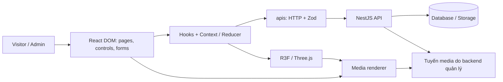

# Kiến trúc frontend Aura Museum

Ngày đối chiếu: **08/10/2026**. Trạng thái: **thiết kế để review**, chưa phải báo cáo chức năng đã triển khai. Bộ tài liệu này chỉ thay đổi tài liệu frontend.

## Cách đọc và nguồn đối chiếu

| Tài liệu | Nội dung |
| --- | --- |
| [Tổng quan](README.md) | Hiện trạng, ranh giới, layer và khác biệt phạm vi |
| [Màn hình và demo](screens-and-demo.md) | Ánh xạ 10 trang demo sang React, route và thành phần dùng chung |
| [Dữ liệu, API và CMS](data-api-and-cms.md) | Validation, request, media, auth, publication và hợp đồng cần bàn giao |
| [Trải nghiệm tham quan](museum-experience.md) | State, 3D/2D/XR, audio, tour, accessibility và hiệu năng |
| [Task và kiểm chứng](tasks-and-validation.md) | Truy vết task 1–45, thứ tự tích hợp và điều kiện kiểm chứng |

Nguồn đã đọc:

- [AGENTS.md](../../../AGENTS.md), [README dự án](../../../README.md), [README FE](../../../front-end/README.md), [coding conventions FE](coding-conventions.md).
- [SRS v0.1](../../../docs/requirements.md): baseline MVP theo mục 1.7 của chính SRS. Các mã FR/NFR/BR/AC bên dưới tham chiếu SRS này.
- [Bảng 45 task](https://docs.google.com/spreadsheets/d/1xmQzsXLrDOCqoDdtb4oRs7Pqmvie8yAShbVhiFLjUHU/edit?gid=0#gid=0), tab `gid=0`, đọc ngày 08/10/2026: snapshot phân công, không phải bằng chứng hoàn thành.
- [Demo giao diện](https://github.com/nguyenthangdev/demo-3d-museum/tree/d2e42091e1bfb4e79508bfd55a3b8832a3cb1888), commit `d2e42091e1bfb4e79508bfd55a3b8832a3cb1888`: đã đối chiếu HTML/CSS/JavaScript và README, chưa audit trực quan trên browser/thiết bị thật.
- Source dự án tại base `b2a2141`: [FE entry](../../../front-end/src/main.tsx), [App](../../../front-end/src/App.tsx), [BE controller](../../../back-end/src/exhibits/exhibits.controller.ts), [BE repository](../../../back-end/src/exhibits/repositories/exhibits.repository.ts).
- [Content schema](../../plans/content-schema.md), [device matrix](../../plans/device-matrix.md), [fallback tests](../../plans/fallback-tests.md), [performance audit](../../plans/performance-audit.md): tài liệu tham khảo cũ; số đo trong đó không chứng minh scaffold hiện tại đạt nghiệm thu.

Tên module/route chưa tồn tại là **đề xuất triển khai**. Không tạo file rỗng, thêm dependency hay đổi API chỉ vì tên có trong tài liệu. `test.md` cũ trong thư mục này là placeholder, không phải tài liệu kiến trúc hoặc bằng chứng test.

## Hiện trạng đã xác minh

| Thành phần | Hiện có | Chưa có |
| --- | --- | --- |
| Entry React | `main.tsx` bật `StrictMode`; `App.tsx` hiển thị `Hello, World!` | Router, public pages, CMS |
| Provider | `AppProviders = composeProviders()`; hàm compose có triển khai | Chưa truyền provider, chưa có museum/auth state |
| Layer FE | `MuseumPage`, `MuseumLayout`, `MuseumScene`, `museumApi`, `useRoom`, `MuseumContext`, `museumReducer`, `exhibitSchema`, `museum`, `mediaUrl`, `scenePosition` chỉ chứa `//` | API client, runtime validation, scene |
| Toolchain | React 18, TypeScript strict, Vite 6, Three.js 0.170, R3F 8, Zod 3, alias `@/`, typecheck/lint/build | Router, test runner, Playwright, formatter, thư viện state ngoài React |
| Cấu hình | `.env.example` có `VITE_API_BASE_URL=`; Vite cổng 5173 | Code đọc base URL, proxy API trong Vite config |
| API | Source có `GET /rooms`, `GET /rooms/:slug`, lấy exhibits/media theo `displayOrder` | Auth/admin/upload; repository chưa lọc Published; thiếu revision/hotspot/i18n đầy đủ |

API được xác nhận bằng source, chưa gọi với DB thật. `ExhibitContentDto` là DTO ghi dự kiến, không phải response public. FE không thể bảo vệ Draft chỉ bằng bộ lọc giao diện.

## Baseline và khác biệt cần chốt

Kiến trúc bao phủ tất cả task. Các task ngoài/trái SRS vẫn được thiết kế nhưng phải chốt thay đổi phạm vi và API trước tích hợp; task tài liệu này không tự sửa SRS hoặc lịch nhóm.

| Chủ đề | SRS v0.1 | Bảng task/demo | Cách áp dụng |
| --- | --- | --- | --- |
| Phòng | Một phòng cố định, không CMS room editor | Task 6 CRUD phòng | Dự kiến trang quản lý; chốt CRUD metadata hay cấu trúc phòng |
| Quyền | Admin cùng quyền, cấp tài khoản ngoài CMS | Task 3–5 user/role/RBAC | Auth boundary chung; màn hình quyền theo contract BE được duyệt |
| Xuất bản | Draft/Published, Unpublish trước sửa, không revision song song | Task 1, 7, 22–24 revision/duyệt/tạm ẩn/audit | Hai workflow mô tả riêng, không tự ghép |
| Report | Chưa có FR/AC tương ứng | Task 20/23 | Yêu cầu từ task; endpoint ghi report chuyên biệt chỉ bổ sung khi triển khai |
| Freshness | Request public mới nhận trạng thái mới sau xác nhận mutation | Task 10 TTL ≤ 60 giây | TTL đơn thuần không đạt BR-22/AC-51; cần invalidation hoặc không cache metadata |
| XR | Capability detection, VR ngoài MVP | Task 15 VR ở giai đoạn 1 | Lifecycle XR riêng; chốt milestone headset |
| Tour | Manual/Auto, teleport ngay MVP; không camera bay liên tục | Task 40/42 giai đoạn 3, task 40 di chuyển mượt | Theo FR-98; chuyển động liên tục cần đổi baseline |
| Ngôn ngữ | vi/en, transcript/captions ngay MVP | Task 39/43/44 giai đoạn 3, thêm Trung/Hàn/Nhật | Không hoãn vi/en nếu nghiệm thu SRS; ngôn ngữ thêm là mở rộng |
| Accessibility | Public WCAG 2.1 AA, CMS mức cơ bản | Task 19/32 WCAG 2.2 AA | Hướng tới 2.2 của task, báo cáo riêng tiêu chí baseline và bổ sung |
| Hiệu năng | ≥ 30 FPS, 60 khuyến nghị; API 100 phiên p95 ≤ 2 giây | Task 30 desktop ≥ 60/mobile ≥ 30; task 29 100–200 CCU, p95 ≤ 500 ms, error < 1% | Đo/báo cáo từng mức, tách FE và API |

Nhóm/phụ trách sản phẩm chốt phạm vi; phụ trách BE/schema chốt contract. Các điểm trên không ngăn review tài liệu nhưng phải giải quyết trước nghiệm thu chức năng. Cần bổ sung phân công hotspot CMS, metadata quyền sử dụng, captions và tour/i18n baseline nếu lịch chưa bao phủ đủ.

## Ranh giới hệ thống

- FE/CMS chỉ gọi NestJS API và tuyến media do BE quản lý; không đưa Supabase/Storage SDK, DB URL hoặc server secret vào bundle.
- Response là `unknown` tới khi qua Zod ở biên API trước hook/component.
- DOM/scene nhận cùng dữ liệu hợp lệ và selection/ngôn ngữ; 2D không phụ thuộc Three.js/XR.
- BE quyết định quyền, visibility, publication và tính toàn vẹn. Route guard/nút ẩn chỉ phục vụ UX.
- Public/Admin chung renderer nhưng tách đường đọc, provider/cache để Draft không lọt sang public.

## Layer và quyền sở hữu

Giữ layered hybrid architecture và [coding conventions](coding-conventions.md). Feature nằm dưới layer hiện có bằng tên kebab-case; không thêm root layer `services/`, `store/`, `features/` trong kế hoạch này.

| Vị trí | Sở hữu | Không sở hữu |
| --- | --- | --- |
| `App.tsx`, `AppProviders.tsx` | Navigation, provider, ranh giới public/admin | Fetch hiện vật, camera |
| `pages/`, `layouts/` | Ghép màn hình, tham số URL, shell | Parse response, tính toán từng frame |
| `components/` | DOM, form, modal, scene object; props/callback | Storage/DB, quyền publish |
| `hooks/` | Request lifecycle, thao tác UI, audio, capability/input | Schema trùng hoặc state public/admin chung vô hạn |
| `contexts/`, `reducers/` | State phiên và chuyển trạng thái thuần | Fetch/DOM/audio/Three.js object trong reducer |
| `apis/` | HTTP, auth policy, timeout, parse response/lỗi | Navigation, toast, camera |
| `validations/` | Schema response/request/form | Import UI, gọi mạng |
| `interfaces/` | Type/view model; dùng `z.infer` với schema | Copy entity BE, lặp type/schema |
| `helpers/` | Map DTO, resolve media URL | Nguồn dữ liệu thứ hai, request ẩn |
| `utils/` | Hàm thuần như tọa độ/đơn vị | Gom mọi logic nghiệp vụ |

Hướng chính: `pages/layouts → hooks/components → apis → validations`; renderer nhận view model qua props. Type/hàm thuần không import ngược UI. Component chia sẻ state qua parent/provider gần nhất.

Ưu tiên React state/context/reducer, native `fetch`, `AbortController`, `HTMLAudioElement`, `matchMedia`, Three.js loader và R3F đang có. Router chọn ở task navigation để có nested route, Back/Forward và lazy load; chưa cài React Router. Thư viện cache/form/XR/test chỉ thêm khi task cần và ghi tradeoff trong PR.

## Ranh giới bàn giao

Không tạo endpoint, đổi schema, chạy migration, triển khai UI hoặc chứng nhận demo đạt accessibility/hiệu năng. Kiểm chứng PR tài liệu ghi ở mô tả PR; kế hoạch test chức năng ở [task và kiểm chứng](tasks-and-validation.md). Feature đổi quyết định thiết kế phải cập nhật tài liệu tương ứng.
