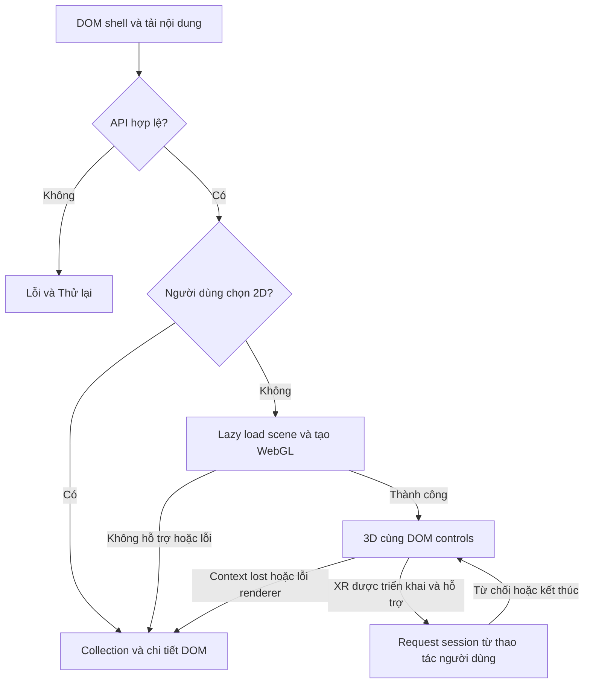

# Trải nghiệm tham quan: state, 3D, 2D và WebXR

Thiết kế mục tiêu, chưa phải triển khai trong scaffold. Phạm vi áp dụng theo [tổng quan](README.md); data/API/Preview theo [hợp đồng dữ liệu](data-api-and-cms.md).

## State dùng chung và owner

`MuseumContext`/`museumReducer` là vị trí có sẵn để quản lý state phiên khi feature được triển khai. Bắt đầu với state tối thiểu: room snapshot hợp lệ, `selectedExhibitId`, `selectedHotspotId`, locale, chế độ hiển thị, capability và tour. Không tạo store thứ hai cho selection của canvas.

| State / thao tác | Owner | Bất biến |
| --- | --- | --- |
| Chọn hiện vật/hotspot | Reducer museum, event từ DOM hoặc scene | ID phải thuộc snapshot hiện hành; đổi exhibit xóa hotspot cũ |
| Ngôn ngữ | Provider phiên public | Giữ khi đổi hiện vật/2D/3D; không tự chọn audio ngôn ngữ khác |
| Request phòng | `useRoom` | Chỉ response hợp lệ của request còn hiệu lực được cập nhật |
| Camera và chuyển động | Hook/component controls, ref Three.js | Không dispatch React state mỗi frame; khóa điều khiển khi UI đang nhập/modal mở |
| GLB load, geometry/material/texture | Component model/scene | Lỗi một model không làm sập cả phòng; cleanup đúng owner |
| Playback | Một audio owner trong mỗi phiên public hoặc Preview | Tối đa một thuyết minh phát; không tạo một audio player nền cho mỗi mesh |
| Tour | Reducer thuần + hook chạy timer/audio/teleport | Một nơi quyết định bước, mode và tiến trình cho cả DOM/scene |

Các event đề xuất như `selectExhibit`, `setLocale`, `enter2D`, `startTour`, `pauseTour` là tên ý nghĩa, không phải API đã có. Reducer trả state mới; hook thực hiện side effect và cleanup. Không cần event bus hoặc framework state machine riêng ở bản đầu.

## Luồng hiển thị và fallback

Nhánh XR chỉ áp dụng khi task 15 được chốt vào scope; MVP SRS chỉ phát hiện capability. Lỗi API không được biến thành danh sách mẫu giả trong fallback.

| Sự kiện | Kết quả và cleanup |
| --- | --- |
| Người dùng chọn 2D từ đầu | Không cần tải scene; DOM có nội dung và controls đầy đủ |
| Thiếu WebGL / scene chunk lỗi / renderer khởi tạo lỗi | Hiện lý do dễ hiểu, chuyển 2D; giữ room, selection và locale hợp lệ |
| GLB thiếu/hỏng/tải lỗi | Placeholder cho đúng exhibit; panel và các model khác vẫn hoạt động; nút thử tải lại nếu phù hợp |
| Ảnh lỗi | Vùng ảnh có nhãn/placeholder; nội dung và ghi công vẫn đọc được |
| Audio lỗi hoặc thiếu | Nội dung/transcript vẫn có; trạng thái audio rõ ràng, Auto tour áp dụng dwell time |
| `webglcontextlost` | Dừng input/tour/audio của tour, chuyển 2D từ snapshot hợp lệ và chuyển focus sang nội dung DOM; không vòng lặp remount vô hạn |
| Người dùng muốn thử 3D lại | Dựng lại scene khi capability cho phép; giữ selection/locale, reset camera về điểm an toàn, không tự resume audio/tour |
| Rời 3D chủ động | Dừng tour/audio của tour, trả pointer lock/input, cleanup scene; không reset locale hoặc làm mất nội dung đang chọn |
| XR không có / detection reject | Ghi capability không khả dụng, giữ 3D web; không làm lỗi tải phòng |
| XR bị từ chối / session end / headset rời phiên | Khôi phục controls/camera web, reset trạng thái session; nếu WebGL cũng mất thì chuyển 2D |

Scene error boundary không được bọc luôn và làm biến mất DOM fallback. WebGL context loss cần event handler riêng; React error boundary không thay thế bắt lỗi renderer/browser. Không tự khôi phục XR session hoặc xin quyền lại liên tục.

## Scene và hợp đồng tọa độ

- `MuseumScene` sở hữu R3F `Canvas`, môi trường phòng cố định, camera/lighting và danh sách model/hotspot. Data đã validate đi vào bằng props; không fetch API hoặc auth trong mesh.
- Load GLB theo nhu cầu bằng Three.js `GLTFLoader` và cơ chế Suspense/error boundary tương ứng. Boundary mỗi model giữ lỗi cục bộ; renderer-level boundary giữ lối ra 2D.
- Transform baseline: position mét, Y hướng lên; rotation radian Euler XYZ; scale từng trục > 0. Hotspot ở local coordinates trước transform (SRS 5.2, AC-23/24).
- Task 12 chuẩn hóa scale/pivot phải chốt cùng pipeline asset: hệ local chuẩn của exhibit chứa model và hotspot, sau đó áp dụng transform exhibit ra world. Nếu cần normalization wrapper, model và tọa độ hotspot phải cùng tham chiếu hệ đã chuẩn hóa; Preview/public dùng cùng hàm. Không tự tính lại scale/pivot khác nhau mỗi lần tải khiến hotspot lệch.
- `utils/scenePosition.ts` là vị trí ứng viên cho phép biến đổi tọa độ thuần; chỉ triển khai khi contract đã rõ. Không giữ một phiên bản phép tính riêng trong CMS Preview.
- Raycast/click model phát `onSelect(exhibitId)`; hotspot phát cả exhibit/hotspot ID. Sau selection, DOM panel lấy nội dung từ snapshot, không lấy text gắn trong mesh.
- Desktop dùng WASD và chuột/kéo nhìn theo task 14; không chặn phím khi focus ở input, textarea, contenteditable hoặc dialog. Pointer lock nếu dùng phải có thao tác kích hoạt và Escape/exit rõ ràng.
- Mobile dùng touch/joystick trong vùng canvas; không chặn scroll toàn trang hoặc mọi touch event. Pointer up/cancel, blur, tab hidden và unmount phải reset input đang giữ.
- Teleport/Return đưa tới điểm xem hợp lệ trong phòng, không nằm trong mesh/tường. Điểm xem cần hợp đồng dữ liệu hoặc quy tắc phòng được kiểm chứng; không suy từ bounding box một cách khiến camera nằm trong model.
- Cleanup event listener, timer, RAF bổ sung, object URL và tài nguyên GPU tạo thủ công. Đối tượng dùng chung/cache không được dispose khi consumer khác còn dùng; R3F quản lý đối tượng declarative, owner xử lý tài nguyên ngoài lifecycle đó. Kiểm tra mount/unmount dưới StrictMode.

## Audio, transcript và captions

`HTMLAudioElement` hoặc `<audio>` là nguồn thời gian duy nhất. Controls bao gồm Play/Pause/Resume/Stop, seek theo task 18, volume; Stop về thời điểm 0. `currentTime` và sự kiện playback cập nhật cue WebVTT, không dùng timer độc lập để giả đồng bộ phụ đề.

- Không autoplay khi chỉ mở hiện vật. Bắt Promise rejection của `play()`; phân biệt playback bị browser chặn với file tải lỗi.
- Đổi hiện vật, đóng panel, đổi locale, rời route hoặc logout Preview phải dừng/reset audio cũ. Cues/transcript theo audio và locale tương ứng. Ngôn ngữ mới chỉ phát sau thao tác người dùng hoặc Auto đã được cho phép.
- Transcript luôn là DOM đọc được khi không phát hoặc tải audio lỗi; không phụ thuộc speech synthesis. Captions có bật/tắt độc lập, không dừng audio khi tắt.
- Preview dùng cùng renderer/media controls nhưng audio owner và data lifetime riêng, không phát song song với phiên public còn treo.
- Không phát đồng thời audio và voice synth demo. Nếu không có audio locale đang chọn, hiển thị rõ và giữ text; không âm thầm đổi audio ngôn ngữ khác.

## Guided tour Manual/Auto

SRS FR-23–31/FR-98 đã yêu cầu tour trong MVP; task 40/42 đặt ở giai đoạn 3 là lệch lịch cần chốt. `displayOrder`/tour order từ BE, chỉ chứa Published còn tồn tại; không hardcode đúng năm bước. Danh sách rỗng vô hiệu Start kèm lý do.

| Event | State/hành vi |
| --- | --- |
| Start Manual | Chọn bước đầu, mở nội dung; chỉ dẫn tới exhibit, người dùng tự đi hoặc chọn Teleport |
| Start Auto | Chọn bước đầu, teleport tức thời trong 3D hoặc đổi nội dung 2D; audio chỉ phát khi đã cho phép |
| Auto playback kết thúc | Chuyển bước kế; cuối danh sách hoàn thành và trở về khám phá tự do |
| Bước Auto không có audio/audio lỗi | Dùng dwell time cấu hình, mặc định **15 giây**; hết thời gian thì bước kế |
| Browser chặn playback | Auto tạm dừng, chờ Play hoặc Next; không coi là file lỗi để bỏ qua sau timer |
| Pause / Resume | Giữ bước, tạm dừng/tiếp tục audio và thời gian còn lại; không tạo thêm timer |
| Next / Previous khi Auto | Dừng audio/timer, chuyển Manual rồi đổi bước; không tự tiếp tục Auto |
| Đổi Auto sang Manual | Dừng audio/timer Auto; giữ bước hiện tại |
| Đổi locale trong Auto | Dừng audio/cues cũ; thiết kế ban đầu tạm dừng tour chờ Resume với locale mới, tránh timer cũ chuyển bước |
| Chọn tự do exhibit khác khi tour chạy | Thiết kế ban đầu thoát tour, dừng side effect rồi chọn exhibit; UI thông báo rõ |
| Exit / rời 3D / mất renderer | Hủy timer, dừng audio/tự chuyển; giữ selection/locale cho DOM |

Previous/Next ở biên bị disable, không tự wrap. Mỗi chuyển bước hủy side effect cũ theo ID bước; `ended` hoặc timer đến muộn không được nhảy thêm bước. Không ghi tiến trình tour bền qua nhiều phiên. Khi tab bị ẩn, đề xuất pause Auto; khi quay lại chờ Resume để không bỏ qua nội dung.

Auto/teleport không tạo camera bay liên tục theo baseline, kể cả máy không bật reduced motion. Task 40 muốn chuyển động mượt phải được thống nhất lại trước triển khai. Trong 2D vẫn có tour/tiến trình/nội dung, không yêu cầu điều hướng không gian.

## WebXR task 15

Capability detection kiểm tra secure context, `navigator.xr` và `isSessionSupported('immersive-vr')`, xử lý cả false/rejection. Không phát hiện theo tên browser. Không hiện nút “Vào VR” hoạt động nếu chỉ mới viết detector.

Khi scope XR được duyệt: user gesture gọi `requestSession`, gắn session vào renderer hiện tại, quản lý controller/ray selection và locomotion phù hợp; không tạo bản data hoặc renderer thứ hai. DOM overlay không được giả định luôn có trong headset; phải có thao tác chọn/thoát bằng input XR phù hợp. Session end/disconnect phải cleanup listener/controller và trả controls web. Nếu GLB lỗi, exhibit vẫn có đường tiếp cận nội dung phù hợp với mode đang chạy.

Test giả lập chỉ chứng minh detection/lifecycle ở mức giả lập; Quest/HTC Vive/Pico phải được xác nhận theo browser/runtime và thiết bị thật trong task 31. Không suy “hỗ trợ mọi kính” từ API có mặt.

## Accessibility và responsive

- Public hướng tới WCAG 2.2 AA theo task 19/32; baseline bắt buộc 2.1 A/AA theo SRS. Checklist phân biệt phần áp dụng và lý do không áp dụng, không suy compliance từ lint/scan tự động.
- Có danh sách/chi tiết DOM đầy đủ, heading/landmark, link thật, button semantic, label và lỗi form đọc được. Hotspot phải có nội dung tương đương ngoài canvas.
- Tab/Shift+Tab, Enter/Space, Escape hoạt động; focus ring rõ. Modal có accessible name, focus vào vị trí hợp lý, trap chỉ khi mở, Escape đóng và trả focus về trigger còn tồn tại; background không nhận focus trong modal.
- Loading/lỗi/hoàn thành report hoặc tour có thông báo screen reader hợp lý; không dùng live region để đọc lại mọi frame/cue khiến người nghe bị ngập thông tin.
- Controls audio/seek/volume có label và dùng bàn phím. Ảnh nội dung có alt đúng locale, ảnh trang trí có alt rỗng. Trạng thái Draft/Published/lỗi không chỉ biểu diễn bằng màu.
- Layout hỗ trợ zoom 200%, màn hình hẹp, xoay dọc/ngang, vùng chạm đủ dùng; panel/joystick không che nút thoát 2D hoặc controls cốt lõi.
- Theo dõi `prefers-reduced-motion` cả khi đổi trong phiên: tắt animation không thiết yếu, pulse/smooth scroll và chuyển động camera tự động; vẫn dùng được tour/teleport tức thời. CMS tối thiểu keyboard, focus, semantic controls và không keyboard trap.

## Tải và chất lượng 3D

DOM shell và lựa chọn 2D phải tương tác trước khi tải asset lớn. Lazy load Three.js/scene/CMS, load model theo giai đoạn; audio chỉ tải theo nhu cầu, ảnh có kích thước và fallback. Không tải trước mọi audio/GLB toàn bảo tàng. Cache media theo ID/version do BE cung cấp; không dùng cache media để suy quyền đọc Draft.

Thiết kế khởi đầu cho FR-96 (phải hiệu chỉnh bằng task 30): hai mức `standard` và `low`. Sau scene ready, đo FPS trung bình trong cửa sổ 5 giây khi tab visible, loại thời gian loading/context lost/XR. Hai cửa sổ liên tiếp dưới 30 FPS thì giảm DPR và tắt bóng/hiệu ứng không thiết yếu ở `low`; ghi mức chất lượng và thời gian. Nếu hai cửa sổ tiếp theo vẫn thấp, thông báo và cung cấp lựa chọn 2D. Không ẩn hiện vật/hotspot để đạt FPS. Giữ mức thấp tới hết phiên scene để tránh dao động; thử lại 3D là hành động rõ ràng. Đây là phương án kỹ thuật ban đầu, chưa có số đo chứng minh phù hợp mọi máy.

Ngân sách SRS: trang public tương tác ≤ 5 giây; transfer từ navigation tới scene ready ≤ 20 MB cache rỗng; ≥ 30 FPS trên thiết bị 3D được hỗ trợ; UI input-to-feedback p95 ≤ 500 ms. Task 30 thêm mục tiêu desktop ≥ 60/mobile ≥ 30. Ghi riêng thời gian scene ready, model/audio load, memory, frametime, draw calls, cấu hình máy/mạng và mức chất lượng. Bundle size không chứng minh FPS hoặc thời gian tải.

Task 41 có thể thêm Draco/LOD/WebP khi asset thực và đo đạc cần; decoder/LOD theo pipeline backend/asset, không tự coi đã cài hoặc đã nén. Tối ưu cần đạt budget MVP ngay cả khi task tối ưu nâng cao nằm giai đoạn 3. CPU/GPU resource cleanup và fallback phải được kiểm tra lại sau thay pipeline.
