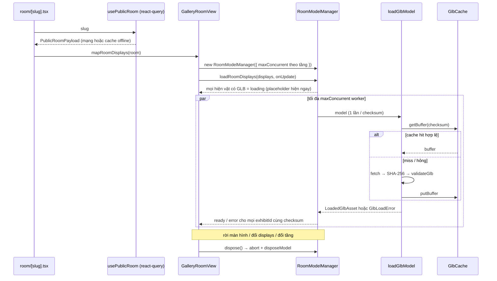

# 02 — Render phòng trưng bày (MOB-E6-04)

Code: `mobile/src/features/scene3d/{museumTypes,gallerySlots,roomModelManager}.ts`,
`GalleryRoomComponents.tsx`, `GalleryRoomView.tsx`, `publicRoomApi.ts`, `usePublicRoom.ts`.
Màn hình: `mobile/app/room/[slug].tsx`.

## Hệ toạ độ và hằng số (`museumTypes.ts`)

Giữ 1:1 với `front-end/src/interfaces/museumScene.ts`. Đơn vị mét, trục Y hướng lên, sàn y = 0,
tâm phòng (0, 0, 0).

| Hằng số | Giá trị | Dùng cho |
|---|---|---|
| `MUSEUM_ROOM_SIZE` | 14 × 16 × 5 m (rộng × sâu × cao) | vỏ phòng, giới hạn va chạm |
| `EXHIBIT_PLINTH_SIZE` | bục trung tâm r = 1.22 · bục tròn r = 0.76 · bục vuông 1.15 m | render + collider |
| `EXHIBIT_LABEL_SIZE` | 1.25 × 0.3125 m, sâu 0.75 (trung tâm 1.24) | kiểm tra tràn phòng |
| `ARTIFACT_BASE_Y` | 1.14 m | mặt bục — GLB, hotspot, camera focus cùng mốc |

## Gallery Template V1 — 5 bục (`gallerySlots.ts`)

| Slot | Vị trí (x, 0, z) | Loại bục |
|---|---|---|
| S01 – Trung tâm | (0, 0, −2) | `hero` (r 1.22) |
| S02 – Trái sau | (−4.3, 0, −4.2) | `standard` (r 0.76) |
| S03 – Phải sau | (4.3, 0, −4.2) | `standard` |
| S04 – Trái trước | (−4.3, 0, 2.1) | `standard` |
| S05 – Phải trước | (4.3, 0, 2.1) | `standard` |

`resolveGalleryLayout(displays)` chọn một trong hai chế độ:

- **`slotted`** — phòng rỗng, hoặc ≤ 5 hiện vật và **mỗi** hiện vật khớp một bục riêng (sai số
  `GALLERY_SLOT_TOLERANCE` = 5 cm, y ≈ 0). Luôn vẽ đủ 5 bục, bục trống vẫn hiện.
- **`legacy`** — ngược lại, kèm lý do: `too-many-exhibits` (> 5), `unmatched-position`,
  `duplicate-slot`. Giữ nguyên toạ độ gốc, **không ẩn hay cắt** hiện vật nào.

`snapDisplaysToSlots` kéo hiện vật lệch ≤ 5 cm về đúng tâm bục (chỉ ở chế độ `slotted`).

`isDisplayOutsideRoom` coi hiện vật là tràn phòng nếu bục + chiều cao mô hình (3.34 m với GLB) +
nhãn vượt vỏ 14 × 16 × 5. Hiện vật tràn được đánh dấu `isOutsideRoom`, không tải GLB và không tạo
collider.

## Ánh xạ payload `/rooms/:slug` → `MuseumDisplay[]`

`mapRoomDisplays(room, locale = 'vi')`:

1. Sắp theo `displayOrder`, hoà thì theo `id` → thứ tự ổn định giữa các lần tải.
2. Tên/mô tả lấy theo `locale`, thiếu thì về `vi`, thiếu nữa thì về trường gốc.
3. Không có `positionX/Y/Z` → tự xếp lưới (cách 3.6 m nếu có GLB, rải trong ±5.3 × ±5.1 m nếu chỉ
   có placeholder).
4. `placeholderShape: 'box'` của API đổi thành `cube`.
5. Hotspot sắp theo `displayOrder`, đổi `positionX/Y/Z` thành tuple.
6. Gắn `isOutsideRoom`, cuối cùng `snapDisplaysToSlots`.

Dữ liệu phòng lấy qua `publicRoomApi` (Zod) và `usePublicRoom(slug)` — chạy bằng react-query nên
phòng đã xem vẫn mở được khi mất mạng (MOB-E12-01).

## Tải nhiều GLB — `RoomModelManager`

```ts
const manager = new RoomModelManager({ maxConcurrent: quality.profile.maxConcurrentGlbLoads });
await manager.loadRoomDisplays(displays, (states) => setModelStates(states));
// khi rời phòng / đổi danh sách:
manager.dispose();
```

- **Gộp theo checksum**: nhiều hiện vật dùng chung một GLB chỉ tải/giải mã một lần.
- **Giới hạn song song**: `maxConcurrent` worker (mặc định 2; theo tầng chất lượng là 1/2/3 —
  xem [04](04-performance-tiers.md)) để tránh đột biến RAM.
- **Cô lập lỗi**: mỗi hiện vật có state riêng `loading { progress } | ready { asset } |
  error { message, category }`; một GLB hỏng không chặn các bục khác.
- **Huỷ sạch**: `dispose()` abort mọi request, `disposeModel` mọi asset đã tải; asset về muộn sau
  khi huỷ cũng bị giải phóng ngay.
- Bỏ qua hiện vật không có `model` hoặc `isOutsideRoom`.



Đổi tầng chất lượng làm `maxConcurrentGlbLoads` đổi → effect tạo manager mới. Các GLB đã tải nằm
trong cache nên lần tải lại đi nhánh cache hit, không tốn mạng (nhưng vẫn parse lại).

## Component

| Component | Vai trò |
|---|---|
| `MuseumRoomShell3D` | Vỏ phòng 14 × 16 × 5, ánh sáng "Heritage Warm"; số đèn phụ và bóng theo tầng chất lượng |
| `GalleryPedestal3D` | Bục `hero` / `standard` / `square`, mặt bục ở `ARTIFACT_BASE_Y` |
| `ExhibitPlaceholder3D` | Hình học thay thế khi không có GLB, đang tải hoặc lỗi |
| `GalleryRoomDisplays3D` | Vẽ bục + hiện vật theo `slotted` hoặc `legacy` |
| `GalleryRoomView` | Màn hình hoàn chỉnh: header (tên phòng, bố cục, nút chất lượng, nút 2D), canvas 3D trong `Scene3DErrorBoundary`, HUD điều khiển, thẻ hiện vật đang chọn với nút "Đi tới" và "Xem trong AR" |

`GalleryRoomView` dừng input di chuyển khi app vào nền (`AppState` ≠ `active`) để camera không tự
trôi khi người dùng quay lại.

## Kiểm thử

- `gallerySlots.test.ts` — 5 bục duy nhất, 1 bục hero, tất cả nằm trong phòng; khớp trong 5 cm,
  từ chối toạ độ tự do/NaN; đặt 0–5 hiện vật độc lập với `displayOrder`; 3 lý do `legacy` không bỏ
  rơi hiện vật; snap; `mapRoomDisplays` sắp thứ tự, fallback `vi`, giữ thứ tự hotspot.
- `roomModelManager.test.ts` — gộp checksum trùng, `maxConcurrent = 2`, cô lập lỗi, dispose GPU.
- `GalleryRoomView.test.tsx` — phòng 5 bục → chuyển danh sách 2D → chọn hiện vật; nhận diện `legacy`.

Chưa có test component cho nút "Xem trong AR" và cho nhánh `isOutsideRoom`.
