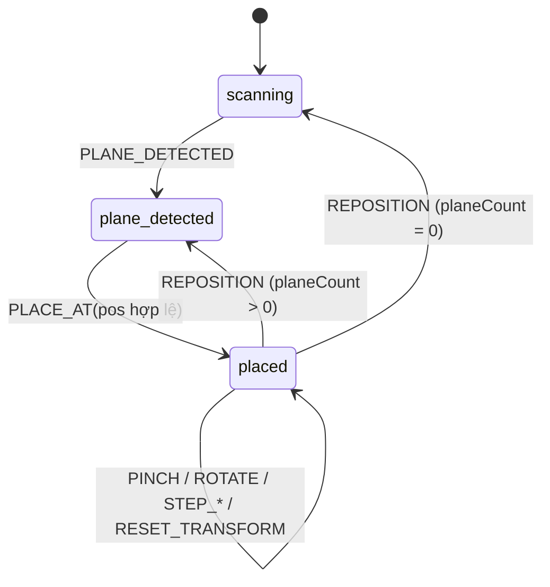

# 05 — AR: kiểm tra thiết bị, nạp Viro, đặt hiện vật (MOB-E9-01, MOB-E9-02)

Code: `mobile/src/features/ar/{arCapability,arBridge,arModelSource,arPlacementMath}.ts`,
`ArSpikeView.tsx`, `ArArtifactPlacementView.tsx`. Màn hình: `mobile/app/spike-ar.tsx`,
`mobile/app/ar-exhibit.tsx`.

Thư viện: `@reactvision/react-viro` (ARKit trên iOS, ARCore trên Android). Viro là **native
module** — không chạy trong Expo Go, cần EAS Development Build trên máy thật.

## Luồng tổng

```text
GalleryRoomView ── "Xem trong AR" ──► /ar-exhibit?roomSlug&exhibitId
                                          │ usePublicRoom + mapRoomDisplays → exhibit
                                          ▼
                              detectDeviceArCapability()
                         không hỗ trợ ─┤            ├─ hỗ trợ
                                       ▼            ▼
                     thẻ lý do + "Xem trong phòng 3D"   loadViroRuntime()
                                                         prepareArGlbSource()  (cache E6-02)
                                                         ViroARSceneNavigator
                                                         scanning → plane_detected → placed
```

## 1. Kiểm tra thiết bị — `arCapability.ts`

`evaluateArCapability(probe)` là hàm thuần (test được mọi biến thể); `detectDeviceArCapability()`
lấy `probe` thật từ `Platform`, `expo-device` và `hasViroNativeRuntime()`.

Thứ tự kiểm tra và kết quả khi thất bại:

| # | Điều kiện | `reason` |
|---|---|---|
| 1 | Không phải iOS/Android | `unsupported_platform` |
| 2 | `Device.isDevice === false` (simulator/emulator) | `emulator_not_supported` |
| 3 | iOS < 15 hoặc Android API < 26 | `os_too_old` |
| 4 | Không có native module Viro (Expo Go, chưa prebuild) | `native_module_missing` |

Mỗi lỗi có `userMessage` tiếng Việt cho người dùng và `technicalHint` cho dev. Thành công trả
`engine: 'ARKit' | 'ARCore'` kèm yêu cầu OS tối thiểu.

`hasViroNativeRuntime()` kiểm tra view manager `VRTARSceneNavigator` hoặc `isViroJSIAvailable()`,
bọc `try/catch` nên không bao giờ crash.

## 2. Nạp Viro an toàn — `arBridge.ts`

`loadViroRuntime()` `require` động `@reactvision/react-viro` và trả `null` nếu thiếu
`ViroARSceneNavigator`/`ViroARScene`. Nhờ vậy cùng một bundle chạy được trên Expo Go, simulator và
Jest — không import tĩnh Viro ở bất kỳ màn hình nào.

`mapViroTrackingState(state, reason)` đổi mã tracking của ARKit/ARCore sang thông báo:

| `state` | Chất lượng | Thông báo |
|---|---|---|
| 3 NORMAL | `normal` | "AR Tracking ổn định — chạm để đặt hiện vật" |
| 2 LIMITED, reason 2 | `limited` | "Di chuyển máy chậm lại để nhận diện mặt phẳng" |
| 2 LIMITED, reason 3 | `limited` | "Bề mặt thiếu chi tiết hoặc thiếu ánh sáng" |
| 2 LIMITED, khác | `limited` | "Đang hiệu chỉnh không gian AR..." |
| 1 UNAVAILABLE | `unavailable` | "… kiểm tra quyền camera" |
| khác | `initializing` | "Đang khởi tạo phiên AR..." |

## 3. Chuẩn bị file GLB — `prepareArGlbSource`

`Viro3DObject` cần **đường dẫn file cục bộ**, không nhận `ArrayBuffer`. Hàm này dùng lại toàn bộ
lớp an toàn của [01-glb-pipeline](01-glb-pipeline.md):

1. Validate metadata bằng `publicModelSchema`, khoá URL về origin API.
2. Đọc cache theo checksum; SHA-256 + kích thước khớp → `validateGlb` → dùng luôn.
   Sai → xoá entry.
3. Không có cache → `fetch`, kiểm tra ≤ 128 MB, SHA-256, `validateGlb`, ghi cache.
4. Parse bằng `GLTFLoader` **chỉ để đo** `normalizeModel`, rồi `disposeModel` ngay (Viro tự render).
5. Trả `{ localUri, checksumSha256, sizeBytes, source, normalization }`.

Hiện vật đã xem trong phòng 3D sẽ có `source: 'cache'` — không tải lại.

## 4. Máy trạng thái đặt hiện vật — `arPlacementReducer`

Reducer thuần, mọi thao tác Viro và nút bấm đều đi qua đây:



Khi chưa ở `placed`, các action cử chỉ bị bỏ qua (trả nguyên state).

| Action | Tác dụng |
|---|---|
| `TRACKING_UPDATED` | cập nhật chất lượng + thông báo |
| `PLANE_DETECTED` | tăng `planeCount`; `scanning` → `plane_detected` |
| `PLACE_AT` | toạ độ NaN/Infinity bị bỏ qua; lưu `anchorPosition` |
| `PINCH_GESTURE` | chỉ khi `placed`; xem bên dưới |
| `ROTATE_GESTURE` | chỉ khi `placed`; góc chuẩn hoá về [0, 360) |
| `STEP_SCALE` / `STEP_ROTATE` | nút một tay: ±0.15 tỷ lệ, ±30° |
| `RESET_TRANSFORM` | tỷ lệ 1, góc 0 |

**Cử chỉ Viro có 3 pha** (1 = START, 2 = MOVE, 3 = END) và `scaleFactor`/`rotationFactor` tính
**từ lúc bắt đầu cử chỉ**, không phải từ khung trước. Nếu nhân trực tiếp vào `scale` mỗi khung thì
kích thước bùng nổ. Reducer lưu mốc `pinchBaseScale` / `rotateBaseDeg` ở pha 1 và luôn tính
`base × factor` (hoặc `base − factor`), xoá mốc ở pha 3.

Tỷ lệ kẹp trong **0.25 … 2.5** (`AR_MIN_SCALE` … `AR_MAX_SCALE`).

### Kích thước thật trong AR — `computeArModelTransform`

Mô hình đã chuẩn hoá cao tối đa 2.2 m (khung trưng bày trong phòng) — quá to để đặt trên bàn.
Hàm thu về **0.55 m** cho cạnh lớn nhất khi `scale = 1`:

```text
arFitFactor = 0.55 / max(size.x, size.y, size.z)
finalScale  = normalization.scale × arFitFactor × arScale
offset      = normalization.offset × finalScale      // đáy chạm mặt phẳng, tâm XZ = 0
```

Scene Viro lồng 2 node: node ngoài mang góc xoay + tỷ lệ người dùng, node trong mang phần "vừa
khít" (`fitTransform`). Chưa có GLB (đang tải hoặc lỗi) → hiện hộp 0.32 m thay thế.

## 5. Màn hình `ArArtifactPlacementView`

- `ViroARPlaneSelector` chỉ nhận **mặt phẳng ngang**, tối đa 5. Chạm mặt phẳng → `PLACE_AT`.
- Thanh trạng thái (`accessibilityLiveRegion="polite"`) đọc to "Phát hiện N mặt phẳng…" rồi
  "Đã đặt · Tỷ lệ X% · Xoay Y°", kèm nguồn GLB (bộ nhớ đệm / vừa tải).
- Thanh nút: Thu nhỏ, Phóng to, Xoay trái, Xoay phải, Đặt lại, Đặt lại vị trí — dùng một tay được
  và đọc được bằng VoiceOver/TalkBack.
- Viro bọc trong `Scene3DErrorBoundary` ("Lỗi camera AR") → nút về phòng 3D.
- Không hỗ trợ AR → thẻ giải thích + "Xem hiện vật trong phòng 3D" + "Thoát chế độ AR".

**Lưu ý với Viro:** `ViroARSceneNavigator` giữ `initialScene` từ lần khởi tạo đầu. State React thay
đổi phải truyền qua `viroAppProps` (scene đọc từ `arSceneNavigator.viroAppProps`), không được đóng
trong closure — nếu không scene AR sẽ đứng yên ở trạng thái đầu (lỗi đã sửa ở PR #209).

## Kiểm thử

- `arCapability.test.ts` — ARKit iOS 15+, ARCore API 26+; từ chối web, simulator, OS cũ, Expo Go;
  bảng mã tracking.
- `ArSpikeView.test.tsx` — fallback trên Expo Go; khởi chạy navigator, đặt model, cập nhật tracking.
- `arPlacementMath.test.ts` — chuỗi trạng thái và từ chối NaN; pinch 3 pha không nhân dồn; xoay
  không cộng dồn, chuẩn hoá [0, 360), reset; transform đặt khít mặt phẳng.
- `arModelSource.test.ts` — đo kích thước/vị trí từ GLB thật trước khi cấp URI cho Viro.
- `ArArtifactPlacementView.test.tsx` — GLB thật trong `back-end/public/media/uploads/models`:
  đọc cache, đặt lên mặt phẳng, xoay/phóng to ổn định. Thư mục này không được commit nên **trên CI
  cả suite bị bỏ qua** (đây là suite "1 skipped" trong báo cáo Jest). Luồng đặt + cử chỉ vẫn được
  phủ gián tiếp bởi `arPlacementMath.test.ts` và `ArExhibitExperienceView.test.tsx`.

Viro được mock trong Jest. Hành vi trên ARKit/ARCore thật **chưa được kiểm chứng** — xem báo cáo
từng task.
