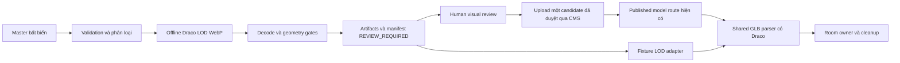

# Kiến trúc và source audit

## Luồng hiện tại trên base dev

`AdminMediaController` áp dụng `media:upload`, audit thao tác ghi và multer memory limits. `MediaService.upload()` nhận dạng magic bytes, giới hạn theo format, validate structure, lưu file, tính SHA-256 rồi tạo media `ready`. Lỗi format bị từ chối. Lỗi inspection bất ngờ tạo bản cách ly. Lỗi DB sau storage write sẽ dọn file vừa tạo. `MediaUploadJobService` dùng lại chính service này, FIFO trong tiến trình và buffer RAM, idempotency theo actor/key + file/metadata, transaction liên kết media/job và startup reconciliation.

`MediaStorageService` sinh key UUID và driver write không ghi đè. Generic `/media/uploads/:directory/:fileName` chỉ phục vụ media ready/chưa xóa, được revision Published hiện hành của exhibit visible trong room active tham chiếu hoặc có chữ ký CMS hợp lệ. Preview dùng `private, no-store`, public dùng revalidation `no-cache` với ETag SHA-256.

Public model đi đường riêng. `toPublicExhibit()` chỉ map revision APPROVED đúng `publishedRevisionId`. `toPublicModel()` trả descriptor checksum/size và route room/exhibit/version. `PublicModelsService.open()` đọc lại room published hiện hành, kiểm version rồi `ModelStorageService` ký và proxy private Supabase bằng credential máy chủ. Service này kiểm key, expected bytes, origin/path signed URL, timeout và abort. Nó dùng Supabase trực tiếp, còn generic media sử dụng storage driver.

Frontend validate API bằng Zod, kiểm model thuộc đúng room và URL checksum. `museumService.getModelBinary()` tải qua NestJS bằng abort signal, kiểm byte count. `loadMuseumModel()` kiểm GLB và SHA-256, parse với URL modifier chỉ blob, sanitize mesh, normalize bằng wrapper. `RoomModelAssets` dedupe checksum, giới hạn hai download, abort khi đóng room, dispose tài nguyên một lần sau detach. `ArtifactModel` clone hierarchy/bones và chia sẻ geometry/material với room owner. Hotspot và focus dùng normalization của model. CMS Preview dùng validation/sanitize/normalization tương tự qua loader riêng, chưa kiểm checksum.

## Ràng buộc đã xác minh

| Quan sát | Nguồn base |
| --- | --- |
| Upload GLB tối đa 10.000.000 bytes, image 2.000.000 bytes | `media-formats.ts` |
| Public GLB tối đa 134.217.728 bytes | `public-model.dto.ts`, `roomSchema.ts` |
| Backend kiểm chunk/embedded references, chấp nhận data URI | `glb.validator.ts` |
| Frontend từ chối buffer/image có URI và chặn Draco/Meshopt/KTX2 | `glbAsset.ts` |
| WebP đã có signature/structure validator và MIME policy | `webp.validator.ts`, `media-formats.ts` |
| Chưa có auto-generation hoặc quan hệ original/derived trong media entity | `media.entity.ts`, upload services |
| Model URL public có version SHA-256, quyền xem được kiểm lại khi đọc binary | `public-model.dto.ts`, `public-models.service.ts` |
| Scene demand-render, room owner ở ngoài Canvas, context recovery giữ owner | `MuseumScene.tsx` |
| `MuseumControls` là camera transform owner web, ngắt khi XR presenting | `MuseumControls.tsx` |

Hai file coding conventions theo đường dẫn trong AGENTS hiện vắng trên base, gồm `front-end/docs/coding-conventions.md` và `back-end/docs/coding-conventions.md`. Việc audit dùng source/README và tài liệu thực có.

### Điểm truy vết trên base SHA

Các line dưới đây thuộc base `dcbb814`, giúp review khi code triển khai dịch dòng.

| Owner | File và dòng |
| --- | --- |
| Upload và inspection trước ghi | `back-end/src/modules/media/services/media.service.ts` dòng 104, 129, 229, 246 |
| Async queue và tái sử dụng upload | `back-end/src/modules/media/services/media-upload-job.service.ts` dòng 79, 130, 201 |
| UUID key và quarantine boundary | `back-end/src/modules/media/services/media-storage.service.ts` dòng 37, 80 |
| Generic delivery và Published references | `back-end/src/modules/media/services/media-delivery.service.ts` dòng 45, 62 và `repositories/media.repository.ts` dòng 136 |
| GLB structure validator | `back-end/src/modules/media/inspection/validators/glb.validator.ts` dòng 124 |
| Upload cap và public cap | `inspection/media-formats.ts` dòng 33 và `dto/public-model.dto.ts` dòng 3, 10 |
| Room/model authorization | `back-end/src/modules/exhibits/services/public-models.service.ts` dòng 8, `services/exhibits.service.ts` dòng 89, `repositories/exhibits.repository.ts` dòng 89 |
| Public model HTTP route | `back-end/src/modules/exhibits/controllers/exhibits.controller.ts` dòng 51 |
| Private Supabase signing/stream | `back-end/src/modules/media/services/model-storage.service.ts` dòng 11 |
| Scene ownership/focus/demand | `front-end/src/components/MuseumScene.tsx` dòng 101, 107, 111, 158 |
| Web camera update | `front-end/src/components/museum/MuseumControls.tsx` dòng 221 |

Audit frontend đã đọc `loadMuseumModel.ts`, `glbAsset.ts`, `sanitizeModel.ts`, `modelNormalization.ts`, `roomModelAssets.ts`, `useRoomModels.ts`, `ArtifactModel.tsx`, `ArtifactModelBoundary.tsx`, `ExhibitionDisplay.tsx`, `MuseumScene.tsx`, `MuseumControls.tsx`, `museumQuality.ts`, `roomSchema.ts`, `museum.service.ts`, `previewModel.ts`, `ModelPreview.tsx` và `ExhibitImage.tsx`.

Audit backend đã đọc các services/validators/DTO/entity nêu trên, `media-inspection.service.ts`, `webp.validator.ts`, `public-exhibit.mapper.ts`, public room/exhibit controllers, admin media/upload-job controllers và media delivery controller. Các regression sources đối chiếu gồm `public-models.spec.ts`, `exhibit-mappers.spec.ts`, `media-structure.spec.ts`, các ca media service/storage/delivery/reference và public room controllers/services. Việc đọc test ghi nhận coverage hiện có, kết quả thực thi của task được ghi riêng trong `verification.md`.

Tài liệu đối chiếu gồm `dynamic-glb-tour-plan.md`, audit performance 261104 cùng measurement protocol, hai tài liệu Supabase media, `museum-experience.md` và các kế hoạch CMS media attach/public API. Một nội dung lịch sử cần lưu ý là mục xóa trong tài liệu Supabase 03 còn mô tả xóa object sau soft delete, trong khi source hiện tại giữ object để restore. Quyết định task theo source hiện hành.

## Luồng bổ sung

Package offline độc lập API, dùng glTF Transform, draco3dgltf, meshoptimizer và sharp được pin bằng package lock. Master checksum, config và versions đủ để chạy lại. Metadata file không chứa signed URLs, secret hoặc private storage credentials.

Shared parser cấu hình Draco self-hosted và vẫn chỉ cho GLB tải tài nguyên nhúng. Decoder là tài nguyên ứng dụng kiểm soát. Chỉ thêm extension được cấu hình và test. Lifecycle decoder/worker thuộc module shared loader, tài nguyên model vẫn thuộc room/Preview owner.

LOD runtime nhận `ModelLodSet` tùy chọn từ fixture tin cậy gồm source checksum, normalization master, thresholds pixel đã duyệt và các `PublicModel` descriptors. Production room DTO giữ contract hiện có trong giai đoạn này. `RoomModelLods` điều phối owner hiện có qua request/evict, giữ asset hiện tại trong lúc tải và thống nhất normalization giữa levels. Selection/focus ưu tiên LOD0. Giới hạn cache ban đầu tối đa một variant inactive mỗi family và bốn inactive toàn owner, eviction sau consumer detach.

## Contract cần duyệt cho production variants

Đề xuất additive optional `variants` sau khi backend có quan hệ source/derived đáng tin. Client chỉ gửi level enum hoặc variant identity do backend phát. Backend tìm variant từ original của revision Published hiện hành, kiểm source checksum, trạng thái QA/ready/chưa xóa và bytes/checksum riêng. Route trả qua NestJS, kiểm quyền trước 304/stream, revoke khi original bị ẩn/unpublish/xóa. Đề xuất này ở trạng thái chờ review. Hiện tại chưa có migration, DTO hoặc storage authorization triển khai cho derived variants.
