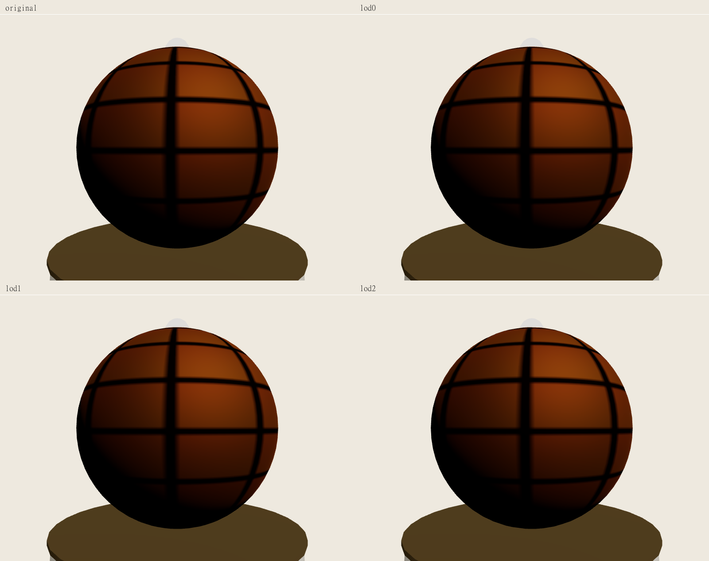

# Báo cáo Advanced 3D Asset Pipeline

Ngày 12/11/2026. Base ban đầu `dcbb814141bef3ed547f0893edb701c4d9407771`, nhánh `feat/advanced-3d-asset-pipeline`. Đã tích hợp `dev` tại `446bba7` qua merge `4388274`, sau đó tại `2a245d0` qua merge `12155b1`.

## 1. Executive summary

Đã triển khai CLI offline Draco, ba GLB LOD độc lập, WebP candidates, shared self-hosted Draco parser và fixture runtime LOD. Candidate luôn giữ `REVIEW_REQUIRED`, `publicationEligible=false`. Production multi-LOD chờ backend/database duyệt quan hệ original/derived. Dataset đo là tài nguyên tổng hợp do test sinh. Nghiệm thu chất lượng bảo tàng và thiết bị thật còn mở.

## 2. Kiến trúc before/after

Base upload kiểm bytes/format/structure rồi tạo media ready. Published model được đọc qua room/exhibit/checksum API. Frontend kiểm SHA-256 và chặn Draco. Media entity chưa có quan hệ source/derived.

Luồng mới là `Master → Validation → Optimization → Decode/geometry gates → Candidates/manifest → Human visual review → Safe publication → Shared runtime → Cleanup`. CLI chạy ngoài HTTP request. Public và CMS dùng chung parser. LOD fixture đi qua owner phòng với master normalization, screen pixels, hysteresis và cache có giới hạn. Chi tiết ở [architecture.md](architecture.md).

## 3. Asset optimization workflow

CLI đọc regular file theo byte limits, nhận dạng từ bytes, chặn external/data URI, kiểm Khronos glTF trước NodeIO và sau encode, decode payload thực rồi so geometry/attributes. Output dùng thư mục mới, temporary sibling, cooperative lock, kiểm lại SHA master và atomic rename. Manifest chứa provenance, config hash, tool/native versions, checksum, bytes, metrics, errors và QA status.

Candidate được curator duyệt cần đi qua inspection/upload và workflow CMS hiện hành trước publication. Contract ở [asset-processing-contract.md](asset-processing-contract.md). Master được giữ bất biến và mọi level được sinh lại từ master.

## 4. Draco compression results

MB dùng 1.000.000 bytes. Raw manifests, hashes, config và samples nằm trong [offline-benchmark.json](evidence/offline-benchmark.json).

| Asset | Original MB | Draco MB | LOD0 Triangles | LOD1 Triangles | LOD2 Triangles | Texture Savings | Visual QA | Status |
| --- | --- | --- | --- | --- | --- | --- | --- | --- |
| Synthetic UV sphere | 0,094692 | 0,023088 | 3.968 | 3.542 | 3.284 | PNG 953 → WebP 202 B khi opt-in | REVIEW_REQUIRED | Candidate |
| Hiện vật có quyền sử dụng được xác nhận | Unavailable | Unavailable | Unavailable | Unavailable | Unavailable | Unavailable | REVIEW_REQUIRED | Chờ dataset và curator |

Draco LOD0 giảm khoảng 75,62% file bytes, giữ 3.968 triangles. Position quantization 20 bits, normal/UV/color/generic 16 bits. Hai vertex pole nguồn không được tham chiếu bị loại qua roundtrip. Mọi referenced vertex/attribute đi qua gate. Khronos Validator trả 0 errors/0 warnings, có INFO vì validator chưa kiểm payload Draco. NodeIO/draco3dgltf decode thực kiểm payload, scene, transforms, materials và attributes.

## 5. LOD generation results

| Variant | Bytes | Vertices | Triangles | Relative bounds delta | Sampled relative surface error |
| --- | --- | --- | --- | --- | --- |
| Original | 94.692 | 2.145 | 3.968 | — | — |
| LOD0 | 23.088 | 2.143 | 3.968 | 0 | 0,0000003971 |
| LOD1 | 22.388 | 1.930 | 3.542 | 0 | 0,000413734 |
| LOD2 | 21.276 | 1.801 | 3.284 | 0 | 0,000778053 |

Target ratios 0,8/0,5 bị ràng buộc bởi geometric error. Actual triangle reduction là khoảng 10,74%/17,24%. LOD0 giữ nguyên triangle count. Ba file có checksum/size riêng và tải độc lập. Open/non-manifold, alpha/double-sided geometry giữ LOD0 và báo `LOD_NOT_GENERATED`. Skinning, morph, animation, cameras, sparse accessors và extensions ngoài policy trả `UNSUPPORTED`.

## 6. WebP conversion results

| Input tổng hợp | Original bytes | WebP bytes | Policy | Decoded quality |
| --- | --- | --- | --- | --- |
| PNG grid 128×128 | 953 | 202 | Lossless detail/data | Pixel exact |
| JPEG gradient 512×256 | 33.424 | 6.186 | Photo quality 95 | PSNR 47,2601 dB |
| Alpha PNG 128×128 | 444 | 44 | Lossless alpha | Pixel và alpha exact |

Embedded conversion là opt-in, lossless, chỉ PNG 8-bit không ICC. Nó giữ non-color bytes/sampler bindings và dùng `EXT_texture_webp`. Trên fixture, GLB LOD0/1/2 sau opt-in còn 22.412/21.712/20.600 bytes. JPEG embedded giữ source. Animated/APNG, ICC, CMYK và high-bit-depth yêu cầu review riêng. Candidate lớn hơn original hoặc sai alpha/pixel giữ original. Orientation được áp dụng, kích thước giữ nguyên. Metadata nguồn/quyền nằm trong immutable master và phải được giữ khi publication.

## 7. Visual fidelity results

Scene identity, transforms, material assignment và bounds giữ theo gates. Normal deviation LOD0 tối đa 0,003444°, UV delta tối đa 0,000007630 trên fixture. Sampled geometric distance là phép xấp xỉ. Human visual QA vẫn `REVIEW_REQUIRED`. Các chi tiết chữ khắc, silhouette mỏng, glossy/transparent material và profile màu hiện vật thật cần curator duyệt theo [visual-quality-protocol.md](visual-quality-protocol.md).

## 8. Original và optimized screenshots

Đã capture original/LOD0/LOD1/LOD2 cùng camera cách tâm 3 m, FOV 45°, DPR 1, renderer/lighting/exposure và texture decode hoàn tất. Canvas 800×600 CSS pixels, ảnh chụp 800×601 pixels do vị trí CSS có phần thập phân. Đã xem contact sheet và đối chiếu hình dạng, grid texture, màu và placement của fixture. Lower LOD được ép tại cùng góc gần để review sai khác, runtime thông thường ưu tiên LOD0 khi gần hoặc focus.

| Candidate so với original | PSNR dB | Mean absolute RGB error | Max channel error | Changed pixels |
| --- | --- | --- | --- | --- |
| LOD0 | 77,3437 | 0,001199 | 1 | 0,3548% |
| LOD1 | 51,8372 | 0,010496 | 110 | 0,4278% |
| LOD2 | 47,2545 | 0,023834 | 112 | 0,5611% |

Các chênh lệch lớn nhất của lower LOD tập trung tại rìa/silhouette và mép pattern. Full-frame PSNR chứa cả background. Một góc nhìn sphere tổng hợp chưa đủ duyệt chữ khắc hoặc chi tiết bảo tàng. Human QA giữ `REVIEW_REQUIRED`. Raw metrics ở [render-comparison.json](evidence/renders/render-comparison.json).

## 9. Load/decode/FPS/memory benchmark

Môi trường offline Windows 10.0.26200, Intel Core i5-13500H, Node 24.8.0, 16 logical CPUs. NodeIO đọc buffer RAM với decoder đã khởi tạo, một warmup và năm samples tuần tự. Background load chưa kiểm soát. Raw samples được lưu trong JSON.

| Metric | Original | LOD0 | LOD1 | LOD2 | Phương pháp |
| --- | --- | --- | --- | --- | --- |
| GLB bytes | 94.692 | 23.088 | 22.388 | 21.276 | File thực |
| Embedded PNG bytes | 953 | 953 | 953 | 953 | Default giữ texture |
| NodeIO decode median ms | 5,4451 | 32,4929 | 45,3546 | 40,0324 | Warm decoder, năm samples |
| Browser fetch median ms | 28,0 | 53,4 | 43,4 | 47,5 | Ba samples, intercepted loopback |
| Browser parse/decode median ms | 6,3 | 106,3 | 108,4 | 117,1 | Shared parser, worker init và image decode |
| First visible/full detail timestamp | Unavailable | Unavailable | Unavailable | Unavailable | DOM-ready observation chỉ là proxy riêng |
| Renderer triangles | 4.588 | 4.588 | 4.162 | 3.904 | Model và 620 triangles của fixture display |
| Draw calls | 8 | 8 | 8 | 8 | Cùng view, renderer counters |
| Geometry/texture counts | 8/6 | 8/6 | 8/6 | 8/6 | Scene cố định, GPU resource counters |
| Decoded accessor bytes | 92.448 | 92.384 | 83.012 | 77.336 | NodeIO arrays, chưa tính GPU allocation |
| Physical GPU memory/FPS | Unavailable | Unavailable | Unavailable | Unavailable | Chờ thiết bị và protocol 261104 |
| JS heap lifecycle | Unavailable | Unavailable | Unavailable | Unavailable | Cần lặp cùng workload có GC |

Draco giảm transfer bytes và tăng CPU decode trên fixture đã đo. WebP vẫn có decoded texture cost. LOD giảm triangles, khả năng tăng FPS cần workload thực. Mục tiêu desktop 60/mobile 30 FPS và headset WebXR cần đo theo [benchmark-plan.md](benchmark-plan.md). Audit 261104 có heap retention chưa giải thích hết, task này chưa đủ bằng chứng kết luận leak-free trên mọi phòng/thiết bị.

Browser là Headless Chromium 156, ANGLE/Vulkan SwiftShader, viewport 1280×720, DPR 1. Các mẫu fetch đi qua Playwright interception trên loopback, chưa có network throttling chuẩn. Mỗi parse bổ sung giải phóng scenes ngay, decoder cohort mới bao gồm worker initialization. Resource counters chứng minh workload đã chạy. Public production DOM model-ready quan sát sau navigation là 982 ms với WASM và 5.947 ms với JS fallback, một sample mỗi case, bao gồm application startup và automation. Raw samples ở [browser-fixed-camera.json](evidence/browser-fixed-camera.json), [public-wasm.json](evidence/public-wasm.json) và [public-js.json](evidence/public-js.json).

Sau tích hợp Gallery Slots, chín ca browser asset đã qua, gồm hai production Public Museum WASM/JS và bảy fixture CMS/legacy LOD/slotted LOD/fallback/visual/native corrupt Draco. Frontend typecheck/lint/build đạt, unit tests đạt 383/383 trên 61 files. Ready-state identity được giữ trong lúc upgrade để Guided Tour tiếp tục camera motion. Bốn PNG fixed-camera sau tích hợp có checksum giống bộ capture đã lưu.

Trước tích hợp Gallery Slots, production regression GLB/hotspots/Guided Tour/WebXR đạt 51/51. Sau tích hợp, selected production suite đạt 24/26, gồm Public Draco, CMS slot picker, late GLB/cancellation và XR/context recovery. Hai ca Gallery Slots đang lỗi về movement và resource/idle, đã tái hiện trên snapshot stock dev `446bba7` và khi chạy riêng trên task. Stock quan sát camera Z khoảng 5,701 với kỳ vọng < 5 và texture count 9 → 17. PR giữ draft với các lỗi này đang mở. Logs nằm trong `evidence/`.

CMS Preview đã kiểm legacy/Draco/embedded WebP. Inspector backend nhận đủ bảy generated candidates và kiểm SHA, bytes, upload limit, format/structure. Backend media 592/592 và public models 10/10 là kết quả trước backend publish guard PR #185. Live storage/publication cần workflow riêng.

## 10. Compatibility và fallback validation

Legacy GLB dùng shared parser mà không khởi tạo Draco. Public download giữ byte count, SHA-256 và AbortSignal. Decoder self-hosted JS/WASM có allowlist riêng, tối đa hai workers/cohort, timeout và cleanup kết quả đến muộn. Missing decoder trả model fallback.

LOD fixture giữ normalization master, selection, hotspots và picking. Shared checksum lấy yêu cầu chi tiết cao nhất giữa các instance. Upgrade lỗi giữ model đang thấy và thử original cho close inspection. Pool giữ hai download, một inactive variant mỗi family và tối đa bốn inactive toàn phòng. Mounted primitives có refcount để bảo vệ GPU resource qua commit riêng của R3F. Actual coverage nằm trong verification.

Sau đồng bộ Gallery Slots, `GallerySlotView` thực hiện LOD selection và truyền retain callback cho cả legacy/slotted layouts. Demand được gửi mỗi frame và owner dedupe, consumer IDs nằm trong hook signature để occupant thay đổi đăng ký đúng owner. Một ca browser riêng chứng minh đủ năm bục và model upgrade theo selection.

## 11. Security considerations

Chỉ mở thêm `KHR_draco_mesh_compression`. Meshopt/KTX2 chưa có decoder tiếp tục bị chặn. External URI bị từ chối trước parse. File limits, checksum và public authorization contract tiếp tục áp dụng. Declared geometry budget và post-decode checks bảo vệ đường nhận model. Native WASM có thể cấp phát trước post-decode validation, chưa có hard OS/WASM memory isolation.

Backend source/schema/auth/storage policy giữ theo base. Production variant phải được backend resolve từ original Published record và kế thừa revocation/QA. Adapter usage `fixture` và mock binary routes thể hiện phạm vi kiểm thử. Chưa có migration hay production derived URLs được triển khai.

## 12. Regression test evidence và atomic commits

Kết quả lệnh ở [verification.md](verification.md), raw evidence ở [evidence/README.md](evidence/README.md), SHA/PR ở [commit-plan.md](commit-plan.md). Review đã tìm và sửa fallback close inspection, R3F refcount, stale remount demand, APNG mất frame và Draco accessor mismatch. Các ca này có regression riêng.

PR draft #186 có base `dev`, đang chờ human review trust-boundary validation và backend/database/curator checkpoints. [Pull request #186](https://github.com/ailabs26/ailabs-museum/pull/186)

## 13. Limitations và phần cần duyệt

- Curator cung cấp dataset có quyền và duyệt screenshots/chi tiết quan trọng ở từng khoảng cách.
- Backend/database duyệt quan hệ original/derived, additive DTO/routes, revocation, retention và migration nếu cần.
- Cần Android/iOS/GPU/headset thật và ba runs cùng workload/network controls để nghiệm thu FPS/VRAM/heap.
- Approved single GLB qua live CMS/storage/Published room chưa được xác minh. Offline và fixture có evidence riêng.
- Hai Gallery Slots regression tests còn lỗi trên cả task và stock dev. Movement dùng fixed-duration input và resource/idle assertions cần được owner Gallery Slots xử lý trước nghiệm thu production.

## 14. Final acceptance status

Nghiệm thu tổng thể giữ `REVIEW_REQUIRED`. Các phần offline và fixture được ghi nhận theo tests/evidence thực. Production multi-LOD, human museum QA và physical performance còn các checkpoint trên. PR hướng vào `dev` và cần human review trước merge.
