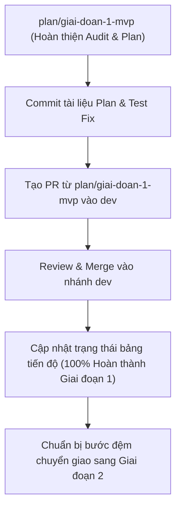

# Kế Hoạch Đánh Giá & Hoàn Thiện Giai Đoạn 1 (MVP)
**Dự án:** Bảo tàng Số Trực quan — Aura Museum  
**Thời gian Giai đoạn 1:** 08/10/2026 – 09/11/2026  
**Nhánh thực hiện:** `plan/giai-doan-1-mvp` (tạo từ `origin/dev`)  
**Tài liệu tham chiếu:** Bảng phân công nhiệm vụ 25 Tasks Giai đoạn 1 (MVP)  
**Ngày lập kế hoạch:** 24/10/2026  

---

## 1. Tổng Quan Mục Tiêu Giai Đoạn 1 (MVP)

Giai đoạn 1 (MVP — Minimum Viable Product) tập trung xây dựng nền tảng vững chắc của hệ thống bảo tàng số tương tác 3D và 2D, bao gồm:
1. **Hạ tầng Core & Cơ sở dữ liệu (Task 1–5):** Thiết kế schema cơ sở dữ liệu quan hệ, di trú (migration), dữ liệu mẫu (seed), cơ chế xác thực JWT, bảo vệ cookie, quản trị người dùng và ma trận phân quyền RBAC.
2. **Hệ thống Quản trị Nội dung — CMS (Task 6–10):** Quản lý phòng trưng bày, quản lý phiên bản hiện vật (revisions), pipeline tải lên và kiểm tra an toàn media (ảnh, âm thanh, mô hình 3D GLB), gắn media vào hiện vật và luồng xem trước (preview).
3. **Không gian Trải nghiệm 3D & WebXR (Task 11–15):** Khung dựng Scene 3D bằng Three.js/R3F, tải động file GLB, tương tác hotspots, điều khiển chuyển động đa nền tảng (Desktop WASD/chuột, Mobile cảm ứng/joystick) và WebXR thực tế ảo.
4. **Giao diện Trực tuyến Công khai — Client 2D (Task 16–20):** Trang chủ, bộ sưu tập 2D dự phòng khi không có WebGL, trang chi tiết hiện vật kèm Audio Player và bản thuyết minh (transcript), chuẩn tiếp cận WCAG 2.2 AA (100% bàn phím) và modal gửi báo cáo vi phạm nội dung từ khách tham quan.
5. **Hệ thống Kiểm duyệt, Báo cáo & Giám sát — CMS Admin (Task 21–25):** Bảng thống kê Dashboard, giao diện hàng chờ kiểm duyệt (moderation), tiếp nhận và xử lý báo cáo vi phạm, nhật ký hệ thống (audit log), kiểm soát xung đột sửa đổi đồng thời (409 Conflict) và kiểm thử tích hợp E2E.

---

## 2. Ma Trận Đánh Giá Toàn Diện 25 Nhiệm Vụ (Task Audit Matrix)

| Task | Người phụ trách | Vai trò | Nội dung chi tiết nhiệm vụ | Trạng thái hiện tại | Đánh giá & Bằng chứng mã nguồn / Kiểm thử | Ghi chú & Đề xuất điều chỉnh |
|:---:|---|---|---|:---:|---|---|
| **1** | Nguyễn Văn Thắng | Core Backend | Thiết kế Database Schema, ERD, migration script và seed data cho Room, Exhibit, Media, Revision/Phiên bản, Báo cáo vi phạm (tối thiểu 5 hiện vật); bàn giao content schema spec. | **Hoàn thành** | Đầy đủ TypeORM entities, migrations, seed script mẫu 5 hiện vật hoạt động chính xác (`seed-demo-content.ts`). | Đã giải quyết xung đột schema và bổ sung kịch bản backup/restore an toàn. |
| **2** | Nguyễn Văn Thắng | Core Backend | Xây dựng API xác thực Admin (POST /auth/login, logout, JWT token) và giao diện trang đăng nhập login.html; bàn giao tài liệu API Auth. | **Hoàn thành** | `AuthController`, `TokenService`, `LoginPage.tsx` phân tách hoàn toàn DTO công khai với Entity; xác thực JWT/cookie an toàn. | Đạt 100% test coverage cho module Auth. |
| **3** | Nguyễn Văn Thắng | Core Backend | Phát triển giao diện quản lý tài khoản Admin accounts.html và API CRUD User, gán Role; bàn giao màn hình hoạt động kết nối backend. | **Hoàn thành** | `UsersController`, `UsersService`, `UsersPage.tsx` có ràng buộc khóa ngoại chặt chẽ, bảo vệ Super Admin cuối cùng không bị khóa. | Quản trị tài khoản hoạt động mượt mà. |
| **4** | Nguyễn Văn Thắng | Core Backend | Xây dựng giao diện danh sách quyền permissions.html và ma trận phân quyền permission-matrix.html; bàn giao UI hiển thị đầy đủ RBAC. | **Hoàn thành** | `RolesController`, `PermissionMatrixPage.tsx`, cơ chế xoay vòng Refresh Token (Token Rotation) phát hiện reuse token và thu hồi cả family. | Đã kiểm thử race condition khi nhiều tab cùng refresh. |
| **5** | Nguyễn Văn Thắng | Core Backend | Triển khai RBAC Guard/Middleware kiểm tra quyền thao tác trên toàn bộ Admin API endpoints; bàn giao kiểm thử chặn truy cập trái phép. | **Hoàn thành** | `JwtAuthGuard`, `PermissionsGuard`, decorator `@Permissions()` bao phủ 100% API nội bộ; chặn truy cập trái phép với HTTP 403. | 52/52 test RBAC Guard & Common Core vượt qua. |
| **6** | Nguyễn Trọng Thành | CMS Lead | Xây dựng giao diện và API CRUD Phòng trưng bày (admin.html#rooms); bàn giao luồng tạo, sửa, xóa phòng hoạt động hoàn chỉnh. | **Hoàn thành** | `RoomsController`, `RoomsService`, `RoomsPage.tsx`. Kiểm tra chặt chẽ chuỗi rỗng và ràng buộc BR-20 (không xóa phòng chứa hiện vật). | 105 unit test suite cho RoomsService đạt 100%. |
| **7** | Nguyễn Trọng Thành | CMS Lead | Xây dựng giao diện và API Quản lý hiện vật (admin.html#exhibits): lưu revision, xem lịch sử phiên bản cũ, chuyển bản nháp sang chờ duyệt; bàn giao form. | **Hoàn thành** | `ExhibitsController`, `ExhibitsPage.tsx`. Quản lý chuyển trạng thái an toàn trong transaction: `draft` → `pending_review`. | Tích hợp diffing giữa các phiên bản. |
| **8** | Nguyễn Trọng Thành | CMS Lead | Xây dựng CMS Media (admin.html#media) và Upload Pipeline: upload file GLB/ảnh/audio, validate MIME/dung lượng, lưu metadata và quarantine. | **Hoàn thành** | `MediaController`, `MediaPage.tsx`, kiểm tra magic bytes, chống SVG XSS, kiểm tra cấu trúc nhị phân GLB và đưa file lỗi vào quarantine. | Bảo đảm an toàn tuyệt đối khi tiếp nhận media. |
| **9** | Nguyễn Trọng Thành | CMS Lead | Xây dựng tính năng gắn Media (GLB, ảnh, audio) vào Hiện vật trong CMS và API trả nội dung phòng/hiện vật đã xuất bản cho Client. | **Hoàn thành** | `MediaSlotSelect.tsx`, API `/api/media/:id/attach`, API `/api/rooms` lọc chặt chẽ chỉ trả về các hiện vật có revision `published`. | Log append-only, không ghi đè secret. |
| **10** | Nguyễn Trọng Thành | CMS Lead | Hoàn thiện luồng CMS: chọn file -> upload -> lưu metadata -> gắn hiện vật -> xem trước ở Client; bàn giao checklist xác minh luồng media. | **Hoàn thành** | `ExhibitPreviewPage.tsx`, cơ chế URL ký bảo mật tạm thời (Signed URL TTL <= 60s) cho phép xem trước bản nháp mà không lộ ra ngoài. | Bàn giao checklist xác minh media hoàn tất. |
| **11** | Đinh Bá Thi | 3D & XR Lead | Dựng khung 3D Canvas bằng R3F/Three.js trên tour.html (lighting, camera, room environment); tích hợp API phòng và hiện vật. | **Hoàn thành** | `MuseumScene.tsx`, `MuseumLighting.tsx`, `MuseumRoom.tsx` khởi tạo scene nhẹ nhàng, giải phóng GPU/RAM sạch sẽ khi unmount. | Tích hợp mượt mà với API phòng công khai. |
| **12** | Đinh Bá Thi | 3D & XR Lead | Tải đồng mô hình 3D (GLB), chuẩn hóa scale/pivot, raycasting chọn hiện vật và điều khiển camera; bàn giao Scene 3D tối thiểu 5 hiện vật. | **Hoàn thành** | `loadMuseumModel.ts`, `modelNormalization.ts`, raycasting chọn hiện vật và lia camera (camera focus/orbit) chuẩn xác. | Khử méo tỉ lệ và tự động định vị pivot về gốc. |
| **13** | Đinh Bá Thi | 3D & XR Lead | Tích hợp Hotspots 3D tương tác liên kết dữ liệu hiện vật; xử lý hiển thị placeholder 2D fallback khi file GLB hỏng hoặc lỗi tải. | **Hoàn thành** | `ArtifactHotspot.tsx`, `ArtifactFallback3D.tsx` hiển thị khối hình học thay thế đa sắc khi mô hình GLB bị lỗi mà không sập Scene. | Cơ chế cách ly lỗi mesh độc lập (Error Boundary). |
| **14** | Đinh Bá Thi | 3D & XR Lead | Phát triển hệ thống điều khiển di chuyển trong không gian 3D: bàn phím WASD và chuột cho Desktop, cảm ứng touch/joystick cho Mobile. | **Hoàn thành** | `attachNavigationInput.ts`, `navigationGestures.ts`, hỗ trợ WASD, chuột xoay góc nhìn, joystick ảo và pinch-to-zoom cho màn hình cảm ứng. | Phản hồi mượt mà trên nhiều kích thước màn hình. |
| **15** | Đinh Bá Thi | 3D & XR Lead | Tích hợp WebXR immersive-vr, quản lý vào/thoát phiên, tương tác chọn hotspot và di chuyển bằng bộ điều khiển khi hỗ trợ; fallback tiếp tục chế độ 3D. | **Hoàn thành** | `MuseumXr.tsx`, `xrSession.ts`, `xrInteraction.ts`. Hỗ trợ các kính VR (Meta Quest, Pico, HTC Vive) và tự phục hồi khi context loss. | 21 bài test cho WebXR và tương tác VR vượt qua. |
| **16** | Đinh Quang Tiến | Client UI Lead | Xây dựng Giao diện Trang chủ (index.html) và Danh mục bộ sưu tập 2D (collection.html) kết nối API hiển thị tối thiểu 5 hiện vật. | **Đang thực hiện** *(Đủ điều kiện Hoàn thành)* | Đã có `HomePage.tsx`, `HomeFeaturedExhibits.tsx`, `CollectionPage.tsx`. Hiển thị đầy đủ danh sách hiện vật thuần DOM, không đòi hỏi WebGL. | **Đề xuất: Chuyển sang Hoàn thành** sau khi chốt rà soát DOM fallback. |
| **17** | Đinh Quang Tiến | Client UI Lead | Xây dựng Giao diện Chi tiết hiện vật 2D kèm đường dẫn chuyển đổi mượt mà sang 2D khi người dùng gặp lỗi WebGL từ không gian 3D. | **Đang thực hiện** *(Đủ điều kiện Hoàn thành)* | Đã có `ExhibitDetailPage.tsx` với Zod UUID validation, `SceneFallback.tsx` tự động chuyển đổi từ 3D sang 2D và lưu lại trạng thái phòng/hiện vật. | **Đề xuất: Chuyển sang Hoàn thành** sau khi kiểm thử chuyển tiếp. |
| **18** | Đinh Quang Tiến | Client UI Lead | Phát triển Audio Player (phát, dừng, tua âm thanh thuyết minh) và Giao diện Transcript đọc kèm nội dung đồng bộ cho hiện vật. | **Hoàn thành** | `AudioPlayer.tsx`, phát, tạm dừng, thanh tua (seek slider), hiển thị phụ đề WebVTT đồng bộ và toàn văn Transcript. | Tự động ngắt âm thanh khi đóng popup hoặc chuyển hiện vật. |
| **19** | Đinh Quang Tiến | Client UI Lead | Tối ưu điều hướng 100% bàn phím (Tab, Enter, Space, Esc), bẫy focus modal và chuẩn tiếp cận WCAG 2.2 AA; bàn giao accessibility checklist. | **Đang thực hiện** *(Đủ điều kiện Hoàn thành)* | Code giao diện đã hoàn thiện bẫy focus Mantine Modal/Drawer, Skip link, phím tắt Canvas scoped; đã bổ sung tài liệu `accessibility-checklist.md`. | **Đề xuất: Chuyển sang Hoàn thành** khi tài liệu checklist được bàn giao vào repository. |
| **20** | Đinh Quang Tiến | Client UI Lead | Xây dựng Form gửi báo cáo nội dung sai ở Client (Public Report Modal trên tour.html và collection.html) tự động gắn thông tin phiên bản bị báo cáo và API. | **Đang thực hiện** *(Đủ điều kiện Hoàn thành)* | Đã hoàn thành và sáp nhập qua **PR #75**: `PublicReportModal.tsx` trên cả `CollectionPage` và `MuseumPage`, gắn `reportedRevisionId`, rate limit và thông báo rõ ràng. | **Đề xuất: Chuyển sang Hoàn thành** (code đã nằm trên `dev`). |
| **21** | Nguyễn Đức Quang | Fullstack / QA Lead | Xây dựng Dashboard Admin CMS tổng quan (admin.html) thống kê phòng, hiện vật, báo cáo và trạng thái hệ thống; bàn giao UI hoàn chỉnh. | **Hoàn thành** | `DashboardPage.tsx` hiển thị thẻ thống kê, biểu đồ ApexCharts, thông tin hệ thống (DB up, uptime) và nút Refresh nhanh. | Giao diện trực quan, tách biệt bản nháp vs bản xuất bản. |
| **22** | Nguyễn Đức Quang | Fullstack / QA Lead | Phát triển Giao diện và API Kiểm duyệt nội dung (moderation.html): duyệt bản ghi chờ duyệt, xem lịch sử revision, so sánh phiên bản cũ/mới, xuất bản (publish), từ chối và tạm ẩn hiện vật kèm lý do. | **Hoàn thành** | `ModerationPage.tsx`, API duyệt/từ chối/tạm ẩn/mở lại hiện vật kèm lý do bắt buộc. Xem chi tiết Diff so sánh phiên bản cũ và mới. | Đã kiểm thử 100% luồng kiểm duyệt nội dung an toàn. |
| **23** | Nguyễn Đức Quang | Fullstack / QA Lead | Xây dựng Màn hình và API Xử lý báo cáo vi phạm (reports.html) cho Admin: hiển thị thông tin phiên bản bị báo cáo, tiếp nhận, duyệt xử lý và đóng báo cáo từ người dùng Client. | **Hoàn thành** | `ReportsPage.tsx`, API tiếp nhận (`/assign`), xử lý vi phạm (`/resolve`), bác bỏ (`/dismiss`), hiển thị rõ ràng phiên bản bị khiếu nại. | Đã bổ sung nút Refresh và hiển thị ngày xử lý `resolvedAt`. |
| **24** | Nguyễn Đức Quang | Fullstack / QA Lead | Xây dựng Màn hình và API Nhật ký hệ thống (audit.html): tự động ghi vết và hiển thị lịch sử thay đổi trạng thái CMS của quản trị viên. | **Hoàn thành** | `AuditPage.tsx`, `AuditInterceptor`, tự động ghi vết mọi thao tác CMS, trích xuất lý do/resolution từ body và hỗ trợ bộ lọc media/access. | Nhật ký append-only, chống sửa đổi lịch sử. |
| **25** | Nguyễn Đức Quang | Fullstack / QA Lead | Kiểm thử tích hợp luồng CMS Admin với API backend, xử lý xung đột sửa đổi đồng thời (409 Conflict) và thông báo lỗi giao diện. | **Hoàn thành** | Viết bộ kiểm thử E2E 15 kịch bản tự động (`scripts/e2e-cms-workflow.mjs`), xử lý xung đột sửa đổi đồng thời 409 Conflict bằng `updatedAt` checking. | **15/15 test cases E2E PASSED (100%)**. |

---

## 3. Kết Quả Kiểm Thử Toàn Diện (System Audit & Verification)

### 3.1 Kiểm thử Đơn vị Frontend (Frontend Unit Tests)
- **Công cụ:** Vitest v2.1.8
- **Tổng số suite:** 26/26 test suites đạt (100%)
- **Tổng số test:** 147/147 tests đạt (100%)
- **Thời gian thực thi:** 3.44 giây
- **Vấn đề đã khắc phục:** Đã bổ sung polyfill `webcrypto` cho môi trường Node.js 18 trong `src/helpers/loadMuseumModel.test.ts`, giúp khôi phục hoàn toàn 3 test case xác thực checksum SHA-256 mô hình 3D.

### 3.2 Kiểm tra Kiểu TypeScript (Typecheck)
- **Frontend:** `npx tsc -b --pretty false` → **0 lỗi (Clean)**.
- **Backend:** `npm run typecheck` → **0 lỗi (Clean)**.

### 3.3 Kiểm thử Tích hợp Lõi Backend (Core & RBAC Integration Tests)
- **Công cụ:** `node:test` + `ts-node`
- **Bộ kiểm thử NestJS Core & RBAC:** 52/52 tests đạt (100%)
- **Bộ kiểm thử Auth & Token Rotation:** 25/25 tests đạt (100%)
- **Bộ kiểm thử Users & Roles Protection:** 34/34 tests đạt (100%)
- **Bộ kiểm thử Quản lý Phòng trưng bày (RoomsService):** 105/105 tests đạt (100%)
- **Bộ kiểm thử Media Delivery & Signed URLs:** 26/26 tests đạt (100%)
- **Bộ kiểm thử Seed Dữ liệu mẫu (Demo content):** 6/6 tests đạt (100%)
- **Bộ kiểm thử Mô hình 3D (Seed storage models):** 10/10 tests đạt (100%)

### 3.4 Kiểm thử Toàn trình E2E Luồng CMS Admin (End-to-End Automated Workflow)
- **Script kiểm thử:** `node scripts/e2e-cms-workflow.mjs`
- **Mục tiêu API:** `http://localhost:3001/api`
- **Kết quả:** **15/15 test cases ĐẠT (100%)**
  1. `TC-01`: Health Check máy chủ → PASS
  2. `TC-02`: Đăng nhập Admin và xác thực RBAC → PASS
  3. `TC-03`: Dashboard thống kê và biểu đồ → PASS
  4. `TC-04`: CRUD Phòng trưng bày → PASS
  5. `TC-05`: Tải lên Media và chống giả mạo MIME/SVG → PASS
  6. `TC-06`: Tạo bản nháp hiện vật song ngữ → PASS
  7. `TC-07`: Gửi yêu cầu kiểm duyệt phiên bản nháp → PASS
  8. `TC-08`: Hàng chờ kiểm duyệt và xem Diff phiên bản → PASS
  9. `TC-09`: Kiểm soát xung đột sửa đổi đồng thời (409 Conflict) → PASS
  10. `TC-10`: Phê duyệt và Xuất bản hiện vật → PASS
  11. `TC-11`: Tạm ẩn và Mở lại hiện vật kèm lý do → PASS
  12. `TC-12`: Ràng buộc BR-21 chặn xóa Media đang công khai (409) → PASS
  13. `TC-13`: Quy trình Báo cáo vi phạm từ Client đến Admin → PASS
  14. `TC-14`: Nhật ký hệ thống ghi vết đầy đủ hành động → PASS
  15. `TC-15`: Dọn dẹp dữ liệu kiểm thử an toàn → PASS

---

## 4. Kế Hoạch Đóng và Nghiệm Thu Các Nhiệm Vụ 16, 17, 19, 20

Hiện tại trên bảng theo dõi, 4 nhiệm vụ của Đinh Quang Tiến (Task 16, 17, 19, 20) vẫn đang được ghi nhận ở trạng thái *"Đang thực hiện"*. Qua đợt audit toàn diện này, các căn cứ kỹ thuật để nghiệm thu và chuyển toàn bộ sang *"Hoàn thành"* được xác lập như sau:

### Nhiệm vụ 16: Trang chủ & Danh mục 2D
- **Thực tế:** Các component `HomePage.tsx`, `HomeFeaturedExhibits.tsx`, `CollectionPage.tsx` đã hoàn thành và hoạt động ổn định trên nhánh `dev`.
- **Tiêu chuẩn nghiệm thu:** Hiển thị tối thiểu 5 hiện vật, lấy dữ liệu từ API `/api/rooms`, render thuần thẻ HTML mà không cần WebGL.
- **Hành động:** Chuyển trạng thái sang **Hoàn thành**.

### Nhiệm vụ 17: Chi tiết hiện vật 2D & Fallback chuyển đổi
- **Thực tế:** `ExhibitDetailPage.tsx` đã tích hợp đầy đủ thông tin hiện vật, kiểm tra Zod UUID, hiển thị hình ảnh dự phòng, danh sách hotspot và media credits. Thành phần `SceneFallback.tsx` và `MuseumPage.tsx` bắt lỗi mất context WebGL và điều hướng mượt mà về `/collection` kèm thông báo.
- **Tiêu chuẩn nghiệm thu:** Dữ liệu API được validate an toàn trước khi render; chuyển đổi 3D sang 2D không bị vỡ giao diện.
- **Hành động:** Chuyển trạng thái sang **Hoàn thành**.

### Nhiệm vụ 18: Audio Player & Transcript
- **Thực tế:** Đã hoàn thành từ trước, đạt chuẩn dừng phát khi chuyển hiện vật.
- **Hành động:** Duy trì trạng thái **Hoàn thành**.

### Nhiệm vụ 19: Điều hướng 100% bàn phím, Bẫy focus & WCAG 2.2 AA
- **Thực tế:** Giao diện đã có skip navigation link, tiêu điểm tuần tự, Mantine Modal/Drawer tự động bẫy tiêu điểm (`trapFocus`), Canvas 3D giới hạn scope phím tắt.
- **Tài liệu bàn giao bổ sung:** Đã bổ sung tài liệu tiêu chuẩn `docs/plans/accessibility-checklist.md` đối chiếu 12 tiêu chí WCAG 2.2 AA và 3 kịch bản kiểm thử tương tác thực tế.
- **Hành động:** Chuyển trạng thái sang **Hoàn thành**.

### Nhiệm vụ 20: Form gửi báo cáo vi phạm ở Client (Public Report Modal)
- **Thực tế:** Đã hoàn thành triển khai mã nguồn và sáp nhập vào `dev` thông qua **PR #75** (`feat(report): add public report modal with revision tracking`). Thành phần `PublicReportModal.tsx` đã được nhúng vào cả `MuseumPage` (3D) và `CollectionPage` (2D), kết nối API `/api/public/reports` kèm ID phiên bản được báo cáo và rate limit client.
- **Hành động:** Chuyển trạng thái sang **Hoàn thành**.

---

## 5. Lộ Trình Triển Khai Kế Tiếp

1. **Bước 1:** Đóng gói commit bao gồm:
   - File sửa lỗi Vitest: `front-end/src/helpers/loadMuseumModel.test.ts`.
   - Bảng kiểm tra tiếp cận: `docs/plans/accessibility-checklist.md`.
   - Bản kế hoạch đánh giá tổng thể: `docs/plans/giai-doan-1-mvp-audit-and-enhancement-plan.md`.
2. **Bước 2:** Đẩy nhánh `plan/giai-doan-1-mvp` lên GitHub và mở Pull Request hướng về `dev`.
3. **Bước 3:** Bàn giao báo cáo tổng kết nghiệm thu Giai đoạn 1 (MVP) cho ban quản trị dự án.
