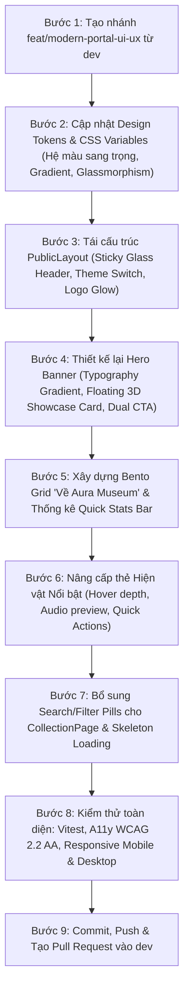

# Kế Hoạch Nâng Cấp Toàn Diện Giao Diện Cổng Thông Tin & Trải Nghiệm Người Dùng (Modern Portal UI/UX Overhaul Plan)
**Dự án:** Bảo tàng Số Trực quan — Aura Museum  
**Mục tiêu:** Chuyển đổi toàn diện giao diện Cổng thông tin công khai (Trang chủ `/`, Layout, Bộ sưu tập 2D) từ phong cách cổ điển/nhạt nhòa sang phong cách **Bảo tàng Số Đương đại Cao cấp (Modern Luxury Digital Museum)** với đồ họa sống động, chiều sâu đa tầng, chuyển động mượt mà 60fps và trải nghiệm WebXR tương tác đỉnh cao.  
**Ngày lập kế hoạch:** 24/10/2026  
**Nhánh dự kiến triển khai:** `feat/modern-portal-ui-ux` (tạo từ `dev`)  
**Tài liệu liên quan:** `docs/plans/client-homepage-plan.md`, `docs/plans/accessibility-checklist.md`

---

## 1. Bối Cảnh, Đánh Giá Hiện Trạng & Vấn Đề Cần Giải Quyết

### 1.1 Hiện trạng quan sát được
Hiện tại, trang chủ công khai (`HomePage.tsx`, `PublicLayout.tsx`, `HomePage.module.css`) đang bộc lộ nhiều điểm hạn chế về mặt thị giác và cảm xúc người dùng:
1. **Màu sắc nhợt nhạt, cảm giác "cũ kỹ / hoài cổ lạc hậu":**
   - Hệ màu nền sử dụng tông vàng be/đất xỉn (`--public-background: #f7f5ef`, `--public-surface: #eeeae0`, `#d5c6aa`), tạo cảm giác như trang giấy báo cũ ố vàng, thiếu sức sống và làm giảm đi tính chất công nghệ cao của một nền tảng 3D WebXR thời thượng.
2. **Typography đơn điệu:**
   - Tiêu đề đang sử dụng font mặc định `font-family: 'Times New Roman', serif;` thô cứng, thiếu nét tinh tế của đồ họa số hiện đại.
3. **Minh họa thị giác (Visual Banner) thô sơ:**
   - Phần banner Hero bên phải hiện tại đang vẽ một hình vòm cửa bằng các thẻ `div` lồng nhau kết hợp viền cứng (`.arch`, `.innerArch`, `.plinth`), không có tương tác, không đại diện được cho hiện vật thật và tạo cảm giác chắp vá.
4. **Thiếu chuyển động (Animations & Micro-interactions):**
   - Các thành phần trên trang hoàn toàn tĩnh. Không có hiệu ứng xuất hiện mượt mà (entrance animation), không có hiệu ứng hover tương tác, không có chiều sâu đổ bóng (depth/elevation) hay hiệu ứng kính mờ (glassmorphism).
5. **Cấu trúc nội dung đơn giản, chưa kích thích khám phá:**
   - Phần giới thiệu "Về Aura" chỉ gồm 2 cột văn bản thuần túy, chưa có các khối nội dung trực quan (Bento Grid) để làm nổi bật các tính năng vượt trội: Không gian 3D WebXR, Audio Thuyết minh song ngữ, Báo tồn di sản số độ phân giải cao.
   - Mục hiện vật nổi bật mới chỉ là danh sách 3 thẻ tĩnh, thiếu các nút nghe nhanh thuyết minh hay phím tắt bay trực tiếp vào không gian 3D.

---

## 2. Triết Lý Thiết Kế Mới (Visual Identity & Design Philosophy)

### Định vị: **"Aura Museum — Không Gian Di Sản Số Đương Đại & Đỉnh Cao Tương Tác"**
(Contemporary Luxury Digital Museum with Glassmorphic Elevation & Fluid Motion)

```
┌────────────────────────────────────────────────────────────────────────┐
│                        AURA DESIGN SYSTEM 2.0                          │
│                                                                        │
│  [ Deep Obsidian ]       [ Aurora Teal ]       [ Imperial Gold ]       │
│     #0A0E17                 #0D9488                 #F59E0B            │
│  (Không gian chiều sâu)  (Điểm nhấn năng lượng)  (Văn hóa hoàng gia)   │
│                                                                        │
│  [ Glassmorphic Surface ] ──────►  backdrop-filter: blur(16px)         │
│  [ Fluid Micro-motion ]   ──────►  cubic-bezier(0.16, 1, 0.3, 1)       │
│  [ Dynamic Typography ]   ──────►  Plus Jakarta Sans / Inter Display    │
└────────────────────────────────────────────────────────────────────────┘
```

### 2.1 Hệ Bảng Màu Đỉnh Cao (Color Palette & Tokens)
- **Chế độ Tối ưu Ban đêm / Không gian Bảo tàng Số (Dark Mode — Mặc định khuyến nghị cho trải nghiệm 3D):**
  - **Nền không gian vũ trụ/chiều sâu:** Deep Obsidian (`#0A0E17`), Midnight Blue (`#0F172A`).
  - **Bề mặt khối nổi (Surfaces):** Dark Slate (`#1E293B`) kết hợp hiệu ứng kính mờ `rgba(30, 41, 59, 0.7)`.
  - **Điểm nhấn ánh sáng bảo tàng (Aura Accents):**
    - *Aurora Teal / Emerald:* `#10B981` / `#0D9488` (ánh sáng ngọc bích hiện đại, tượng trưng cho công nghệ).
    - *Imperial Gold:* `#F59E0B` / `#D97706` (ánh kim hoàng gia quý phái, tượng trưng cho cổ vật di sản).
    - *Cyan Neon:* `#06B6D4` (chỉ dẫn tương tác WebXR).
  - **Viền sáng tinh tế:** `border: 1px solid rgba(255, 255, 255, 0.08)`.
- **Chế độ Sáng Hiện Đại (Refined Studio Light Mode):**
  - **Nền không gian triển lãm:** Pure Gallery White (`#F8FAFC`) và Soft Ivory (`#FAFAF9`), loại bỏ hoàn toàn màu bùn đất nhợt nhạt cũ.
  - **Chữ & Nội dung:** Slate Ink (`#0F172A`), tương phản tuyệt đối đạt chuẩn WCAG 2.2 AAA.
  - **Bề mặt thẻ:** Pure White (`#FFFFFF`) với bóng đổ đa tầng mịn màng (`box-shadow: 0 10px 30px -10px rgba(0,0,0,0.06)`).

### 2.2 Typography Đẳng Cấp
- **Bỏ hoàn toàn:** `Times New Roman`.
- **Phông chữ tiêu đề (Display Headings):** Sử dụng hệ phông hình học hiện đại, sắc nét: **Plus Jakarta Sans / Cabinet Grotesk / Inter Display** với nét đậm 700–800, kết hợp hiệu ứng Gradient Text óng ánh (`background: linear-gradient(135deg, #FFFFFF 20%, #94A3B8 100%)`).
- **Phông chữ nội dung (Body):** **Inter** hoặc **Roboto** sắc nét, line-height 1.7, letter-spacing chuẩn quốc tế.

### 2.3 Chuyển Động & Hiệu Ứng (Micro-interactions & Physics)
- **Spring Physics:** Chuyển động lướt êm ái với đường cong `cubic-bezier(0.16, 1, 0.3, 1)`.
- **Card Hover Elevation:** Thẻ hiện vật tự động nâng nhẹ (`translateY(-6px)`), viền phát sáng gradient (Aura glow border), hình ảnh phóng to chậm rãi (`scale(1.04)`).
- **Aura Ambient Pulse:** Hiệu ứng hào quang thở nhẹ nhàng đằng sau Hero Banner và các nút kêu gọi hành động (CTA).

---

## 3. Kiến Trúc & Chi Tiết Nâng Cấp Từng Khu Vực (Component Roadmap)

### 3.1 Khu Vực 1: Header Nổi & Navigation Glassmorphism (`PublicLayout`)
- **Sticky Glass Navbar:** Thanh điều hướng cố định trên đầu trang với hiệu ứng kính mờ `backdrop-filter: blur(16px)`, tự động thu nhỏ nhẹ khi cuộn trang.
- **Logo Aura Phát Sáng:** Logo bảo tàng có viền phát hào quang nhẹ (Aura Glow effect) khi người dùng di chuột.
- **Active Navigation Pill:** Hiển thị tab đang chọn với hình khối bo tròn tinh tế và chuyển động trượt mượt mà.
- **Nút CTA Nhanh:** Bổ sung nút **"Vào không gian 3D"** nổi bật ngay trên Header để khách có thể trải nghiệm ngay từ bất kỳ trang nào.
- **Bộ Chuyển Đổi Giao Diện (Theme Switcher):** Thêm nút chuyển đổi Dark / Light mode mượt mà với icon Mặt trời / Mặt trăng có animation xoay.

### 3.2 Khu Vực 2: Hero Banner — Trải Nghiệm Thị Giác Đỉnh Cao
- **Headline Mạnh Mẽ & Đầy Cảm Hứng:**
  - *Eyebrow Badge:* `● KHÔNG GIAN BẢO TÀNG SỐ 3D WEBXR THẾ HỆ MỚI` với viền phát sáng nhẹ.
  - *Main Title:* **"Chạm vào Di sản.<br />Khám phá Không giới hạn."** (Sử dụng Gradient Text chuyển tiếp từ trắng bạc sang vàng kim/emerald).
  - *Sub-headline:* "Bước vào không gian triển lãm 3D tương tác thực tế ảo, lắng nghe câu chuyện nghìn năm qua âm thanh thuyết minh sống động — ngay trên trình duyệt của bạn."
- **Dual CTA Buttons (Bộ đôi nút hành động cao cấp):**
  - *Nút Chính:* **"Khám phá Không gian 3D (WebXR)"** — Nút kích thước lớn, hiệu ứng gradient phát sáng, có icon kính thực tế ảo và hiệu ứng nhịp thở nhẹ.
  - *Nút Phụ:* **"Xem Danh mục Bộ sưu tập"** — Nút trong suốt viền kính mờ (Glassmorphic Outline), thanh lịch và tinh tế.
- **Hero Visual Showcase (Thay thế hình vòm cũ):**
  - Thiết kế **Floating Exhibit Showcase**: Một thẻ 3D nghệ thuật đa tầng lơ lửng giữa không gian với hiệu ứng góc nghiêng (Perspective 3D tilt).
  - Hiển thị mô hình/hình ảnh hiện vật tiêu biểu sắc nét kèm nhãn thông tin phát sáng: Tên cổ vật, Niên đại, và nút phát nhanh âm thanh thuyết minh mini.
- **Thanh Chỉ Số Ấn Tượng (Quick Stats Bar):**
  - Tích hợp ngay dưới Hero banner dải 4 chỉ số nổi bật:
    - **5+** Phòng trưng bày ảo
    - **100%** Khám phá 3D & WebXR
    - **Song ngữ** Thuyết minh & Phụ đề
    - **0s** Không cần cài đặt

### 3.3 Khu Vực 3: Bento Grid — Khám Phá Tính Năng Vượt Trội (Về Aura)
Thay thế hoàn toàn 2 cột văn bản dài dòng bằng **Bento Grid 4 ô trực quan**, sắp xếp nghệ thuật:
1. **Ô Lớn 1: Không Gian Thực Tế Ảo WebXR Nhập Vai**
   - Minh họa góc nhìn 3D góc rộng, nhấn mạnh khả năng tương thích kính VR (Quest, Pico, HTC Vive) và điều khiển linh hoạt WASD/Touch.
2. **Ô 2: Thuyết Minh Âm Thanh & Sóng Nhạc Động**
   - Minh họa bộ Audio Player với animation cột sóng âm thanh (Animated Equalizer Waves), phụ đề WebVTT đồng bộ từng câu nói.
3. **Ô 3: Tái Hiện Di Sản Độ Chi Tiết Cao**
   - Mô phỏng khả năng soi rõ từng chi tiết hoa văn, chất liệu gốm sứ/đồng thau cổ vật và các điểm chú thích (Hotspots) thông minh.
4. **Ô 4: Tiếp Cận Toàn Diện (WCAG 2.2 AA & Đa Thiết Bị)**
   - Biểu tượng tiếp cận: 100% điều hướng bàn phím, chế độ dự phòng 2D mượt mà khi thiết bị không có WebGL.

### 3.4 Khu Vực 4: Hiện Vật Nổi Bật (Featured Exhibits Modern Showcase)
- **Thẻ Hiện Vật Hiện Đại (Modern Artifact Cards):**
  - Khung thẻ bo góc 16px, viền kính mờ tinh tế.
  - Hình ảnh hiện vật với hiệu ứng chiều sâu, lớp phủ gradient tối dần ở đáy để tôn chữ.
  - Huy hiệu phân loại hiện vật (Cổ vật quý, Bảo vật quốc gia, Nghệ thuật điêu khắc).
  - Tích hợp 2 nút hành động trực tiếp trên mỗi thẻ:
    - Nút **"Nghe thuyết minh"** (phát trực tiếp không cần chuyển trang).
    - Nút **"Xem chi tiết & Vị trí 3D"**.
- **Chuyển Động Trực Quan:** Thẻ có hiệu ứng shimmer loading khi đang tải và phóng to nhẹ hình ảnh khi rê chuột vào.

### 3.5 Khu Vực 5: Footer Đẳng Cấp & Liên Kết
- **Thương hiệu & Tuyên ngôn:** Tuyên ngôn bảo tồn di sản số, logo phát sáng nhẹ.
- **Lối tắt nhanh:** Liên kết nhanh đến các phòng trưng bày, tour 3D, danh mục hiện vật.
- **Trợ giúp & Khả năng tiếp cận:** Hướng dẫn phím tắt bàn phím, form báo cáo vi phạm nội dung, cam kết WCAG 2.2 AA.
- **Cổng Quản Trị Viên (Admin CMS Portal):** Nút đăng nhập bảo mật dành cho ban quản lý bảo tàng.

---

## 4. Kế Hoạch Bổ Sung & Tinh Chỉnh Cho Các Phân Hệ Khác Của Team

Bên cạnh trang chủ, các phân hệ khác cũng được bổ sung các cải tiến UI/UX đồng bộ:

### 4.1 Trang Danh Mục Bộ Sưu Tập 2D (`CollectionPage`)
- **Thanh Tìm Kiếm Nhanh (Search Bar):** Cho phép người dùng gõ tên hiện vật hoặc từ khóa để lọc tức thì.
- **Bộ Lọc Bằng Chip (Filter Pills):** Thay thế dropdown chọn phòng đơn điệu bằng hàng nút bấm dạng chip (All, Phòng Điêu Khắc, Phòng Gốm Sứ...) chuyển đổi mượt mà.
- **Skeleton Loader:** Sử dụng khung xương mô phỏng thẻ hiện vật nhấp nháy ánh sáng (Shimmer Skeleton) thay vì thông báo "Đang tải hiện vật...".

### 4.2 Trang Chi Tiết Hiện Vật 2D (`ExhibitDetailPage`)
- **Floating Audio Bar:** Nâng cấp thanh Audio Player thành thanh điều khiển nổi cố định dưới đáy màn hình khi cuộn trang, giúp người dùng vừa đọc vừa nghe thuyết minh không bị gián đoạn.
- **Nút "Bay Vào Không Gian 3D" (Jump to 3D):** Nhấn nút sẽ mở tour 3D và tự động lia camera thẳng vào vị trí của hiện vật này trong không gian 3D.

### 4.3 Trải Nghiệm Tour 3D (`MuseumPage`)
- **HUD Controls Help Overlay:** Bổ sung popover hướng dẫn phím tắt đẹp mắt (WASD di chuyển, chuột xoay góc nhìn, F chụp cận cảnh).
- **Cinematic Entrance Camera:** Khi mở phòng 3D, camera lia từ trên cao xuống vị trí người tham quan mượt mà trong 2 giây đầu để tạo cảm giác bước vào một bảo tàng thật.

---

## 5. Lộ Trình Triển Khai Chi Tiết (Actionable Implementation Steps)



### Chi tiết các công việc triển khai:
- **Task A — Design Tokens & Styling Base (1 ngày):**
  - Cập nhật `PublicLayout.module.css` với hệ biến CSS hiện đại: màu tối sâu (`#0A0E17`), điểm nhấn ngọc bích/emerald (`#10B981`), vàng hoàng gia (`#F59E0B`), viền kính mờ và bóng đổ đa tầng.
  - Bổ sung keyframes animation trong CSS: `@keyframes aura-glow`, `@keyframes float`, `@keyframes shimmer`, `@keyframes fade-in-up`.
- **Task B — Modern Header & Navigation (0.5 ngày):**
  - Thêm hiệu ứng kính mờ khi cuộn trang cho Header.
  - Nâng cấp logo Aura với hiệu ứng phát sáng Aura glow.
  - Bổ sung nút Quick Launch "Tham quan 3D" trên Header.
- **Task C — Hero Banner & Interactive Showcase (1.5 ngày):**
  - Xóa bỏ các class CSS vẽ hình vòm cũ (`.arch`, `.innerArch`, `.plinth`).
  - Viết lại cấu trúc Hero trong `HomePage.tsx`: Headline typography sang trọng, nút bấm CTA phát sáng nhịp thở, Floating 3D Preview Card lơ lửng với góc nghiêng phối cảnh.
  - Tích hợp thanh thống kê nhanh 4 chỉ số (Quick Stats Bar).
- **Task D — Bento Grid & Featured Exhibits (1.5 ngày):**
  - Thiết kế Bento Grid 4 khối hiện đại giới thiệu tính năng đặc quyền của Aura Museum.
  - Nâng cấp `HomeFeaturedExhibits.tsx` với thẻ hiện vật sang trọng, hình ảnh zoom mượt mà và nút nghe âm thanh nhanh.
- **Task E — Tinh chỉnh Bộ sưu tập 2D & Kiểm thử (1 ngày):**
  - Thêm Filter Pills và tìm kiếm cho `CollectionPage.tsx`.
  - Kiểm tra tương thích 100% bàn phím, contrast chữ WCAG 2.2 AA.
  - Chạy `npm run test:unit`, `npx tsc` và xác minh trên Chrome/Firefox/Edge.

---

## 6. Tiêu Chuẩn Nghiệm Thu (Acceptance Criteria)

1. **Thẩm mỹ & Cảm xúc thị giác:**
   - Giao diện toát lên vẻ sang trọng, hiện đại, màu sắc có chiều sâu và điểm nhấn ánh sáng rõ rệt, không còn cảm giác giấy cũ nhợt nhạt.
   - Typography sắc nét, loại bỏ 100% Times New Roman trên các tiêu đề công khai.
   - Hiệu ứng chuyển động mượt mà (60fps), không gây giật lag hoặc quá tải GPU.
2. **Khả năng tiếp cận & Tương thích:**
   - Giữ nguyên 100% khả năng điều hướng bàn phím (Tab, Enter, Space, Esc) theo đúng tài liệu `docs/plans/accessibility-checklist.md`.
   - Đáp ứng hiển thị hoàn hảo từ màn hình di động (375px) đến máy tính để bàn (4K).
3. **Chất lượng mã nguồn:**
   - Toàn bộ 26/26 test suites Vitest tiếp tục PASS (100%).
   - TypeScript typecheck đạt 0 lỗi.
   - Mã nguồn tuân thủ nghiêm ngặt CSS Modules, không phá vỡ bất kỳ quy ước nào của dự án.
