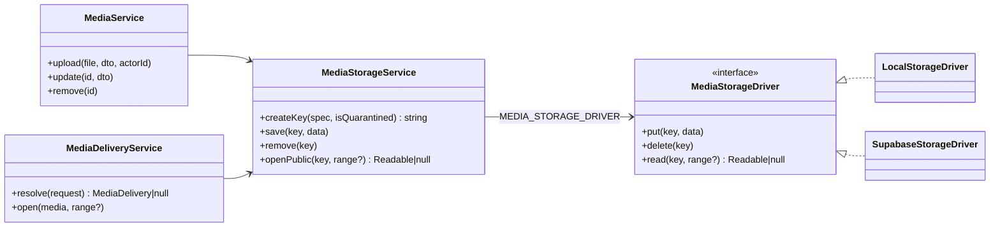
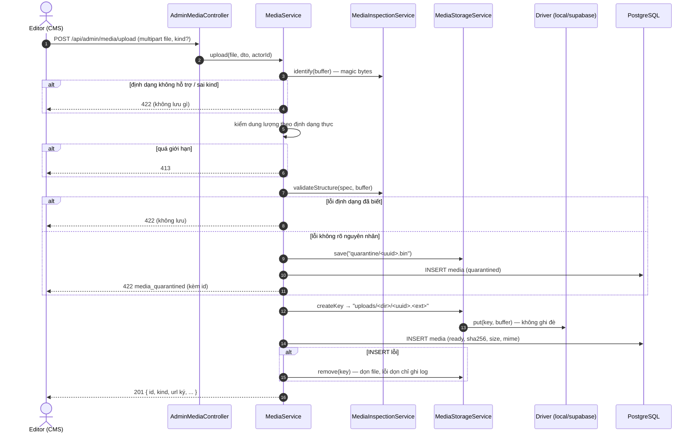

# 03 — Kiến trúc lưu trữ media

> Code nằm ở `back-end/src/modules/media/`. Tài liệu này mô tả lớp lưu file (driver), quy tắc
> storage key, luồng upload/xóa, và đường đọc GLB riêng của tour 3D.

## 1. Các lớp và trách nhiệm



| Lớp | File | Trách nhiệm | Không làm |
|---|---|---|---|
| `MediaService` | `services/media.service.ts` | Nghiệp vụ: pipeline upload, metadata, xóa mềm theo BR-21 | Không biết file nằm ở đâu |
| `MediaStorageService` | `services/media-storage.service.ts` | Sinh key, **kiểm key an toàn**, chặn đọc vùng quarantine, ủy quyền driver | Không gọi `fs`/HTTP trực tiếp |
| `MediaStorageDriver` | `storage/media-storage-driver.ts` | Interface 3 hàm `put/delete/read` | — |
| `LocalStorageDriver` | `storage/local-storage.driver.ts` | Đĩa: `public/media/` + `storage/quarantine/` | — |
| `SupabaseStorageDriver` | `storage/supabase-storage.driver.ts` | REST API Supabase Storage | Không dùng SDK |

### Chọn driver (DI)
`media.module.ts` đăng ký provider `MEDIA_STORAGE_DRIVER` bằng `useFactory`:

```ts
config.get('media.storageDriver') === 'supabase'
  ? new SupabaseStorageDriver({ url, serviceKey, bucket })   // media.supabase.*
  : new LocalStorageDriver();                                 // mặc định
```

Đổi driver = đổi env + khởi động lại. Không có cột DB lưu "file nằm ở driver nào" (quyết định S3) →
**không chạy hai driver song song trên cùng một DB**: media upload khi chạy `local` sẽ 404 khi chuyển sang
`supabase` cho tới khi đẩy file lên bucket (xem [05](05-chuyen-du-lieu-va-script.md)).

## 2. Interface driver — hợp đồng bắt buộc

```ts
export interface MediaStorageDriver {
  put(key: string, data: Buffer): Promise<void>;          // PHẢI lỗi nếu key đã tồn tại
  delete(key: string): Promise<void>;                     // bỏ qua nếu không còn
  read(key: string, range?: ByteRange): Promise<Readable | null>; // null nếu không tồn tại
}
interface ByteRange { start: number; end: number }        // end tính cả byte cuối
```

| Hàm | Hợp đồng | Local | Supabase |
|---|---|---|---|
| `put` | Không bao giờ ghi đè; trùng key → lỗi có `code = 'EEXIST'` | `writeFile(..., { flag: 'wx' })` | `POST /storage/v1/object/<bucket>/<key>` + `x-upsert: false`; HTTP 409 **hoặc** body `statusCode "409"` → `EEXIST` |
| `delete` | Idempotent | `unlink`, nuốt `ENOENT` | `DELETE /storage/v1/object/<bucket>/<key>`; 404 / body `"404"` / `not_found` → bỏ qua |
| `read` | `null` khi không có; có `range` thì **phải** trả đúng đoạn | `open()` trước rồi `createReadStream({start,end})` | `GET /storage/v1/object/authenticated/<bucket>/<key>` + `range: bytes=a-b`; xin Range mà nhận ≠ 206 → ném lỗi |

Viết driver mới (S3, MinIO…) phải giữ đủ 3 hợp đồng trên; test mẫu: `tests/supabase-storage-driver.spec.ts`
(dùng `fetchFn` giả), `tests/media-storage.spec.ts`.

### Chi tiết `SupabaseStorageDriver`
- **Xác thực:** header `apikey: <key>` + `authorization: Bearer <key>` với khóa secret/service_role.
- **Timeout:** 15 s **tới khi nhận header** (`AbortController`); thân stream không bị giới hạn thời gian
  (file lớn, mạng chậm vẫn tải hết).
- **Mã lỗi Supabase:** Storage API trả `statusCode` dạng **chuỗi** trong body, có thể **khác HTTP status**.
  Đã kiểm chứng 21/10/2026:

  | Tình huống | HTTP | Body |
  |---|---|---|
  | Ghi trùng key (`x-upsert: false`) | 400 | `{"statusCode":"409","error":"Duplicate","code":"KeyAlreadyExists"}` |
  | Đọc/xóa key không tồn tại | 400 | `{"statusCode":"404","error":"not_found","code":"NoSuchKey"}` |
  | Range trên `/object/authenticated/` | 206 | `Content-Range: bytes 0-9/71` |

  → Luôn đọc cả HTTP status **và** `body.statusCode`; đừng chỉ dựa vào HTTP 404/409.
- **Encode key:** từng đoạn `encodeURIComponent`, giữ `/`; bucket cũng được encode.
- **Stream:** `Readable.fromWeb(res.body)` → pipe thẳng ra response, không buffer cả file vào RAM.

### Chi tiết `LocalStorageDriver`
- Gốc mặc định: `public/media/` (key `uploads/...`) và `storage/quarantine/` (key `quarantine/...`), tính từ
  `process.cwd()` → chạy lệnh trong `back-end/`.
- `resolvePath` chặn path traversal: đường dẫn cuối phải bắt đầu bằng `<root>/`.
- Thư mục `public/media` **không** được phục vụ bằng `express.static` nữa (Task 9) — mọi file đi qua
  `MediaDeliveryController`.

## 3. Storage key

### Quy tắc sinh (`MediaStorageService.createKey`)

| Loại | Key | Ví dụ |
|---|---|---|
| File hợp lệ | `uploads/<dir>/<uuid>.<ext>` | `uploads/images/61ff7cf8-666a-4cae-8a11-3369926ddbf2.png` |
| File bị cách ly | `quarantine/<uuid>.bin` | `quarantine/0b6e….bin` |
| GLB tour (seed, không qua `createKey`) | `models/<tên>.glb` | `models/tuong_vua_champa.glb` |

| `kind` | `<dir>` | Đuôi | Giới hạn upload (Task 8) |
|---|---|---|---|
| `model` | `models` | `glb` | 10 MB |
| `image` | `images` | `jpg` `png` `webp` | 2 MB, ≤ 8192 px/cạnh |
| `audio` | `audio` | `mp3` | 10 MB |
| `subtitle` | `subtitles` | `vtt` | 1 MB |

(MB = 1.000.000 byte.)

### Kiểm tra an toàn
- `SAFE_KEY = /^[a-z0-9]+(?:[/_.-][a-z0-9]+)*$/` — chỉ chữ thường, số, `/ _ . -`; không `..`, không `\`,
  không đường dẫn tuyệt đối. `save`/`remove` ném lỗi nếu sai; `openPublic` trả `null`.
- `openPublic` **luôn trả `null` với key `quarantine/...`** → file cách ly không bao giờ ra ngoài.
- Key do **server sinh** (UUID); client không gửi được `storageKey`/`url` (DTO không có field đó → 400).

### Vì sao không đổi key khi chuyển sang Supabase
Key giữ nguyên ở cả hai driver → cột `media.storage_key` không phải sửa; chuyển driver chỉ cần đẩy file
(script ở [05](05-chuyen-du-lieu-va-script.md)).

## 4. Hai đường đọc Supabase song song

| | Media CMS (ảnh/audio/phụ đề/GLB upload) | GLB tour 3D |
|---|---|---|
| Route | `GET /media/uploads/:dir/:file` | `GET /api/rooms/:slug/exhibits/:id/model?version=<sha256>` |
| Service | `MediaDeliveryService` → `MediaStorageService` → driver | `PublicModelsService` → `ModelStorageService` |
| Đọc Supabase bằng | `/object/authenticated/` + khóa secret | Xin **signed URL 120 s** (`/object/sign/`) rồi tải |
| Driver `local` | Chạy (đọc đĩa) | **503** "Chưa cấu hình kho mô hình" — luôn cần `SUPABASE_*` |
| Range / 304 | Có | Không (`private, no-store`, trả cả file) |
| Kiểm tra toàn vẹn | ETag = SHA-256 trong DB | So `Content-Length` với `size_bytes`, đếm byte khi stream |
| Key hợp lệ | `uploads/...` | `isSafeModelKey`: `[a-zA-Z0-9_/-]+\.glb`, ≤ 512 ký tự, ≤ 128 MiB |

Đường thứ hai đến từ `dev` (PR #55/#57). Khi merge (commit `46df53f`, `13ddffe`) hai bên **dùng chung
biến `SUPABASE_*` và bucket**. Nợ kỹ thuật: nên gộp `ModelStorageService` về `MediaStorageService` để có một
cách đọc Storage duy nhất (cần review của người phụ trách tour).

Trong public API, field `model` theo contract của `dev`:
`{ id, storageKey, sizeBytes, checksumSha256, url: "/rooms/<slug>/exhibits/<id>/model?version=<sha256>" }`;
`image`/`audio` theo contract Task 9 (URL tuyệt đối `/media/...`).

## 5. Luồng upload



Điểm cần nhớ:
- Thứ tự **file trước, DB sau**; DB lỗi thì dọn file. Không bao giờ có bản ghi `ready` trỏ tới file chưa ghi.
- `Content-Type` và đuôi file của client bị bỏ qua; MIME lưu trong DB lấy từ kết quả nhận diện.
- Response thư viện CMS trả **URL ký** (xem được cả media chưa gắn vào revision public).

## 6. Luồng xóa (BR-21)

```mermaid
sequenceDiagram
  autonumber
  actor Ed as Editor
  participant S as MediaService
  participant DB as PostgreSQL
  participant D as Driver
  Ed->>S: DELETE /api/admin/media/:id
  S->>DB: BEGIN; SELECT ... FOR UPDATE (media chưa xóa)
  S->>DB: đếm tham chiếu: revision published hiện hành + revision in_review (6 slot)
  alt published > 0
    S-->>Ed: 409 "đang được N hiện vật đã xuất bản sử dụng (BR-21)"
  else in_review > 0
    S-->>Ed: 409 "đang nằm trong N bản chờ duyệt"
  end
  S->>DB: UPDATE media SET is_deleted=true, deleted_at=now(); COMMIT
  S->>D: delete(key) — sau commit; lỗi chỉ ghi log
  S-->>Ed: 200
```

- **Database là nguồn sự thật.** File mồ côi (dọn file lỗi) vô hại vì không còn bản ghi tham chiếu → luôn 404.
- Media trong **Draft** vẫn xóa được (hành vi Task 8); Submit sau đó báo `media_not_found`.
- Gắn media vào revision (Task 9) khóa `FOR SHARE` trên media → không xóa được giữa lúc gắn.
- `RevisionPublishGate` kiểm lại tham chiếu media khi Submit/Publish → đóng race "publish ↔ xóa".
- Đã kiểm chứng trên Supabase 21/10: xóa media qua API dọn object trên bucket.

## 7. Sáu slot media của revision (Task 9)

Nguồn sự thật: `back-end/src/modules/exhibits/constants/revision-media-slots.ts`.

| Slot | Cột | `kind` | Ghi chú |
|---|---|---|---|
| `model` | `model_media_id` | model | |
| `image` | `image_media_id` | image | Cần `altText.vi` + `.en` khi Submit |
| `audioVi` | `audio_media_id` | audio | Cột cũ; `audioId` trong DTO là alias |
| `audioEn` | `audio_en_media_id` | audio | Mới (migration 21/10) |
| `subtitleVi` | `subtitle_vi_media_id` | subtitle | Mới; cần `audioVi` |
| `subtitleEn` | `subtitle_en_media_id` | subtitle | Mới; cần `audioEn` |

FK `ON DELETE RESTRICT` lên `media(id)`; index một phần `WHERE <cột> IS NOT NULL` cho truy vấn BR-21 và
kiểm tra công khai. Mọi chỗ (gắn, cổng publish, BR-21, public API, phân phối) lặp qua hằng này — thêm slot
mới chỉ sửa một chỗ + migration.
