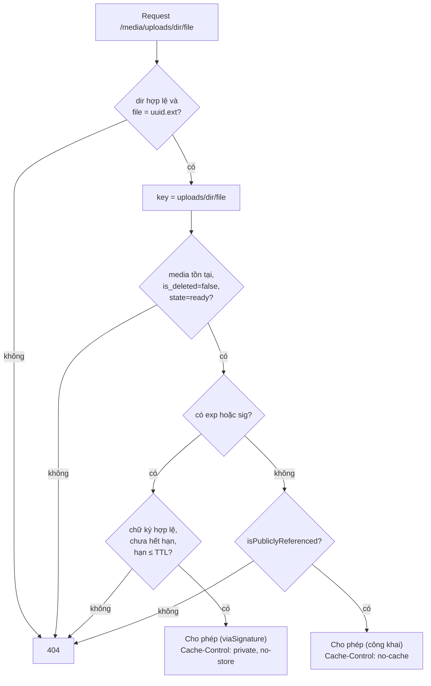
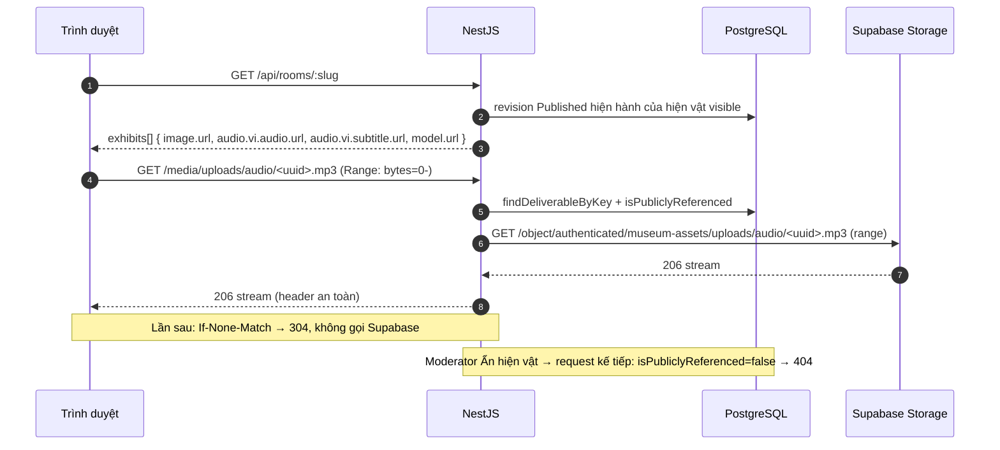

# 04 — Phân phối file media

> Mọi file media CMS ra ngoài qua **một route** của API, kể cả khi lưu trên Supabase. Tài liệu này mô tả
> ai được tải file nào, URL ký hoạt động ra sao, header trả về, và Range/304/HEAD.
>
> Code: `back-end/src/modules/media/controllers/media-delivery.controller.ts`,
> `services/media-delivery.service.ts`, `services/media-url.service.ts`,
> `repositories/media.repository.ts` (`findDeliverableByKey`, `isPubliclyReferenced`).

## 1. Vì sao không cho trình duyệt tải thẳng từ Supabase

| Yêu cầu | Nếu dùng URL Supabase (public/signed) | Qua API (đang làm) |
|---|---|---|
| AC-51 / BR-22: Ẩn, Gỡ xuất bản có hiệu lực **ngay** | URL public sống mãi; signed URL sống tới khi hết hạn | Mỗi request kiểm lại DB → 404 ngay |
| AC-36 / FR-68: chỉ media đã xuất bản mới công khai | Phải đồng bộ policy bucket với trạng thái revision | Kiểm trong 1 truy vấn SQL |
| Preview CMS xem media Draft | Cần ký riêng từng file | URL ký HMAC của API |
| Header an toàn (`nosniff`, CSP sandbox, MIME từ DB) | Không kiểm soát | Có |
| Không lộ hạ tầng | Lộ `<ref>.supabase.co`, tên bucket | Chỉ thấy origin API |

Đánh đổi: băng thông đi 2 lần (Supabase → API → client). Giảm bằng `ETag` → 304; GLB upload ≤ 10 MB.
Nếu nghẽn mới cân nhắc redirect sang signed URL của Supabase (phải tính lại AC-51).

## 2. Route

```
GET|HEAD  /media/uploads/:directory/:fileName            ← công khai
GET|HEAD  /media/uploads/:directory/:fileName?exp=&sig=  ← URL ký (Preview)
```

- Nằm **ngoài** prefix `/api` (xem `main.ts`: `setGlobalPrefix('api', { exclude: [...] })`).
- `@Public()` (không cần JWT) và `@ApiExcludeController()` (không hiện trên Swagger).
- `directory` ∈ `models | images | audio | subtitles`.
- `fileName` khớp `^<uuid>\.(glb|jpg|png|webp|mp3|vtt)$` → mọi tên khác 404 trước khi chạm DB.

## 3. Quyết định cho phép tải



### "Công khai" nghĩa là gì (`isPubliclyReferenced`)
Tồn tại ít nhất một hiện vật thỏa **tất cả**:

| Điều kiện | Cột |
|---|---|
| Revision được tham chiếu là revision Published hiện hành | `revision.id = exhibit.published_revision_id` |
| Revision đã duyệt | `revision.state = 'approved'` |
| Hiện vật đang hiện | `exhibit.visibility = 'visible'` |
| Hiện vật chưa xóa, chưa lưu trữ | `exhibit.is_deleted = false AND exhibit.archived_at IS NULL` |
| Phòng hoạt động, chưa xóa | `room.status = 'active' AND room.is_deleted = false` |
| Media nằm ở **một trong 6 slot** của revision đó | `model/image/audio/audio_en/subtitle_vi/subtitle_en_media_id = :mediaId` |

Phải **khớp đúng** điều kiện mà `GET /api/rooms/:slug` dùng để liệt kê hiện vật — nếu sửa một bên, sửa
bên kia (comment trong repository nhắc điều này).

### Mọi từ chối đều là 404
Không phân biệt "không tồn tại" và "không được phép" → không dò được media Draft có tồn tại hay không.

### Chữ ký sai không "rơi" về nhánh công khai
Có gửi `exp`/`sig` thì chữ ký **phải** hợp lệ, kể cả khi file đang công khai. URL ký giả/hết hạn luôn 404
nhất quán.

## 4. URL ký (Preview CMS)

`MediaUrlService` (`services/media-url.service.ts`):

```
URL  = <MEDIA_PUBLIC_BASE_URL>/media/<storageKey>?exp=<unix giây>&sig=<hex>
exp  = now + MEDIA_SIGNED_URL_TTL_SECONDS          (mặc định 900 = 15 phút)
sig  = HMAC-SHA256(MEDIA_URL_SIGNING_SECRET, "<storageKey>\n<exp>")  → 64 ký tự hex
```

Kiểm tra (`verify`):
1. `exp` là chuỗi `^\d{1,12}$`, `sig` là `^[0-9a-f]{64}$`.
2. `exp > now` và `exp - now ≤ TTL` (không chấp nhận URL tự đặt hạn dài).
3. So sánh bằng `timingSafeEqual` (chống timing attack).

Chữ ký gắn với **đúng storage key** → không dùng lại cho file khác. Đổi `MEDIA_URL_SIGNING_SECRET` làm mọi
URL ký đang mở hết hiệu lực.

Ai nhận URL ký:
| API | Trả |
|---|---|
| `GET /api/admin/media`, `/:id`, `POST /upload` | `url` ký |
| `GET /api/admin/exhibits/:id`, `/:id/preview` | `media.<slot>.url` ký cho revision đang xem |
| `GET /api/rooms/:slug` (public) | URL **không** ký |

## 5. Header phản hồi

| Header | Công khai | URL ký | Lý do |
|---|---|---|---|
| `Content-Type` | MIME trong DB; phụ đề `text/vtt; charset=utf-8` | như trái | Không tin client; DB lấy từ magic bytes |
| `ETag` | `"<sha256>"` | như trái | Revalidate → 304 |
| `Cache-Control` | `no-cache` | `private, no-store` | Ẩn có hiệu lực ngay (luôn hỏi lại); Preview không lưu cache chung |
| `Accept-Ranges` | `bytes` | `bytes` | Seek audio, GLTFLoader |
| `Content-Disposition` | `inline` | `inline` | |
| `X-Content-Type-Options` | `nosniff` | `nosniff` | Chống MIME sniffing |
| `Content-Security-Policy` | `default-src 'none'; sandbox` | như trái | Mở trực tiếp file cũng không chạy script |
| `Cross-Origin-Resource-Policy` | `cross-origin` | như trái | FE ở origin khác vẫn nhúng được |

Phản hồi lỗi (404, 416) **không** mang các header trên.

## 6. Range, 304, HEAD

### Thứ tự xử lý trong controller
1. `resolve()` → `null` ⇒ 404.
2. `If-None-Match` khớp ETag ⇒ **304**, không mở stream (không tốn băng thông Supabase).
3. Parse `Range` ⇒ đoạn hợp lệ / cả file / **416**.
4. `driver.read(key, range)` ⇒ `null` (file mất) ⇒ 404 + log `error`.
5. Đặt header, `206` + `Content-Range` nếu có Range, `Content-Length`.
6. `HEAD` ⇒ hủy stream, `end()`. `GET` ⇒ `pipeline(stream, res)`; client ngắt (seek, đóng tab) không log lỗi.

### Range
| Header gửi | Kết quả |
|---|---|
| Không có | 200, cả file |
| `bytes=100-199` | 206, `Content-Range: bytes 100-199/<size>`, 100 byte |
| `bytes=100-` | 206 tới hết file |
| `bytes=999999-` (ngoài file) | **416** |
| Sai cú pháp / nhiều đoạn | 200, cả file (bỏ qua Range) |

Với Supabase, driver gửi tiếp `range: bytes=a-b` lên `/object/authenticated/` và **yêu cầu 206** — nếu
Supabase bỏ qua Range và trả 200, driver ném lỗi thay vì trả nhầm nội dung.

### 304
`If-None-Match` hỗ trợ danh sách, `*`, và so sánh yếu (`W/"..."`). **Bỏ qua** khi request có
`Cache-Control: no-cache` (client yêu cầu tải lại) → trả 200.

> Lưu ý khi test: `fetch` của Node/undici **tự thêm** `Cache-Control: no-cache` khi bạn tự đặt
> `If-None-Match` (theo đặc tả Fetch) → luôn nhận 200. Kiểm 304 bằng `curl` hoặc trình duyệt:
> ```bash
> curl -s -o /dev/null -w "%{http_code}\n" -H 'If-None-Match: "<sha256>"' http://localhost:3001/media/uploads/images/<uuid>.png
> # 304
> ```

## 7. Sequence: client xem hiện vật đã xuất bản



## 8. Kiểm chứng (21/10/2026, Supabase thật)

| Kiểm tra | Kết quả |
|---|---|
| URL ký Preview | 200, `private, no-store` |
| Cùng file, không ký, chưa publish | 404 |
| Sau publish: ảnh | 200, `nosniff`, `no-cache`, ETag |
| `If-None-Match` (curl) | 304 |
| HEAD | 200, thân rỗng, `Content-Length` đúng |
| Audio `bytes=100-199` | 206 `bytes 100-199/2532` |
| Range ngoài file | 416 |
| Phụ đề | 200 `text/vtt; charset=utf-8` |
| GLB qua route tour | 200 |
| Ẩn hiện vật → ảnh, audio | 404 ngay |

Chi tiết cách chạy: [06-kiem-thu-va-nghiem-thu.md](06-kiem-thu-va-nghiem-thu.md).
