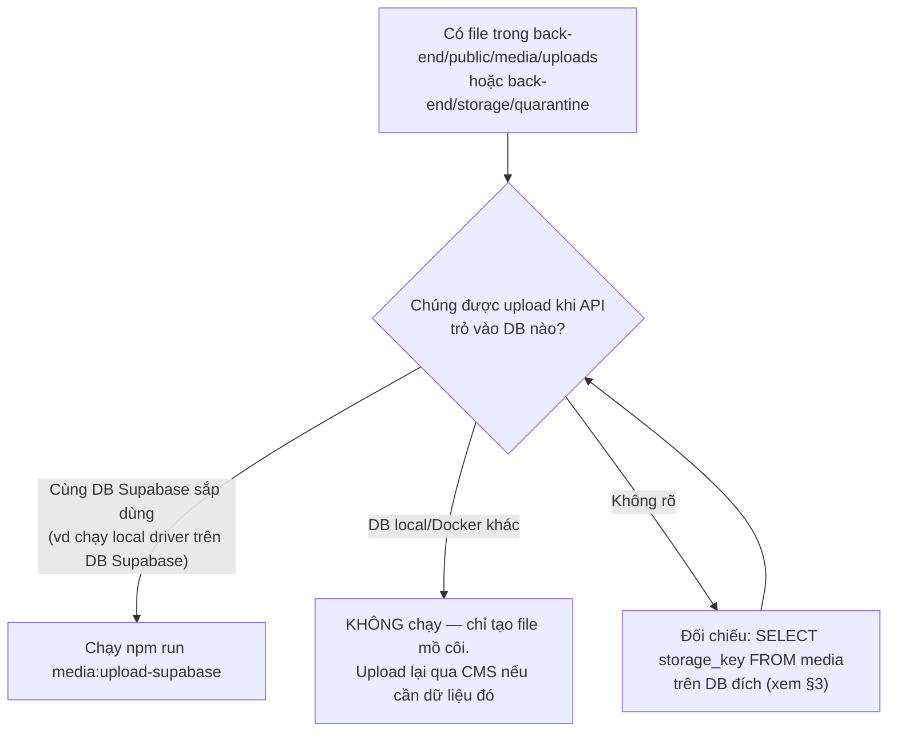

# 05 — Chuyển dữ liệu và các script

> Khi nào cần đẩy file local lên Supabase, khi nào **không**, và các script liên quan tới bucket.

## 1. Nguyên tắc: file đi theo bản ghi DB

Bucket chỉ có ý nghĩa khi bảng `media` của **cùng DB** tham chiếu tới key đó. API phân phối file theo
`media.storage_key` → file không có bản ghi là **file mồ côi**: không bao giờ được tải, chỉ tốn dung lượng.

Trước mọi thao tác đẩy file, trả lời: *"DB mà API sắp dùng có bản ghi `media` nào trỏ tới các key này không?"*



## 2. `npm run media:upload-supabase`

File: `back-end/src/database/scripts/upload-media-to-supabase.ts`.

| | |
|---|---|
| Đọc | Mọi file trong `public/media/uploads/**` và `storage/quarantine/**` (tính từ `back-end/`) |
| Key | `uploads/<dir>/<file>` và `quarantine/<file>` — **giống hệt** key trong DB, không đổi cột nào |
| Ghi | Qua `MediaStorageService` + `SupabaseStorageDriver` → giữ kiểm tra `SAFE_KEY`, `x-upsert: false` |
| Trùng | Key đã có trên bucket → **bỏ qua** (đếm `skipped`), không ghi đè → chạy lại an toàn |
| Biến cần | `SUPABASE_URL`, `SUPABASE_SECRET_KEY` (hoặc `SUPABASE_SERVICE_ROLE_KEY`), `SUPABASE_STORAGE_BUCKET` |
| Không cần | `MEDIA_STORAGE_DRIVER` (script luôn dùng driver Supabase) |
| Không đụng | `models/` (GLB tour), bảng DB |
| Kết thúc | `Xong: <n> file đã đẩy, <n> đã có sẵn, <n> lỗi.`; có lỗi → exit code 1 |

```bash
cd back-end
npm run media:upload-supabase
# ↑ uploads/images/b5aad10f-....png
# ...
# Xong: 16 file đã đẩy, 0 đã có sẵn, 0 lỗi.
```

### Quy trình chuyển hẳn một môi trường từ `local` sang `supabase`
1. Dừng API (tránh upload mới giữa chừng).
2. Đảm bảo `DATABASE_URL` trỏ đúng DB mà các file local thuộc về.
3. `npm run media:upload-supabase` → 0 lỗi.
4. Đặt `MEDIA_STORAGE_DRIVER=supabase`, khởi động API.
5. Kiểm: mở một hiện vật đã xuất bản có ảnh/audio → 200; Preview trong CMS → 200.
6. Giữ thư mục local tới khi kiểm xong, rồi mới dọn.

### Quyết định ngày 21/10/2026: không chạy
Máy của Thành có 16 file (`audio` 4, `images` 2, `models` 6, `subtitles` 4) upload khi API dùng DB
**local cũ**. Bảng `media` trên DB Supabase dùng chung chỉ có 5 bản ghi `models/*.glb` (GLB tour) → không
bản ghi nào trỏ tới 16 file kia → đẩy lên chỉ tạo file mồ côi. Media mới sẽ vào thẳng bucket khi upload
qua CMS với `MEDIA_STORAGE_DRIVER=supabase`.

## 3. Đối chiếu DB ↔ bucket

### Liệt kê key trong DB
```sql
SELECT kind, processing_state, is_deleted, storage_key
FROM media
ORDER BY created_at NULLS FIRST;
```

### Liệt kê object trong bucket (chỉ đọc)
```bash
cd back-end
node -e '
process.loadEnvFile(".env");
const k = process.env.SUPABASE_SECRET_KEY || process.env.SUPABASE_SERVICE_ROLE_KEY;
const h = { apikey: k, Authorization: `Bearer ${k}`, "Content-Type": "application/json" };
(async () => {
  for (const prefix of ["models", "uploads/models", "uploads/images", "uploads/audio", "uploads/subtitles", "quarantine"]) {
    const r = await fetch(`${process.env.SUPABASE_URL}/storage/v1/object/list/${process.env.SUPABASE_STORAGE_BUCKET}`,
      { method: "POST", headers: h, body: JSON.stringify({ prefix, limit: 1000 }) });
    const items = await r.json();
    console.log(prefix, items.map(i => i.name));
  }
})();
'
```
API `object/list` trả từng cấp thư mục; với prefix gốc (`""`) chỉ thấy `models/`, `uploads/`… dạng thư mục.

### Ba loại lệch và cách xử lý
| Lệch | Hậu quả | Xử lý |
|---|---|---|
| DB có bản ghi `ready`, bucket không có file | Phân phối 404 + log `error` "File của media … không còn trong kho" | Đẩy file (script) nếu còn bản local; nếu mất hẳn → upload lại qua CMS, gắn lại vào revision |
| Bucket có file, DB không có bản ghi (mồ côi) | Vô hại, tốn dung lượng | Xóa object (Storage → chọn file → Delete) sau khi chắc chắn không ai dùng |
| Bản ghi `is_deleted = true`, file vẫn còn | Vô hại (luôn 404) — do lần dọn file sau commit bị lỗi | Xóa object nếu muốn gọn |

## 4. GLB tour: `npm run seed:models`

File: `back-end/src/database/seeds/seed-storage-models.ts`, dữ liệu ở `storage-model-content.ts`.

| Bước | Hành vi |
|---|---|
| 1. Kiểm file | Với từng GLB khai báo, tải qua `ModelStorageService`, kiểm header glTF (`magic = glTF`, version 2, length = size) và **SHA-256 khớp** giá trị cứng |
| 2. Ghi DB | Trong 1 transaction + `pg_advisory_xact_lock('seed-storage-models')`: phòng `bo-suu-tap-glb`, 5 bản ghi `media` (`models/<tên>.glb`), 5 hiện vật + revision đã duyệt |
| Điều kiện | Cần tài khoản `SEED_ADMIN_EMAIL` đang active và có role admin |
| An toàn | Cộng thêm, **dừng** nếu trùng ID/path thay vì ghi đè ("never a migration") |

GLB đang có trên bucket (21/10/2026):

| Key | Kích thước |
|---|---|
| `models/binh_rot_men_ngoc.glb` | 22,28 MB |
| `models/coc_go_bach_dang.glb` | 3,56 MB |
| `models/trong_dong_dong_son.glb` | 16,53 MB |
| `models/tuong_than_shiva_champa.glb` | 28,90 MB |
| `models/tuong_vua_champa.glb` | 18,29 MB |

Thay một GLB tour = upload file mới lên `models/` (tên mới hoặc xóa file cũ trước — Storage UI cũng không
ghi đè mặc định) **và** cập nhật `size`/`checksum` trong `storage-model-content.ts` + bản ghi `media`
tương ứng; nếu không, route tour trả 502 vì `Content-Length` không khớp.

## 5. Dữ liệu demo khác

| Lệnh | Nội dung | Ghi chú cho DB dùng chung |
|---|---|---|
| `npm run seed` | Permission, role, admin | ⚠️ Reset `role_permissions` — xem [02 §5](02-ket-noi-database.md#5-npm-run-seed--đọc-kỹ-trước-khi-chạy) |
| `npm run seed:demo` | 5 hiện vật `[Mẫu]` placeholder (không media) ở `phong-lich-su-quan-su-viet-nam` | Đã có; idempotent theo ID cố định |
| `npm run seed:models` | 5 GLB tour | Đã có |

## 6. Dọn file trong bucket bằng API (khi cần)

Xóa nhiều object một lần (chỉ dùng cho key bạn **chắc chắn** là của mình, vd dữ liệu test):

```bash
node -e '
process.loadEnvFile(".env");
const k = process.env.SUPABASE_SECRET_KEY || process.env.SUPABASE_SERVICE_ROLE_KEY;
fetch(`${process.env.SUPABASE_URL}/storage/v1/object/${process.env.SUPABASE_STORAGE_BUCKET}`, {
  method: "DELETE",
  headers: { apikey: k, Authorization: `Bearer ${k}`, "Content-Type": "application/json" },
  body: JSON.stringify({ prefixes: ["uploads/images/<uuid>.png"] }),
}).then(r => r.json()).then(console.log);
'
```

`prefixes` là danh sách **key đầy đủ** (không phải tiền tố thư mục). Kết quả trả về các object đã xóa; key
không tồn tại bị bỏ qua. **Không** xóa gì trong `models/` nếu không phải người phụ trách tour.
