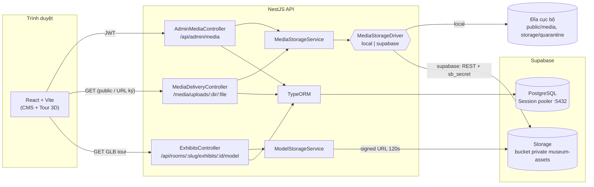

# Supabase — Database & Media Storage

> Bộ tài liệu về cách Aura Museum dùng **Supabase** cho PostgreSQL và lưu file media
> (Task 9 + nhánh `feat/supabase-storage`). Viết cho thành viên nhóm cần chạy, sửa hoặc
> vận hành phần này.
>
> Plan gốc: [`plans/261019-2333-supabase-db-storage/plan.md`](../plans/261019-2333-supabase-db-storage/plan.md) ·
> Nhật ký task: [`back-end/tasks/supabase-db-storage.md`](../back-end/tasks/supabase-db-storage.md),
> [`cms-media-attach.md`](../back-end/tasks/cms-media-attach.md).

## Tóm tắt 30 giây

- **Database:** NestJS + TypeORM kết nối thẳng PostgreSQL của Supabase qua **Session pooler**
  (cổng 5432, IPv4). Không dùng `@supabase/supabase-js`, không dùng PostgREST.
- **File media:** bucket **private** `museum-assets`. Back-end gọi **REST API của Supabase
  Storage** bằng `fetch` có sẵn của Node, ký bằng khóa secret (`sb_secret_...`).
- **Trình duyệt không bao giờ nói chuyện trực tiếp với Supabase.** Mọi file đi qua API
  (`/media/uploads/...` và `/api/rooms/:slug/exhibits/:id/model`) để giữ kiểm tra
  "đã xuất bản / URL ký" và để Ẩn/Gỡ xuất bản có hiệu lực ngay.
- **Chọn nơi lưu bằng env** `MEDIA_STORAGE_DRIVER=local|supabase`. Dev mặc định `local`
  (đĩa), không cần Supabase vẫn chạy được (trừ route GLB của tour — xem [03](03-kien-truc-luu-tru-media.md#4-hai-đường-đọc-supabase-song-song)).

## Sơ đồ tổng thể

## Mục lục

| # | Tài liệu | Đọc khi |
|---|---|---|
| 01 | [01-thiet-lap-project.md](01-thiet-lap-project.md) | Lần đầu cấu hình: lấy key, tạo bucket, điền `.env`, chọn đúng tab trên dashboard |
| 02 | [02-ket-noi-database.md](02-ket-noi-database.md) | Kết nối DB: chọn pooler, TLS (2 cách), chạy migration trên DB **dùng chung**, rủi ro `seed` |
| 03 | [03-kien-truc-luu-tru-media.md](03-kien-truc-luu-tru-media.md) | Sửa code lưu file: interface driver, `local` vs `supabase`, quy tắc storage key, BR-21, luồng upload/xóa |
| 04 | [04-phan-phoi-media.md](04-phan-phoi-media.md) | Sửa code phân phối file: điều kiện công khai, URL ký HMAC, header, Range/304/HEAD |
| 05 | [05-chuyen-du-lieu-va-script.md](05-chuyen-du-lieu-va-script.md) | Chuyển file local lên Supabase, `seed:models`, khi nào chạy / không chạy script |
| 06 | [06-kiem-thu-va-nghiem-thu.md](06-kiem-thu-va-nghiem-thu.md) | Chạy test tự động, kịch bản E2E trên Supabase thật, kết quả nghiệm thu 21/10/2026 |
| 07 | [07-van-hanh-va-xu-ly-su-co.md](07-van-hanh-va-xu-ly-su-co.md) | Lỗi thường gặp, xoay vòng khóa/mật khẩu, gói free tạm dừng, checklist trước demo/deploy |

## Quyết định chính (từ plan)

| # | Vấn đề | Chọn | Lý do |
|---|---|---|---|
| S1 | Cách gọi Storage | REST API bằng `fetch`, khóa secret ở server | Không thêm dependency; `x-upsert: false` chặn ghi đè đúng BR-21 (S3 API của Supabase ghi đè) |
| S2 | Phân phối file | Stream **qua API** | Giữ kiểm tra published/HMAC, `no-cache` + `ETag`, Range; bucket private không lộ URL Supabase |
| S3 | Chọn driver | `MEDIA_STORAGE_DRIVER=local\|supabase` | Không cần cột DB mới (YAGNI) |
| S4 | Bucket | 1 bucket private `museum-assets`, dùng chung với GLB tour | Key giữ nguyên `uploads/<kind>/<uuid>.<ext>` → không sửa `media.storage_key` |
| S5 | Kết nối DB | Session pooler 5432 cho cả app lẫn migration | Direct chỉ IPv6; Transaction pooler (6543) không hợp migration |
| S6 | File cũ | Script `npm run media:upload-supabase` (bỏ qua file đã có) | Key không đổi → DB không cần sửa |

## Trạng thái (21/10/2026)

| Hạng mục | Trạng thái |
|---|---|
| Code driver + delivery stream + env validate + script | ✅ trên `feat/supabase-storage` |
| Test tự động (`test:media`, `npm test`) | ✅ (xem [06](06-kiem-thu-va-nghiem-thu.md)) |
| Migration Task 9 trên DB Supabase dùng chung | ✅ đã chạy 21/10 |
| E2E trên Supabase thật | ✅ 29/29 bước |
| PR `feat/cms-media-attach` → `dev`, rồi `feat/supabase-storage` → `dev` | ⏳ chờ review |

## Thuật ngữ

| Thuật ngữ | Nghĩa trong dự án |
|---|---|
| **Storage key** | Đường dẫn object trong bucket/đĩa, do server sinh: `uploads/<kind>/<uuid>.<ext>` hoặc `quarantine/<uuid>.bin`; GLB tour dùng `models/<tên>.glb` |
| **Driver** | Lớp hiện thực `MediaStorageDriver` (`LocalStorageDriver`, `SupabaseStorageDriver`) |
| **Công khai (publicly referenced)** | Media được revision Published hiện hành của hiện vật visible, phòng active tham chiếu |
| **URL ký** | URL `/media/...?exp=&sig=` có HMAC-SHA256, dùng cho Preview CMS xem media của Draft |
| **Session pooler** | Supavisor chế độ session, cổng 5432, có IPv4; user dạng `postgres.<ref>` |
| **BR-21** | Media đang dùng không bị ghi đè/xóa; xóa bị chặn khi revision published/in_review tham chiếu |
| **BR-22 / AC-51** | Ẩn/Gỡ xuất bản phải có hiệu lực ngay với request mới (không cache lâu) |
