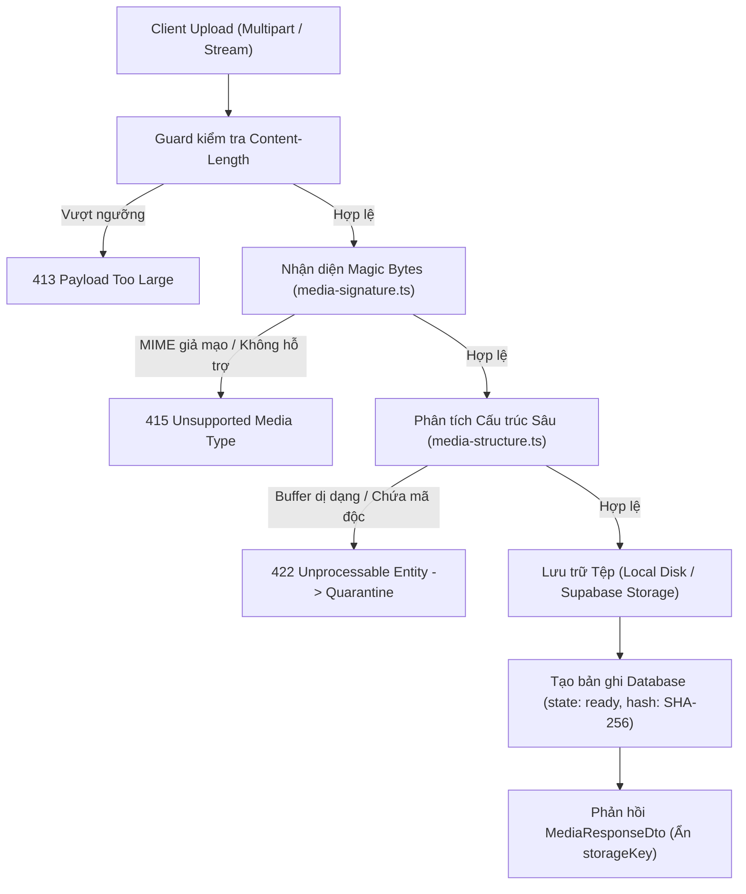

# Cẩm nang Vận hành & Xử lý Sự cố — CMS Media Pipeline

> Tài liệu kỹ thuật phân hệ Media · Aura Museum  
> Người phụ trách: **Nguyễn Trọng Thành**  
> Phạm vi: Pipeline upload, kiểm định an toàn tệp, quản lý cách ly, quy tắc bất biến BR-21, cơ chế phân phối có bảo vệ.

---

## 1. Tổng quan Kiến trúc Media Pipeline

Hệ thống quản lý tệp đa phương tiện của Aura Museum chịu trách nhiệm tiếp nhận, thẩm tra an toàn và phân phối 4 nhóm tài sản số cốt lõi:
1. **Mô hình 3D**: Chuẩn định dạng `.glb` (glTF 2.0 Binary), kích thước tối đa 40 MB.
2. **Hình ảnh**: Các chuẩn `.png`, `.jpg` / `.jpeg`, `.webp`, kích thước tối đa 10 MB.
3. **Âm thanh**: Định dạng `.mp3` chuẩn MPEG-1 Audio Layer III, kích thước tối đa 20 MB.
4. **Phụ đề / Thuyết minh**: Chuẩn định dạng WebVTT (`.vtt`), kích thước tối đa 1 MB.

### Luồng xử lý tệp (Pipeline Architecture)



---

## 2. Các Quy tắc Bất biến Nghiệp vụ (Business Rules)

### Quy tắc BR-21: Bảo vệ Toàn vẹn Tài sản Đang Sử dụng
- **Nguyên tắc**: Tệp media đã liên kết với bất kỳ phiên bản hiện vật nào đang xuất bản (`state = APPROVED` và `id = publishedRevisionId`) hoặc đang chờ duyệt (`state = IN_REVIEW`) **tuyệt đối không được phép xóa vật lý hoặc xóa mềm**.
- **Cơ chế bảo vệ**:
  - Khi nhận yêu cầu `DELETE /api/admin/media/:id`, `MediaRepository.countUsage(id)` sẽ kiểm tra liên kết trên cả 6 slot truyền thông của revision (`model`, `image`, `audioVi`, `audioEn`, `subtitleVi`, `subtitleEn`).
  - Sử dụng khóa dòng `SELECT ... FOR UPDATE` trong transaction để triệt tiêu tình trạng tranh chấp (race condition) giữa thao tác kiểm duyệt xuất bản và thao tác xóa media.
  - Nếu số lượng tham chiếu $> 0$, API phản hồi mã lỗi `409 ConflictException` kèm thông báo chi tiết danh sách hiện vật đang sử dụng.

### Quy tắc BR-22 & AC-51: Bảo vệ Quyền Riêng tư & Cập nhật Trạng thái Tức thời
- File media gắn với bản nháp (`DRAFT`) hoặc bản bị từ chối (`REJECTED`) **không được phép phân phối công khai**.
- Mọi truy vấn trực tiếp vào `/media/uploads/...` mà không có chữ ký HMAC hợp lệ sẽ nhận mã lỗi `404 Not Found`.
- Khi hiện vật bị ẩn (`HIDDEN`) hoặc thu hồi (`UNPUBLISHED`), việc truy cập file công khai sẽ bị chặn ngay lập tức ở request kế tiếp nhờ header `Cache-Control: no-cache` và cơ chế kiểm tra thời gian thực tại `MediaDeliveryController`.

---

## 3. Quản lý Thư mục Cách ly (Quarantine Management)

Khi phát hiện tệp tải lên có dấu hiệu bất thường (ví dụ: magic bytes vượt qua nhưng cấu trúc chunk GLB bị hỏng nặng, hoặc giải nén PNG phát hiện kích thước ảnh vượt quá giới hạn an toàn 8192px):
1. Hệ thống không lưu tệp vào thư mục phân phối `public/media/uploads/`.
2. Tệp được chuyển ngay vào thư mục cách ly `storage/quarantine/<uuid>.bin`.
3. Trạng thái bản ghi trong cơ sở dữ liệu được gán `processingState = 'quarantined'`.
4. Không có bất kỳ endpoint công khai nào trỏ tới vùng cách ly; chỉ tài khoản kỹ thuật quản trị hệ thống với khóa truy cập cấp cao mới có thể thanh tra hoặc thanh lý tệp cách ly.

---

## 4. Ma trận Mã lỗi & Hướng dẫn Xử lý Sự cố

| Mã HTTP | Mã nội bộ / Lỗi | Nguyên nhân gốc rễ | Hành động khắc phục đề xuất |
|---|---|---|---|
| **400** | `Validation failed` | Thiếu file upload, hoặc tên file chứa ký tự điều khiển, null-byte | Kiểm tra form-data multipart, đảm bảo gửi kèm trường `file` |
| **409** | `media_in_use` | Tệp đang được sử dụng bởi hiện vật công khai (Quy tắc BR-21) | Kiểm tra hiện vật liên kết; cần gỡ bỏ media khỏi revision hoặc thay thế trước khi xóa |
| **413** | `File too large` | Kích thước tệp vượt ngưỡng trần của định dạng (GLB: 40MB, Image: 10MB...) | Nén tệp (dùng Draco / WebP / nén audio bitrate 128kbps) trước khi tải lên |
| **415** | `unsupported_format` | Phần mở rộng file không khớp với magic bytes thực tế | Không đổi đuôi file thủ công; xuất file đúng định dạng chuẩn từ phần mềm nguồn |
| **422** | `invalid_structure` | Cấu trúc file bị phân mảnh, CRC hỏng, hoặc phát hiện mã script độc hại | Kiểm tra file bằng công cụ chuyên dụng (glTF Validator, pngcheck) trước khi upload |
| **404** | `Media not found` | File thuộc bản nháp chưa công khai hoặc URL đã ký HMAC hết hạn (TTL 900s) | Làm mới trang CMS để nhận URL ký mới, hoặc kiểm tra quyền truy cập |

---

## 5. Lệnh Vận hành & Kiểm tra Sức khỏe Định kỳ

### Kiểm tra tính toàn vẹn của tệp media cục bộ:
```bash
# Kiểm tra số lượng tệp trong thư mục phân phối công khai
find back-end/public/media/uploads -type f | wc -l

# Kiểm tra các tệp bị cách ly cần phân tích
ls -la back-end/storage/quarantine/
```

### Chạy bộ kiểm thử tự động toàn diện của Media Module:
```bash
# Chạy toàn bộ unit test & integration test của Media
cd back-end && npm run test:media

# Chạy kiểm thử tự động Fuzzing chống giả mạo định dạng (Task 28)
cd back-end && npm run test:fuzz
```
